# 1.7B 首轮实测：证据来了，模型各层怎样变

本轮已完成 **12例、131个证据时间点、28层** 的真实前向捕捉，另做45个换位观察点，共176点。模型是Qwen3-1.7B；运行于本机Apple M2 Pro GPU；API费用0美元。

## 先说结果

在固定选项映射下，初始资料时选中数据标签疾病的有 **2/12例**，看到全部资料后有 **7/12例**。相邻证据轮之间，最终首选疾病共切换 **23次**；**4例**出现过先选对、随后又转错。

换位对照是本轮判断是否可信的关键：同一份医学资料，只换疾病对应的字母和列表位置，**4/9个检查点**的首选疾病发生变化。因此，当前单一映射轨迹混有选项呈现效应，不能把整条变化全部归因于医学证据。下一步先消除这一测量干扰，再解释疾病层面的机制。

我们确实测到了模型内部状态和逐层输出头分数随输入改变。这里的“支持”是六种候选内部的相对分数，不是患者患病的临床概率。是否形成了独立于答案编码、跨提示稳定的医学信念，下一阶段用对照进一步判断。

## 先用三个具体变化看懂模型内部

以下是从本轮结果中挑出的说明案例，用来提出后续假设；它们还没有完成跨映射复核或因果干预。

| 病例与新证据 | 表面上的变化 | 内部读到了什么 |
|---|---|---|
| ddx_train_0940128：曾有深静脉血栓：是 | 哮喘急性发作 → 肺栓塞 | 第24—28层的首选都从哮喘转为肺栓塞；最终肺栓塞支持由约0.0007%升至98.64%。 |
| ddx_train_0902216：有心力衰竭病史：是 | 肺炎 → 急性肺水肿 | 第26—28层的首选从肺炎转为肺水肿；最终肺炎支持由92.89%降到不足0.001%。 |
| ddx_train_0874944：近四周出国旅行：否 | 急性肺水肿 → 肺栓塞 | 新证据后第24—27层仍首选肺水肿，第28层却首选肺栓塞；最终肺水肿支持由75.41%降至29.40%。 |

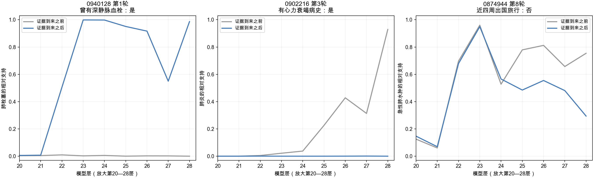

**本轮给出的具体研究线索是：证据引起的疾病转向可能在后几层被加强，也可能在最后一层与前面几层的读出分开。** 下一步要确认这种分开在更换答案编码、校准读出后是否仍存在，再干预相应层检查原因。这比只统计最终答对多少更接近我们要研究的内部变化。

## 一个具体病例怎么测

例如57岁女性病例0857360，数据标签是肺炎。第0轮只有年龄、性别和深吸气加重的疼痛；后续逐组加入帕金森病史、COPD病史、咳嗽和痰等明确记录，直到第17轮看到全部已有记录。每轮重新输入累计资料，先前模型答案不带入。模型从未看到数据标签字段。

六种固定候选是：肺炎、支气管炎、哮喘急性发作、肺栓塞、自发性气胸、急性肺水肿。每类2例。资料来自DDxPlus模拟病例；本轮没有添加或编造化验、影像。

## 到底测了模型里面的什么

每层保存五个向量：进入该层、注意力增量、注意力之后、MLP增量、离开该层。对进入层、注意力后、离开层的状态，使用同一个最终输出头，读取六种疾病的分数。每一层2048个数，所有28层都保存了，不是让模型口头描述自己怎么想。

模型权重在整个实验中固定。发生变化的是输入引起的内部激活及其读出；本轮没有测量注意力分配矩阵，也没有用局部干预证明因果。

9个预定输入均通过正常模型与捕捉前向的一致性检查（atol=rtol=0.001；最大绝对差0.015625，所有argmax一致；容差包含相对项）。131个主观察点均通过输入前缀检查、残差重建、分词边界及末层读出检查。

严格遵守“只输出一个字母并结束”的主观察点为0/131；多输出解释或32词元内未结束的，保留原文并标为格式无效。下文诊断统计使用诊断位置的六类条件分数首选，不把格式无效偷偷补成有效回答。

早层中，候选总概率的中位数低于0.0001的层是[1]。这些层的颜色尤其需要结合图④看；原始输出头并没有经过独立病例校准。

## 全部病例结果

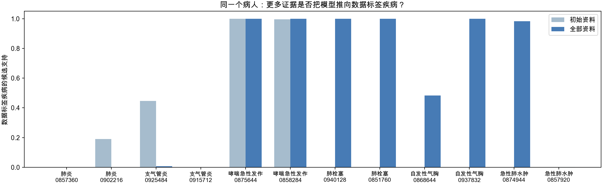

| 病例ID | 数据标签 | 末轮首选 | 第一次正确 | 此后一直正确 | 正确后转错次数 |
|---|---|---|---|---|---|
| ddx_train_0857360 | 肺炎 | 急性肺水肿 | 未达到 | 未达到 | 0 |
| ddx_train_0902216 | 肺炎 | 急性肺水肿 | 2 | 未达到 | 1 |
| ddx_train_0925484 | 支气管炎 | 肺炎 | 1 | 未达到 | 1 |
| ddx_train_0915712 | 支气管炎 | 哮喘急性发作 | 未达到 | 未达到 | 0 |
| ddx_train_0875644 | 哮喘急性发作 | 哮喘急性发作 | 0 | 0 | 0 |
| ddx_train_0858284 | 哮喘急性发作 | 哮喘急性发作 | 0 | 0 | 0 |
| ddx_train_0940128 | 肺栓塞 | 肺栓塞 | 1 | 1 | 0 |
| ddx_train_0851760 | 肺栓塞 | 肺栓塞 | 3 | 3 | 0 |
| ddx_train_0868644 | 自发性气胸 | 自发性气胸 | 8 | 8 | 0 |
| ddx_train_0937832 | 自发性气胸 | 自发性气胸 | 2 | 6 | 1 |
| ddx_train_0874944 | 急性肺水肿 | 急性肺水肿 | 7 | 10 | 1 |
| ddx_train_0857920 | 急性肺水肿 | 肺栓塞 | 未达到 | 未达到 | 0 |

“正确”表示首选与数据最终标签一致；早期信息不全时，其他疾病仍可能合理。这12例是测量验证样本，不能把12例准确率当成总体医学能力。

## 相同证据，换选项之后怎样

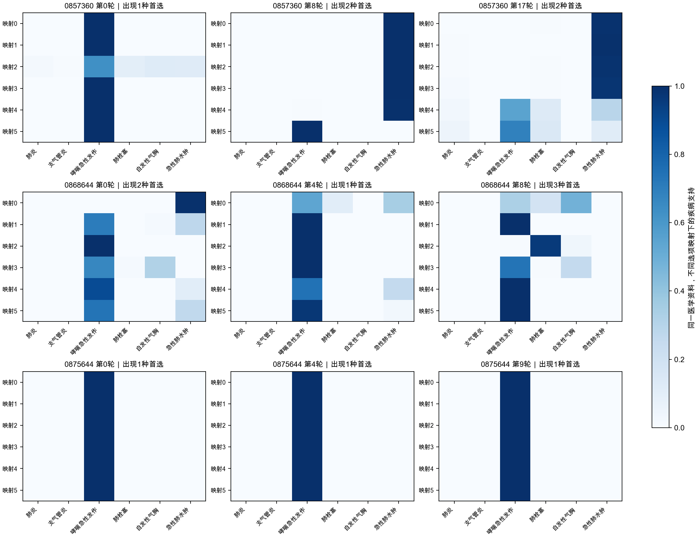

每个小图是一份完全相同的医学资料；六行是六种选项映射，列按疾病名称对齐。如果深色列换了，说明答案呈现方式影响了最终疾病选择。这项对照同时改变字母映射和候选顺序，不能单独认定是字母偏好。

## 每例逐轮结果和内部图

### ddx_train_0857360：数据标签为肺炎

末轮选择：**急性肺水肿**；首次正确轮：未达到；稳定正确轮：未达到；正确后又转错：0次。

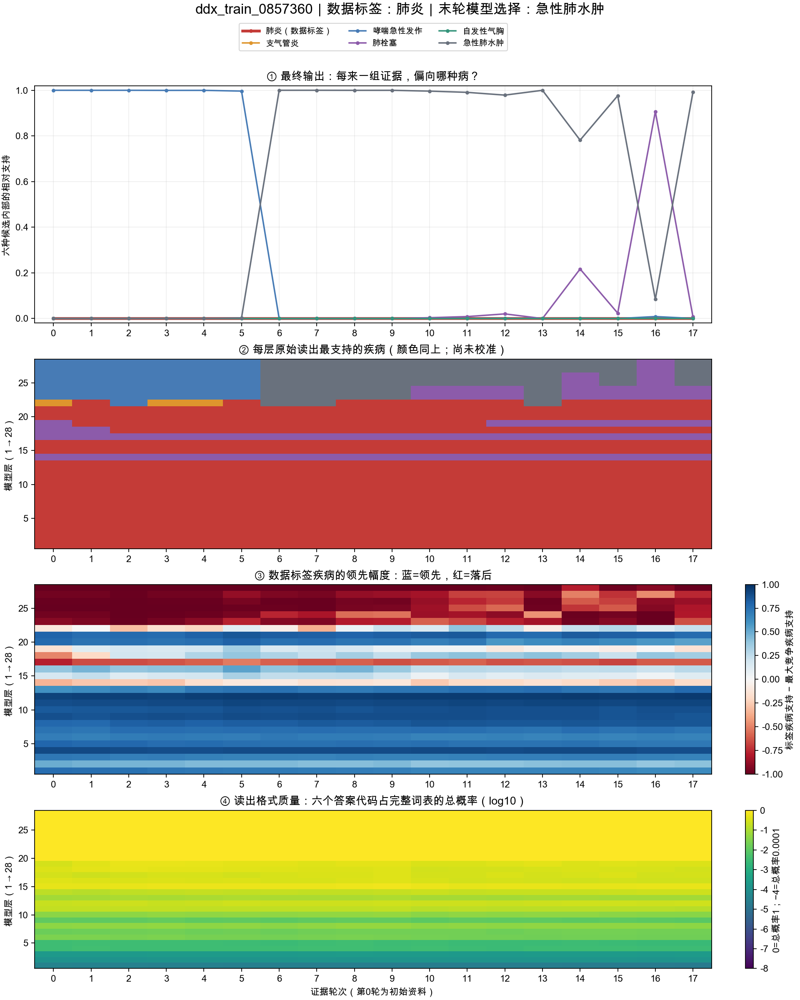

图①先看最终判断；图②再看哪个层转向；图③蓝色表示数据标签疾病领先；图④检查这些代码是否是该层输出头容易读出的内容。早层颜色不能直接当作已证实的内部诊断。

| 轮次 | 本轮新增的原始记录 | 最终最支持的疾病 | 数据标签疾病的支持 |
|---|---|---|---|
| 0 | 深吸气使疼痛加重：是 | 哮喘急性发作 | 0.000000 |
| 1 | 有帕金森病史：是 | 哮喘急性发作 | 0.000000 |
| 2 | 有慢性阻塞性肺疾病病史：是 | 哮喘急性发作 | 0.000000 |
| 3 | 咳嗽，痰变色或增多：是 | 哮喘急性发作 | 0.000000 |
| 4 | 疫苗按时接种：是 | 哮喘急性发作 | 0.000001 |
| 5 | 寒战：是 | 哮喘急性发作 | 0.000039 |
| 6 | 有心力衰竭病史：是 | 急性肺水肿 | 0.000001 |
| 7 | 明显气短或呼吸困难：是 | 急性肺水肿 | 0.000000 |
| 8 | 曾有卒中：是 | 急性肺水肿 | 0.000001 |
| 9 | 咯血：是 | 急性肺水肿 | 0.000005 |
| 10 | 本次就诊相关疼痛（同时揭示性质、位置、程度、放射等记录）：是 | 急性肺水肿 | 0.000006 |
| 11 | 夜间症状更明显：是 | 急性肺水肿 | 0.000143 |
| 12 | 发热：是 | 急性肺水肿 | 0.000071 |
| 13 | 曾有肺炎：是 | 急性肺水肿 | 0.000001 |
| 14 | 近四周出国旅行：否 | 急性肺水肿 | 0.000091 |
| 15 | 有哮喘或曾用支气管扩张药：是 | 急性肺水肿 | 0.000018 |
| 16 | 有自认为与本次就诊相关的皮肤问题（同时揭示颜色、位置、程度等记录）：是 | 肺栓塞 | 0.000070 |
| 17 | 广泛肌肉疼痛：是 | 急性肺水肿 | 0.000020 |

本病例数据标签疾病支持变化最大的是第11轮：+0.000137；最高支持从急性肺水肿转为急性肺水肿。这是看完结果后选出的说明案例。
逐层最高支持发生改变的层：[]。精确变化见机器可读事件表。

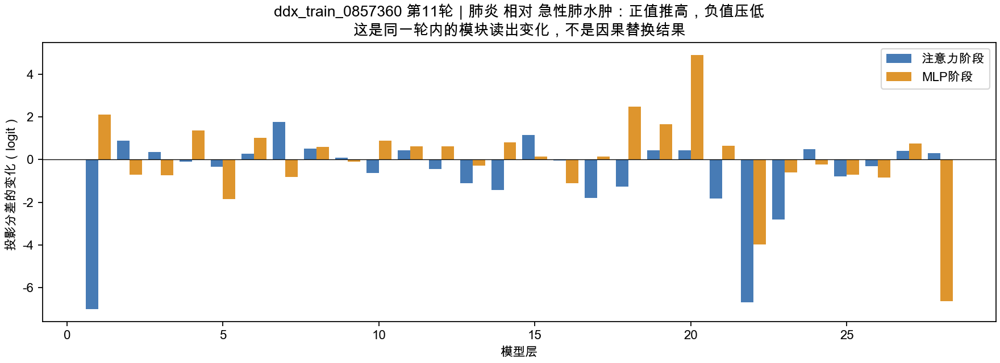

### ddx_train_0902216：数据标签为肺炎

末轮选择：**急性肺水肿**；首次正确轮：2；稳定正确轮：未达到；正确后又转错：1次。

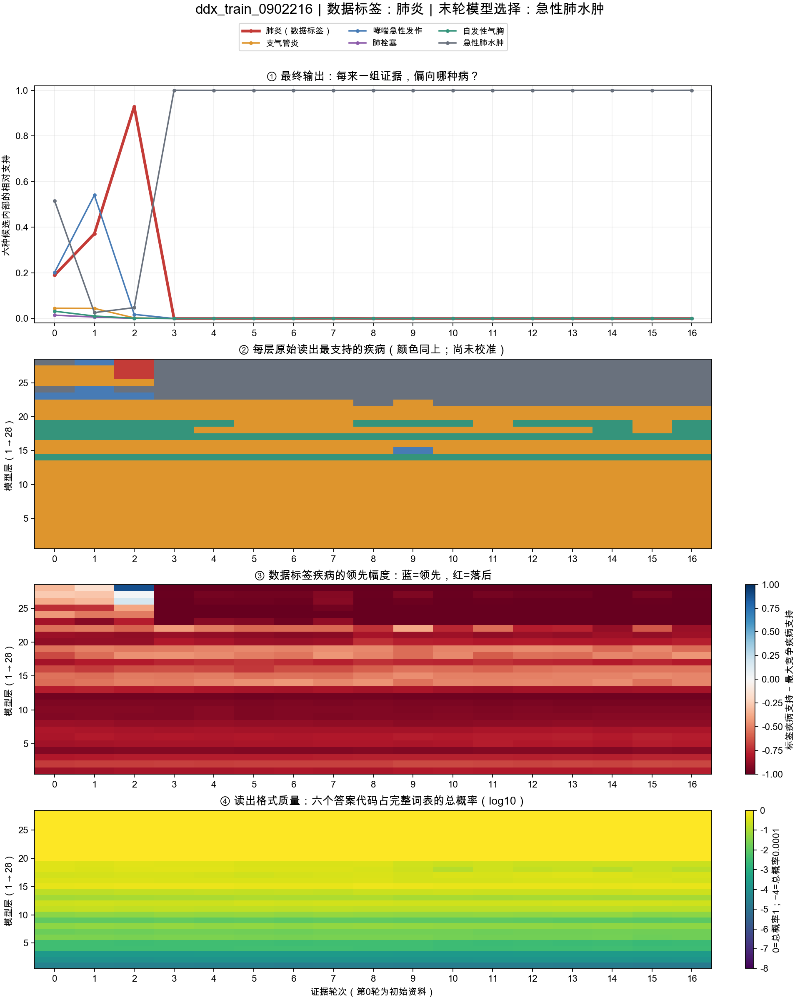

图①先看最终判断；图②再看哪个层转向；图③蓝色表示数据标签疾病领先；图④检查这些代码是否是该层输出头容易读出的内容。早层颜色不能直接当作已证实的内部诊断。

| 轮次 | 本轮新增的原始记录 | 最终最支持的疾病 | 数据标签疾病的支持 |
|---|---|---|---|
| 0 | 咳嗽，痰变色或增多：是 | 急性肺水肿 | 0.189903 |
| 1 | 咳嗽：是 | 哮喘急性发作 | 0.371594 |
| 2 | 近期食欲下降或更容易饱：是 | 肺炎 | 0.928945 |
| 3 | 有心力衰竭病史：是 | 急性肺水肿 | 0.000001 |
| 4 | 近四周出国旅行：否 | 急性肺水肿 | 0.000007 |
| 5 | 吸烟：是 | 急性肺水肿 | 0.000011 |
| 6 | 寒战：是 | 急性肺水肿 | 0.000015 |
| 7 | 广泛肌肉疼痛：是 | 急性肺水肿 | 0.000503 |
| 8 | 有慢性阻塞性肺疾病病史：是 | 急性肺水肿 | 0.000006 |
| 9 | 本次就诊相关疼痛（同时揭示性质、位置、程度、放射等记录）：是 | 急性肺水肿 | 0.000020 |
| 10 | 明显气短或呼吸困难：是 | 急性肺水肿 | 0.000000 |
| 11 | 有帕金森病史：是 | 急性肺水肿 | 0.000003 |
| 12 | 近一个月接受过手术：是 | 急性肺水肿 | 0.000000 |
| 13 | 疫苗按时接种：是 | 急性肺水肿 | 0.000000 |
| 14 | 有哮喘或曾用支气管扩张药：是 | 急性肺水肿 | 0.000000 |
| 15 | 有自认为与本次就诊相关的皮肤问题（同时揭示颜色、位置、程度等记录）：是 | 急性肺水肿 | 0.000002 |
| 16 | 曾有肺炎：是 | 急性肺水肿 | 0.000001 |

本病例数据标签疾病支持变化最大的是第3轮：-0.928944；最高支持从肺炎转为急性肺水肿。这是看完结果后选出的说明案例。
逐层最高支持发生改变的层：[23, 25, 26, 27, 28]。精确变化见机器可读事件表。

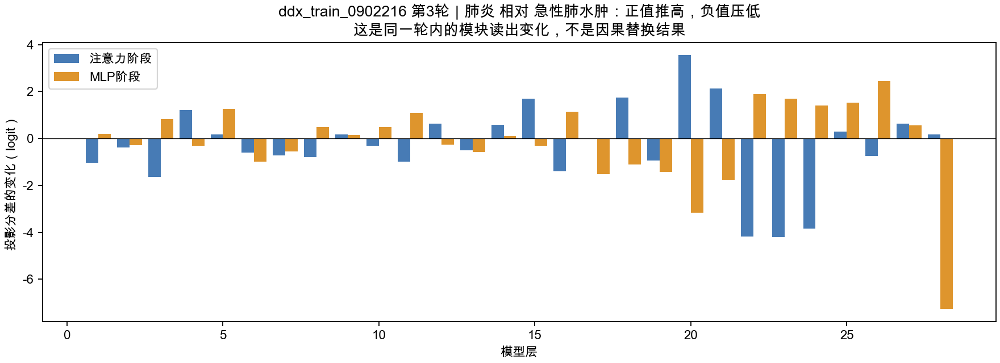

### ddx_train_0925484：数据标签为支气管炎

末轮选择：**肺炎**；首次正确轮：1；稳定正确轮：未达到；正确后又转错：1次。

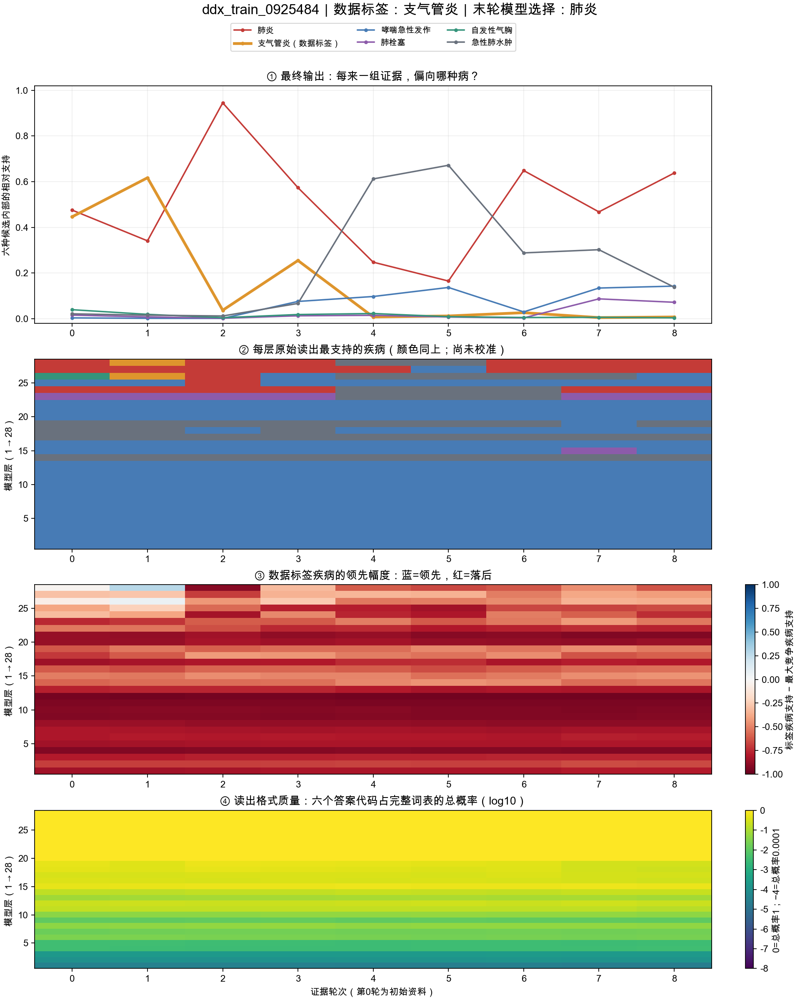

图①先看最终判断；图②再看哪个层转向；图③蓝色表示数据标签疾病领先；图④检查这些代码是否是该层输出头容易读出的内容。早层颜色不能直接当作已证实的内部诊断。

| 轮次 | 本轮新增的原始记录 | 最终最支持的疾病 | 数据标签疾病的支持 |
|---|---|---|---|
| 0 | 咳嗽，痰变色或增多：是 | 肺炎 | 0.446422 |
| 1 | 咳嗽：是 | 支气管炎 | 0.617033 |
| 2 | 有慢性阻塞性肺疾病病史：是 | 肺炎 | 0.036656 |
| 3 | 呼气时有喘鸣：是 | 肺炎 | 0.254552 |
| 4 | 明显气短或呼吸困难：是 | 急性肺水肿 | 0.007237 |
| 5 | 咽痛：是 | 急性肺水肿 | 0.011560 |
| 6 | 发热：是 | 肺炎 | 0.025952 |
| 7 | 本次就诊相关疼痛（同时揭示性质、位置、程度、放射等记录）：是 | 肺炎 | 0.004443 |
| 8 | 近四周出国旅行：否 | 肺炎 | 0.007084 |

本病例数据标签疾病支持变化最大的是第2轮：-0.580377；最高支持从支气管炎转为肺炎。这是看完结果后选出的说明案例。
逐层最高支持发生改变的层：[18, 25, 26, 28]。精确变化见机器可读事件表。

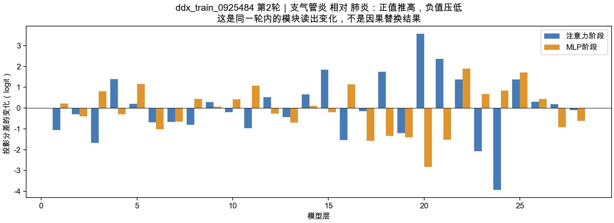

### ddx_train_0915712：数据标签为支气管炎

末轮选择：**哮喘急性发作**；首次正确轮：未达到；稳定正确轮：未达到；正确后又转错：0次。

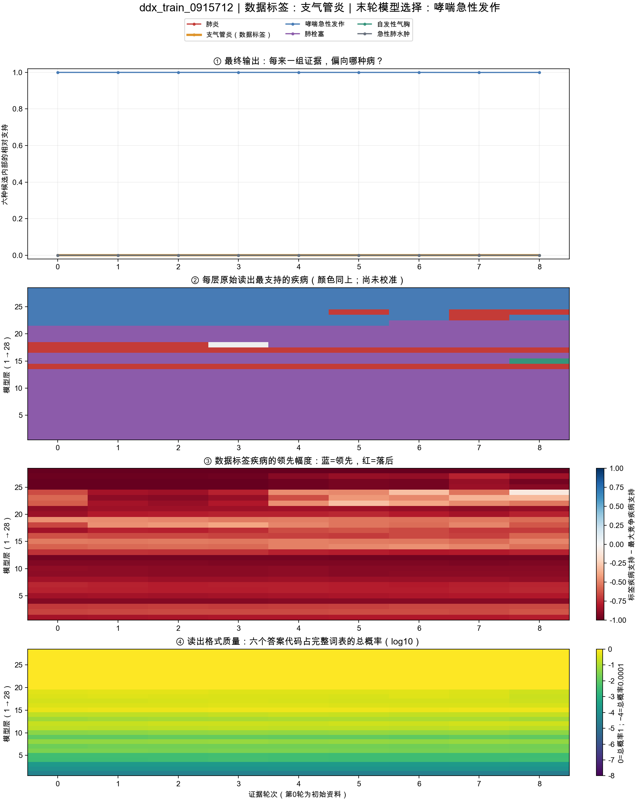

图①先看最终判断；图②再看哪个层转向；图③蓝色表示数据标签疾病领先；图④检查这些代码是否是该层输出头容易读出的内容。早层颜色不能直接当作已证实的内部诊断。

| 轮次 | 本轮新增的原始记录 | 最终最支持的疾病 | 数据标签疾病的支持 |
|---|---|---|---|
| 0 | 呼气时有喘鸣：是 | 哮喘急性发作 | 0.000000 |
| 1 | 发热：是 | 哮喘急性发作 | 0.000001 |
| 2 | 咳嗽：是 | 哮喘急性发作 | 0.000001 |
| 3 | 疫苗按时接种：是 | 哮喘急性发作 | 0.000002 |
| 4 | 近四周出国旅行：否 | 哮喘急性发作 | 0.000027 |
| 5 | 夜间症状更明显：是 | 哮喘急性发作 | 0.000070 |
| 6 | 有慢性阻塞性肺疾病病史：是 | 哮喘急性发作 | 0.000050 |
| 7 | 咽痛：是 | 哮喘急性发作 | 0.000174 |
| 8 | 本次就诊相关疼痛（同时揭示性质、位置、程度、放射等记录）：是 | 哮喘急性发作 | 0.000093 |

本病例数据标签疾病支持变化最大的是第7轮：+0.000124；最高支持从哮喘急性发作转为哮喘急性发作。这是看完结果后选出的说明案例。
逐层最高支持发生改变的层：[23, 24]。精确变化见机器可读事件表。

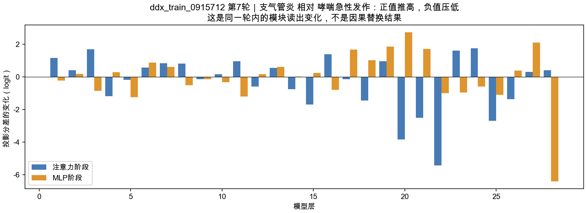

### ddx_train_0875644：数据标签为哮喘急性发作

末轮选择：**哮喘急性发作**；首次正确轮：0；稳定正确轮：0；正确后又转错：0次。

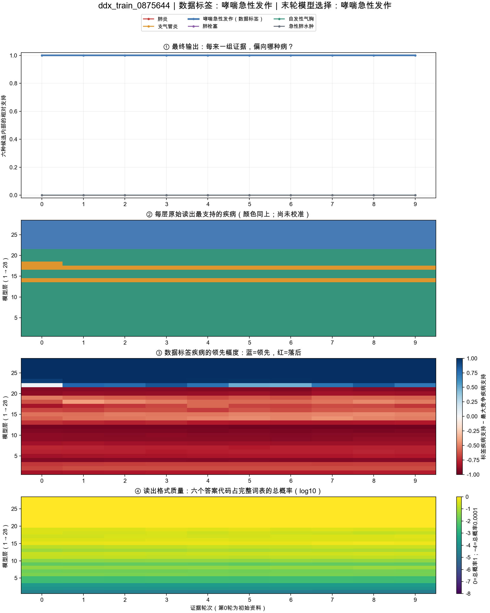

图①先看最终判断；图②再看哪个层转向；图③蓝色表示数据标签疾病领先；图④检查这些代码是否是该层输出头容易读出的内容。早层颜色不能直接当作已证实的内部诊断。

| 轮次 | 本轮新增的原始记录 | 最终最支持的疾病 | 数据标签疾病的支持 |
|---|---|---|---|
| 0 | 呼气时有喘鸣：是 | 哮喘急性发作 | 0.999999 |
| 1 | 更容易发生常见过敏：是 | 哮喘急性发作 | 1.000000 |
| 2 | 每天接触二手烟：是 | 哮喘急性发作 | 0.999999 |
| 3 | 有哮喘或曾用支气管扩张药：是 | 哮喘急性发作 | 0.999999 |
| 4 | 近四周出国旅行：否 | 哮喘急性发作 | 0.999998 |
| 5 | 过去一年哮喘发作至少两次：是 | 哮喘急性发作 | 0.999998 |
| 6 | 住在大城市：是 | 哮喘急性发作 | 0.999998 |
| 7 | 明显气短或呼吸困难：是 | 哮喘急性发作 | 0.999998 |
| 8 | 家人有哮喘：是 | 哮喘急性发作 | 0.999999 |
| 9 | 近两周有感冒：是 | 哮喘急性发作 | 0.999999 |

本病例数据标签疾病支持变化最大的是第8轮：+0.000001；最高支持从哮喘急性发作转为哮喘急性发作。这是看完结果后选出的说明案例。
逐层最高支持发生改变的层：[]。精确变化见机器可读事件表。

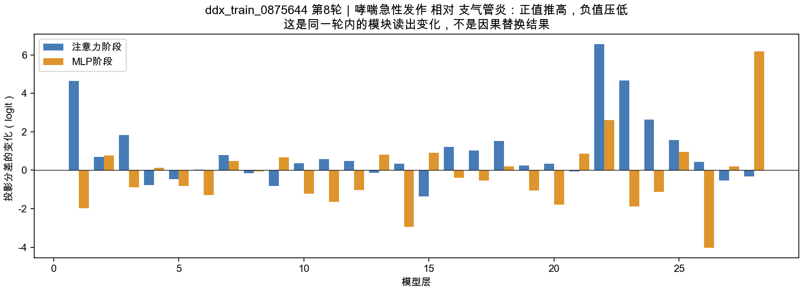

### ddx_train_0858284：数据标签为哮喘急性发作

末轮选择：**哮喘急性发作**；首次正确轮：0；稳定正确轮：0；正确后又转错：0次。

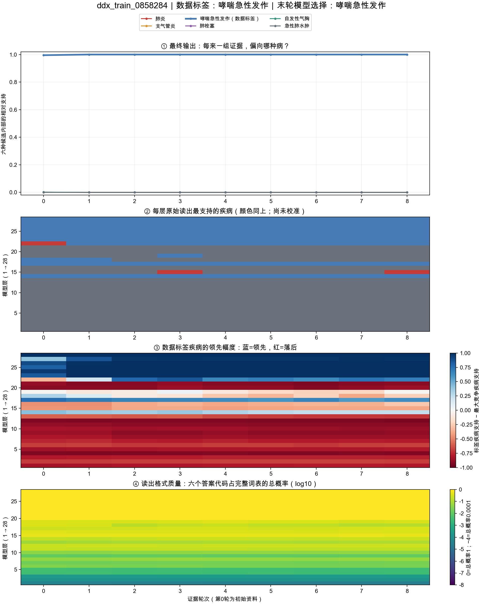

图①先看最终判断；图②再看哪个层转向；图③蓝色表示数据标签疾病领先；图④检查这些代码是否是该层输出头容易读出的内容。早层颜色不能直接当作已证实的内部诊断。

| 轮次 | 本轮新增的原始记录 | 最终最支持的疾病 | 数据标签疾病的支持 |
|---|---|---|---|
| 0 | 咳嗽：是 | 哮喘急性发作 | 0.995143 |
| 1 | 呼气时有喘鸣：是 | 哮喘急性发作 | 0.999979 |
| 2 | 有哮喘或曾用支气管扩张药：是 | 哮喘急性发作 | 0.999997 |
| 3 | 过去一年因哮喘住院：是 | 哮喘急性发作 | 0.999998 |
| 4 | 曾被诊断慢性鼻窦炎：是 | 哮喘急性发作 | 0.999998 |
| 5 | 过去一年哮喘发作至少两次：是 | 哮喘急性发作 | 0.999998 |
| 6 | 明显气短或呼吸困难：是 | 哮喘急性发作 | 0.999998 |
| 7 | 住在大城市：是 | 哮喘急性发作 | 0.999999 |
| 8 | 近四周出国旅行：否 | 哮喘急性发作 | 0.999998 |

本病例数据标签疾病支持变化最大的是第1轮：+0.004836；最高支持从哮喘急性发作转为哮喘急性发作。这是看完结果后选出的说明案例。
逐层最高支持发生改变的层：[22]。精确变化见机器可读事件表。

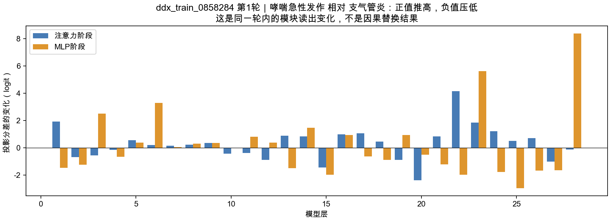

### ddx_train_0940128：数据标签为肺栓塞

末轮选择：**肺栓塞**；首次正确轮：1；稳定正确轮：1；正确后又转错：0次。

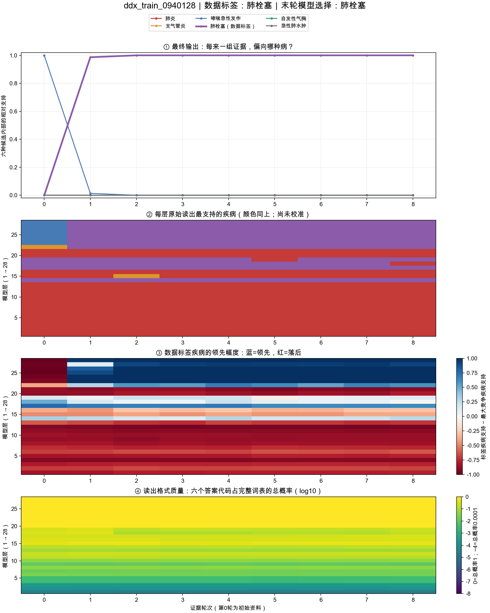

图①先看最终判断；图②再看哪个层转向；图③蓝色表示数据标签疾病领先；图④检查这些代码是否是该层输出头容易读出的内容。早层颜色不能直接当作已证实的内部诊断。

| 轮次 | 本轮新增的原始记录 | 最终最支持的疾病 | 数据标签疾病的支持 |
|---|---|---|---|
| 0 | 深吸气使疼痛加重：是 | 哮喘急性发作 | 0.000007 |
| 1 | 曾有深静脉血栓：是 | 肺栓塞 | 0.986354 |
| 2 | 本次就诊相关疼痛（同时揭示性质、位置、程度、放射等记录）：是 | 肺栓塞 | 0.999995 |
| 3 | 目前服用激素：是 | 肺栓塞 | 0.999998 |
| 4 | 目前患有活动性癌症：是 | 肺栓塞 | 0.999999 |
| 5 | 身体局部肿胀（同时揭示部位）：nowhere | 肺栓塞 | 0.999998 |
| 6 | 咯血：是 | 肺栓塞 | 0.999997 |
| 7 | 近一个月接受过手术：是 | 肺栓塞 | 0.999999 |
| 8 | 近四周出国旅行：否 | 肺栓塞 | 0.999995 |

本病例数据标签疾病支持变化最大的是第1轮：+0.986347；最高支持从哮喘急性发作转为肺栓塞。这是看完结果后选出的说明案例。
逐层最高支持发生改变的层：[22, 23, 24, 25, 26, 27, 28]。精确变化见机器可读事件表。

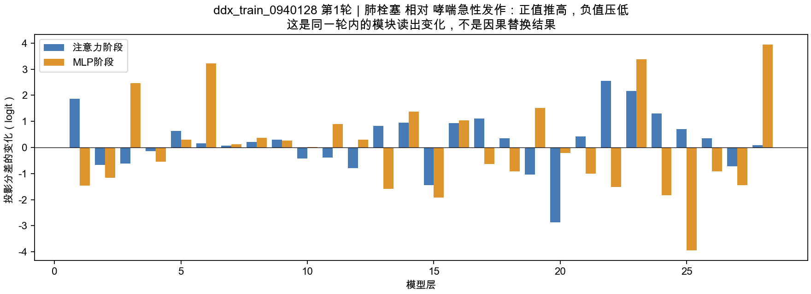

### ddx_train_0851760：数据标签为肺栓塞

末轮选择：**肺栓塞**；首次正确轮：3；稳定正确轮：3；正确后又转错：0次。

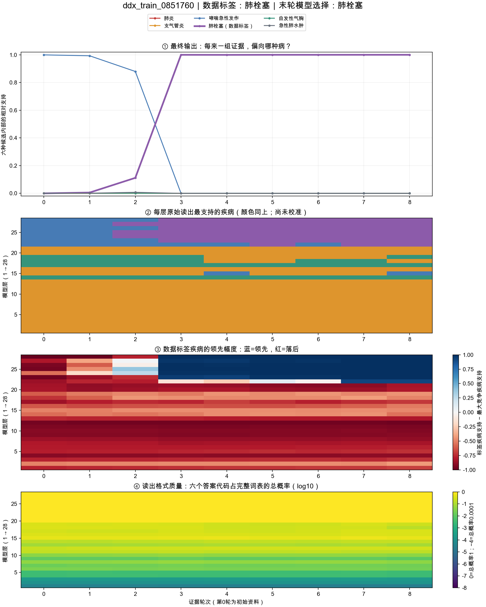

图①先看最终判断；图②再看哪个层转向；图③蓝色表示数据标签疾病领先；图④检查这些代码是否是该层输出头容易读出的内容。早层颜色不能直接当作已证实的内部诊断。

| 轮次 | 本轮新增的原始记录 | 最终最支持的疾病 | 数据标签疾病的支持 |
|---|---|---|---|
| 0 | 深吸气使疼痛加重：是 | 哮喘急性发作 | 0.000043 |
| 1 | 近四周出国旅行：North America | 哮喘急性发作 | 0.005546 |
| 2 | 目前患有活动性癌症：是 | 哮喘急性发作 | 0.111842 |
| 3 | 曾有深静脉血栓：是 | 肺栓塞 | 0.999840 |
| 4 | 过去四周有连续超过三天不能活动或起床：是 | 肺栓塞 | 0.999412 |
| 5 | 近一个月接受过手术：是 | 肺栓塞 | 0.999972 |
| 6 | 曾失去意识：是 | 肺栓塞 | 0.999948 |
| 7 | 身体局部肿胀（同时揭示部位）：是 | 肺栓塞 | 1.000000 |
| 8 | 本次就诊相关疼痛（同时揭示性质、位置、程度、放射等记录）：是 | 肺栓塞 | 0.999999 |

本病例数据标签疾病支持变化最大的是第3轮：+0.887998；最高支持从哮喘急性发作转为肺栓塞。这是看完结果后选出的说明案例。
逐层最高支持发生改变的层：[23, 26, 28]。精确变化见机器可读事件表。

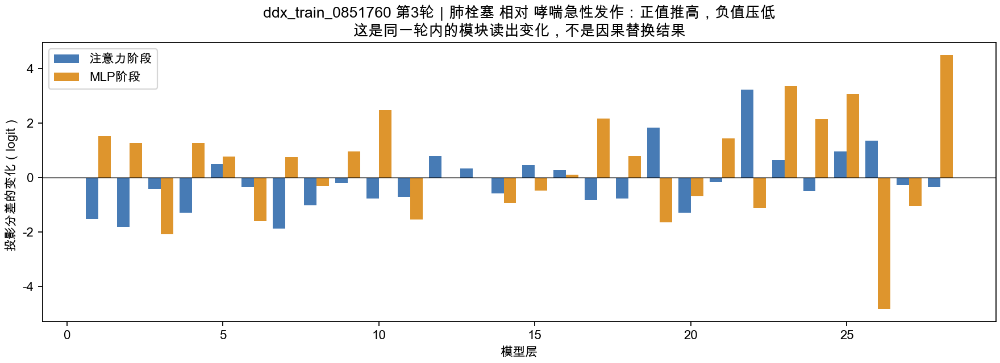

### ddx_train_0868644：数据标签为自发性气胸

末轮选择：**自发性气胸**；首次正确轮：8；稳定正确轮：8；正确后又转错：0次。

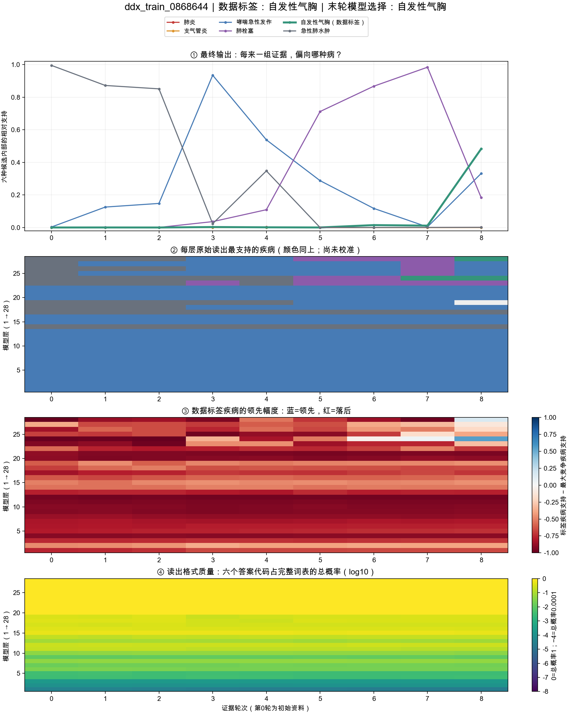

图①先看最终判断；图②再看哪个层转向；图③蓝色表示数据标签疾病领先；图④检查这些代码是否是该层输出头容易读出的内容。早层颜色不能直接当作已证实的内部诊断。

| 轮次 | 本轮新增的原始记录 | 最终最支持的疾病 | 数据标签疾病的支持 |
|---|---|---|---|
| 0 | 明显气短或呼吸困难：是 | 急性肺水肿 | 0.000260 |
| 1 | 吸烟：是 | 急性肺水肿 | 0.000426 |
| 2 | 活动时症状加重、休息时缓解：是 | 急性肺水肿 | 0.000184 |
| 3 | 本次就诊相关疼痛（同时揭示性质、位置、程度、放射等记录）：是 | 哮喘急性发作 | 0.003069 |
| 4 | 近四周出国旅行：否 | 哮喘急性发作 | 0.001376 |
| 5 | 曾有自发性气胸：是 | 肺栓塞 | 0.000358 |
| 6 | 深吸气使疼痛加重：是 | 肺栓塞 | 0.014923 |
| 7 | 休息时也有胸痛：是 | 肺栓塞 | 0.011634 |
| 8 | 家人曾有气胸：是 | 自发性气胸 | 0.482856 |

本病例数据标签疾病支持变化最大的是第8轮：+0.471222；最高支持从肺栓塞转为自发性气胸。这是看完结果后选出的说明案例。
逐层最高支持发生改变的层：[19, 25, 26, 27, 28]。精确变化见机器可读事件表。

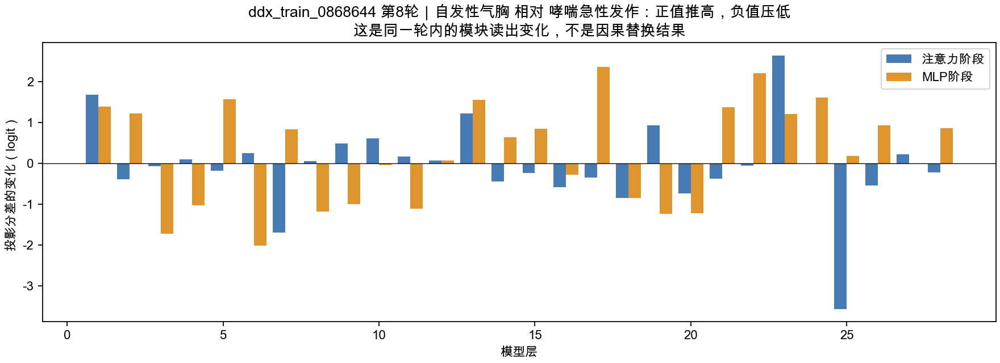

### ddx_train_0937832：数据标签为自发性气胸

末轮选择：**自发性气胸**；首次正确轮：2；稳定正确轮：6；正确后又转错：1次。

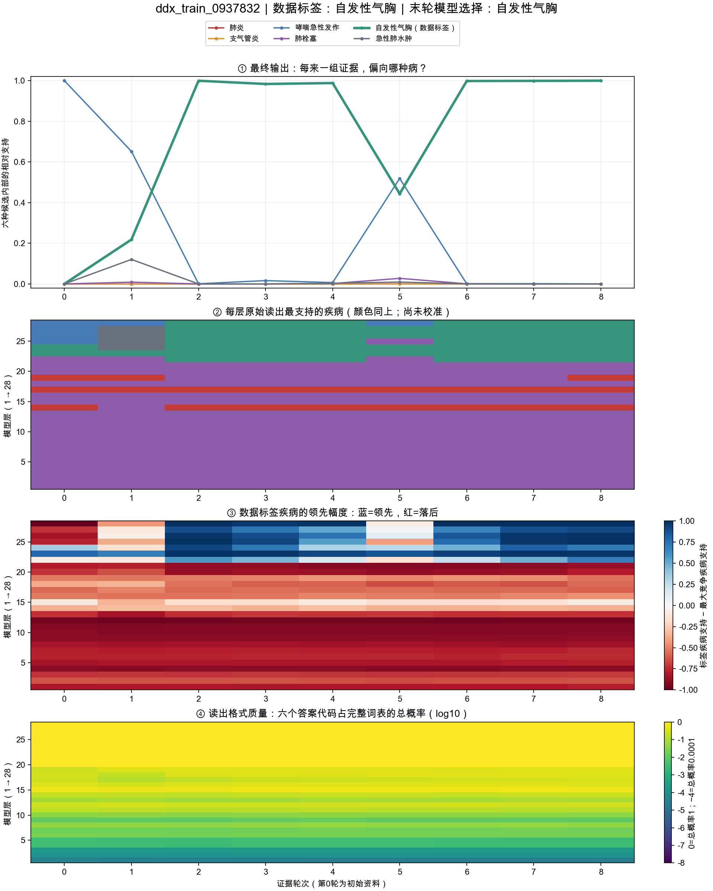

图①先看最终判断；图②再看哪个层转向；图③蓝色表示数据标签疾病领先；图④检查这些代码是否是该层输出头容易读出的内容。早层颜色不能直接当作已证实的内部诊断。

| 轮次 | 本轮新增的原始记录 | 最终最支持的疾病 | 数据标签疾病的支持 |
|---|---|---|---|
| 0 | 本次就诊相关疼痛（同时揭示性质、位置、程度、放射等记录）：是 | 哮喘急性发作 | 0.000278 |
| 1 | 明显气短或呼吸困难：是 | 哮喘急性发作 | 0.218351 |
| 2 | 曾有自发性气胸：是 | 自发性气胸 | 0.999201 |
| 3 | 休息时也有胸痛：是 | 自发性气胸 | 0.983379 |
| 4 | 近四周出国旅行：否 | 自发性气胸 | 0.987890 |
| 5 | 吸烟：是 | 哮喘急性发作 | 0.443677 |
| 6 | 深吸气使疼痛加重：是 | 自发性气胸 | 0.997908 |
| 7 | 家人曾有气胸：是 | 自发性气胸 | 0.998689 |
| 8 | 活动时症状加重、休息时缓解：是 | 自发性气胸 | 0.999536 |

本病例数据标签疾病支持变化最大的是第2轮：+0.780850；最高支持从哮喘急性发作转为自发性气胸。这是看完结果后选出的说明案例。
逐层最高支持发生改变的层：[14, 19, 22, 24, 25, 26, 27, 28]。精确变化见机器可读事件表。

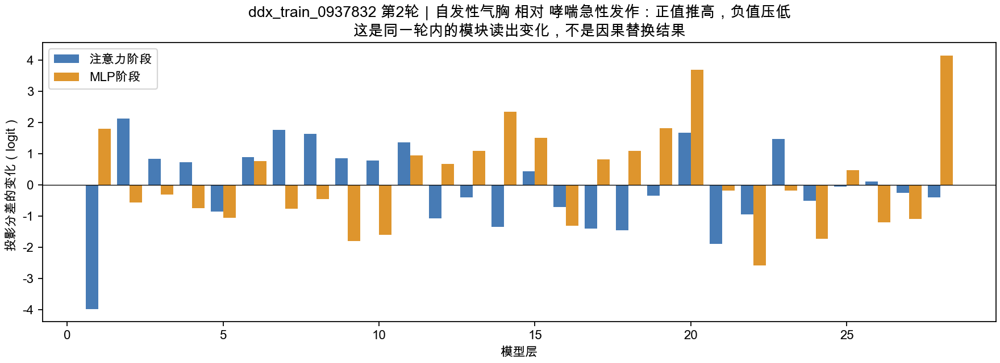

### ddx_train_0874944：数据标签为急性肺水肿

末轮选择：**急性肺水肿**；首次正确轮：7；稳定正确轮：10；正确后又转错：1次。

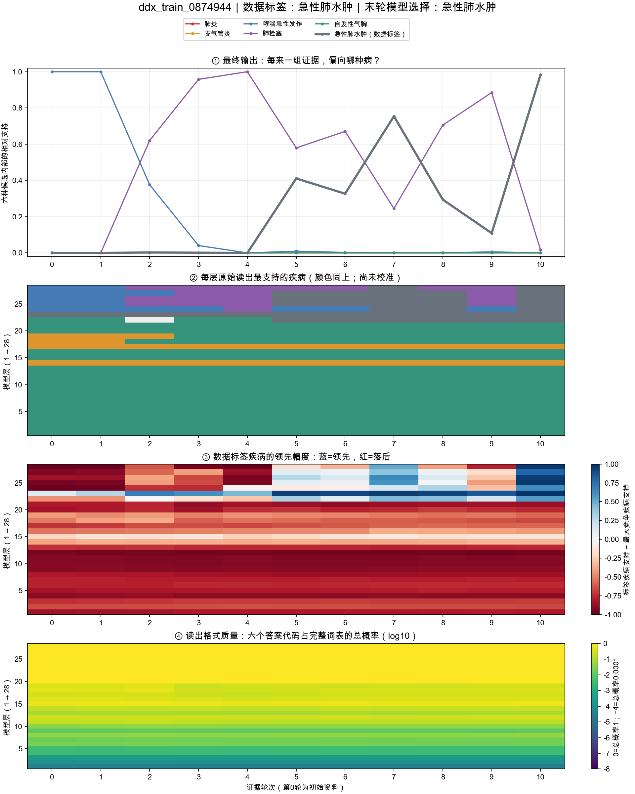

图①先看最终判断；图②再看哪个层转向；图③蓝色表示数据标签疾病领先；图④检查这些代码是否是该层输出头容易读出的内容。早层颜色不能直接当作已证实的内部诊断。

| 轮次 | 本轮新增的原始记录 | 最终最支持的疾病 | 数据标签疾病的支持 |
|---|---|---|---|
| 0 | 本次出现疲倦、全身不适、肌痛或整体状态变化：是 | 哮喘急性发作 | 0.000010 |
| 1 | 明显气短或呼吸困难：是 | 哮喘急性发作 | 0.000051 |
| 2 | 目前接受透析：是 | 肺栓塞 | 0.002615 |
| 3 | 本次就诊相关疼痛（同时揭示性质、位置、程度、放射等记录）：是 | 肺栓塞 | 0.001395 |
| 4 | 有心力衰竭病史：是 | 肺栓塞 | 0.000019 |
| 5 | 曾有心肌梗死或有心绞痛：是 | 肺栓塞 | 0.410827 |
| 6 | 有高血压或服用降压药：是 | 肺栓塞 | 0.326753 |
| 7 | 身体局部肿胀（同时揭示部位）：是 | 急性肺水肿 | 0.754080 |
| 8 | 近四周出国旅行：否 | 肺栓塞 | 0.294022 |
| 9 | 出汗明显增多：是 | 肺栓塞 | 0.109015 |
| 10 | 曾有肺部积液：是 | 急性肺水肿 | 0.982976 |

本病例数据标签疾病支持变化最大的是第10轮：+0.873961；最高支持从肺栓塞转为急性肺水肿。这是看完结果后选出的说明案例。
逐层最高支持发生改变的层：[24, 25, 26, 27, 28]。精确变化见机器可读事件表。

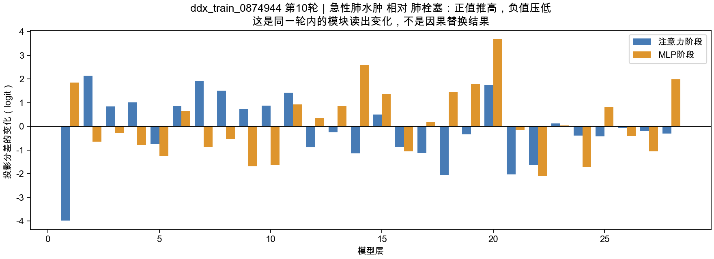

### ddx_train_0857920：数据标签为急性肺水肿

末轮选择：**肺栓塞**；首次正确轮：未达到；稳定正确轮：未达到；正确后又转错：0次。

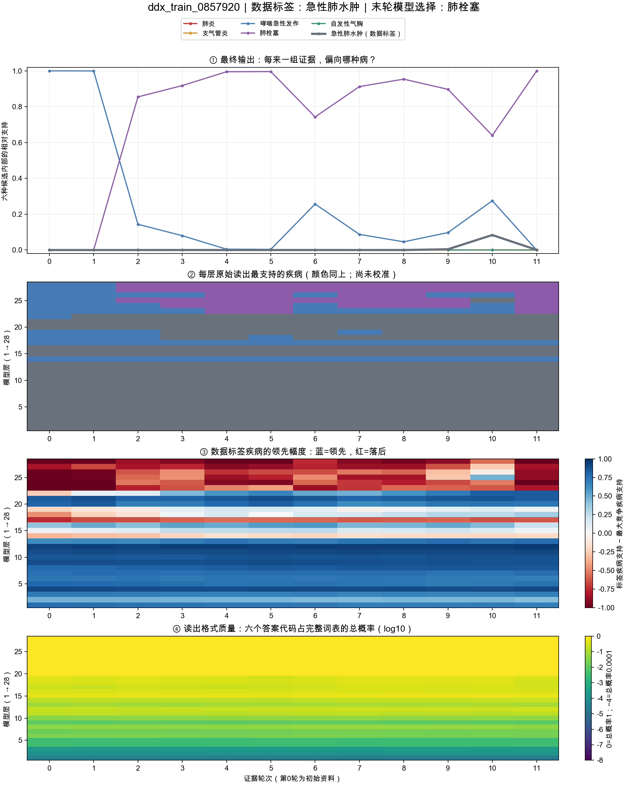

图①先看最终判断；图②再看哪个层转向；图③蓝色表示数据标签疾病领先；图④检查这些代码是否是该层输出头容易读出的内容。早层颜色不能直接当作已证实的内部诊断。

| 轮次 | 本轮新增的原始记录 | 最终最支持的疾病 | 数据标签疾病的支持 |
|---|---|---|---|
| 0 | 活动时症状加重、休息时缓解：是 | 哮喘急性发作 | 0.000001 |
| 1 | 近四周出国旅行：否 | 哮喘急性发作 | 0.000007 |
| 2 | 身体局部肿胀（同时揭示部位）：是 | 肺栓塞 | 0.000009 |
| 3 | 曾有肺部积液：是 | 肺栓塞 | 0.000199 |
| 4 | 明显气短或呼吸困难：是 | 肺栓塞 | 0.000018 |
| 5 | 有高血压或服用降压药：是 | 肺栓塞 | 0.000062 |
| 6 | 出汗明显增多：是 | 肺栓塞 | 0.000104 |
| 7 | 曾有心肌梗死或有心绞痛：是 | 肺栓塞 | 0.000039 |
| 8 | 夜间因憋气或气短醒来：是 | 肺栓塞 | 0.000098 |
| 9 | 目前接受透析：是 | 肺栓塞 | 0.004561 |
| 10 | 有心力衰竭病史：是 | 肺栓塞 | 0.083917 |
| 11 | 本次就诊相关疼痛（同时揭示性质、位置、程度、放射等记录）：是 | 肺栓塞 | 0.001000 |

本病例数据标签疾病支持变化最大的是第11轮：-0.082917；最高支持从肺栓塞转为肺栓塞。这是看完结果后选出的说明案例。
逐层最高支持发生改变的层：[23, 24, 25, 26]。精确变化见机器可读事件表。

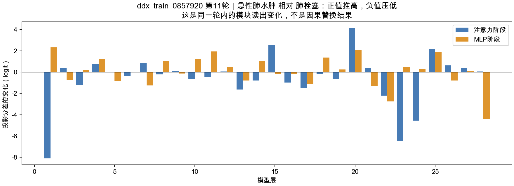

## 下一阶段怎么继续

1. 将六种映射扩到所有131个时间点，逐病例比较哪些证据转向跨映射一致；同时加入直接疾病名称评分，避免只靠答案代码。
2. 先在独立病例上校准逐层读出，确认中间层的疾病信号能在留出病例上预测同轮模型判断，再谈“内部先转向”。
3. 对稳定重现的证据转向做证据顺序、删除和等长替换对照，再定位哪些层真正造成最终选择改变。
4. D测量可靠后加入思考前P、思考后R；不把本轮直接诊断包装为已经完成推理全过程。

## 文件与复现

- 原始观察、完整末层logits、五处激活及版本：[runs/phase1_direct_v2](../runs/phase1_direct_v2/manifest.json)。
- [逐病例指标](../runs/phase1_direct_v2/metrics/case_metrics.csv)、[逐轮数值](../runs/phase1_direct_v2/metrics/round_scores.csv)、[逐条证据的变化](../runs/phase1_direct_v2/metrics/evidence_updates.json)。
- [执行程序](../src/run_direct.py)、[分析与matplotlib作图程序](../src/analyze.py)、[冻结协议](../protocol/PHASE1.md)。
- 早期phase1_direct试跑因float32概率运算的舍入误差触发检查而中断，保留在原目录；正式v2使用等价的稳定完整词表softmax重新跑全部点，统计不混用试跑结果。
