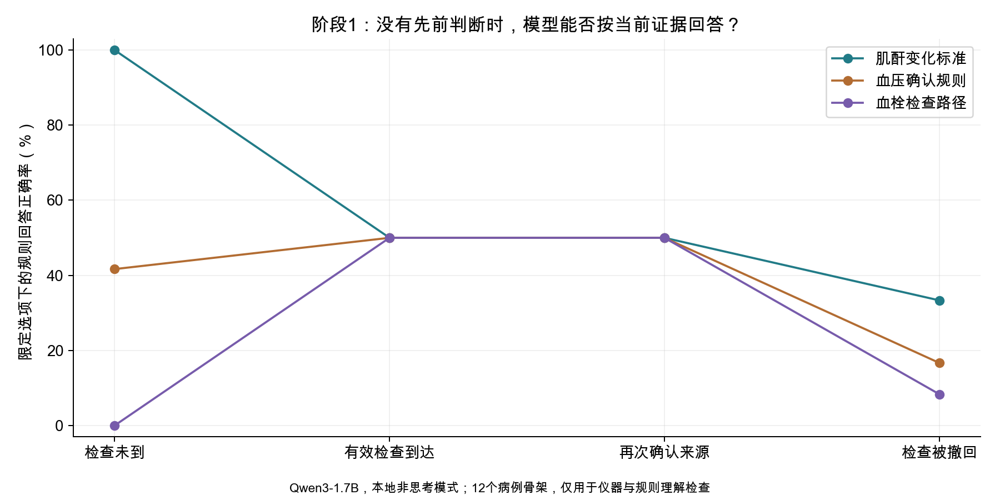
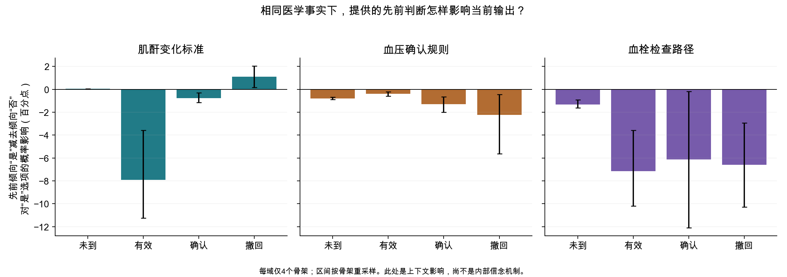

# 阶段1交付：规则理解与内部采集验证

本阶段已经运行本地开放权重模型。以下数值来自保存的真实模型输出；没有人工填充结果。研究目标仍是医学信念机制，本阶段只验证实验仪器与基础能力。

模型：`Qwen/Qwen3-1.7B`；固定提交`70d244cc86ccca08cf5af4e1e306ecf908b1ad5e`；28层，隐藏维度2048；本地mps、torch.float16、非思考模式。

**完成了什么。** 12个病例骨架、216条配对轨迹、864条阶段记录，共756个不同提示。三类任务分别是肌酐变化标准、血压确认规则和血栓初始检查路径。每条轨迹比较检查未到、有效检查到达、来源再次确认及报告撤回。

**先看一道真实跑过的题。** 给定规则：48小时内肌酐升高至少26 μmol/L满足这条标准。病例`aki_00`的有效报告写着：24小时内从70升到100。报告撤回时，题目明确说明它属于其他患者，而且没有替代报告。下面固定展示无旧判断、选项轮换0的这一个预定病例；它不是从错误案例里挑选出来的。

| 证据到了哪一步 | 按题目规则应回答 | 模型在限定选项中选择 |
|---|---|---|
| 检查未到 | 资料不足 | 资料不足 |
| 有效检查到达 | 满足这条标准 | 满足这条标准 |
| 再次确认来源 | 满足这条标准 | 满足这条标准 |
| 检查被撤回 | 资料不足 | 资料不足 |

**没有先前判断时的基础结果。** 下表是限定A/B/C候选中的最高分答案；完整词表质量检查另列。每域只有4个骨架，多种选项轮换不算独立病例。

| 任务 | 检查未到 | 有效检查 | 来源确认 | 报告撤回 |
|---|---:|---:|---:|---:|
| 肌酐变化标准 | 100.0% | 50.0% | 50.0% | 33.3% |
| 血压确认规则 | 41.7% | 50.0% | 50.0% | 16.7% |
| 血栓检查路径 | 0.0% | 50.0% | 50.0% | 8.3% |

**先前判断的影响。** 在相同事实下，把提供的旧判断从“否”改为“是”，观察模型对“是”的输出概率变化。这个差值测的是上下文中的先前判断影响；本阶段没有让模型自然形成并保存初始医学判断。

**内部数据已经取得。** 每个不同提示都保存全部解码层、3个预定义位置的输出向量，位置包括读完提示处、报告结尾和最新来源说明结尾。初始阶段不存在的报告/来源位置带缺失标记，不把占位向量用于分析。

每份激活数组形状为`28 × 3 × 2048`，共756份；本轮采集没有训练或修改模型权重。被动采集对照的最大答案logit差为0。

**答案格式检查。** 候选字母在完整词表中的平均概率质量为1.0000，最小值为1.0000；0/864条记录的完整词表首选词元不是有效选项。条件化候选分数不能直接当作真实患病概率。

**现在能够说到哪里。** 可以评价采集流程、这组限定规则题的基础理解和提供旧判断的影响。不能宣布发现医学信念、证明某种内部机制，也不能据此推广到大型模型或实际诊疗。尚未开展独立医学审核、跨模板验证、训练读出器或有科学对照的因果干预。

**下一阶段。** 根据各域的基础理解表现，优先修正任务理解与表达问题，补充新模板和专业审核；随后在严格留出的病例上测量事实、证据条件和判断倾向。词面基线和随机标签对照同时运行，再决定哪些位置值得因果干预。

**复现与文件。** [论文逻辑](../paper/PAPER_LOGIC.md)、[分阶段计划](../protocol/STAGES.md)、[规则来源](../protocol/SOURCES.md)、[完整统计](../runs/phase1_qwen3_1p7b/analysis.json)、[逐条输出](../runs/phase1_qwen3_1p7b/predictions.jsonl)、[采集代码](../src/run_phase1.py)、[分析代码](../src/analyze_phase1.py)。激活在运行目录的`states/`中。

本轮收费API支出0美元，本地电力未计量。
