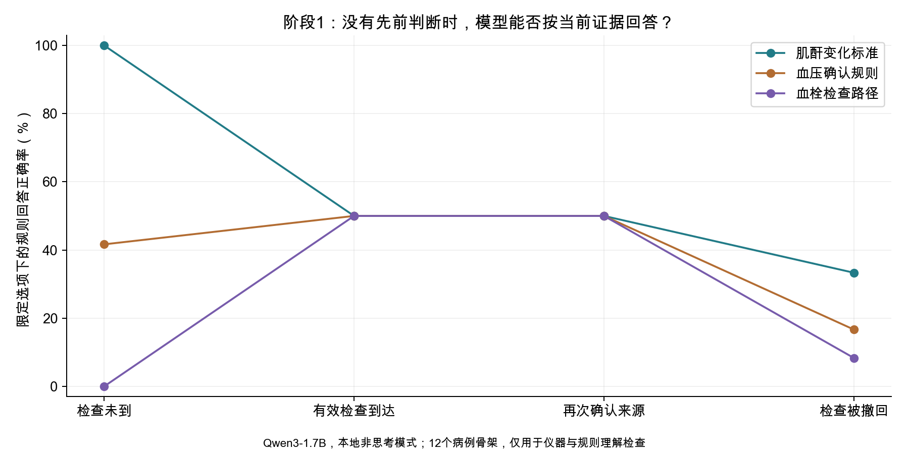

# 第一阶段结果：实验已经跑通，基础能力校准还没有通过

**本轮已经完成真实模型运行，取得回答、内部状态和结果图。最重要的结论是：当前这套模型、题目和非思考模式的组合，尚不适合直接用于解释医学信念机制。** 原因是没有设置旧判断时，它就已经大量答错。

论文仍然研究四件事：**医学判断怎样形成，证据怎样改变判断，哪些内部信息实际起作用，这种解释能覆盖哪些场景。** [完整论文逻辑](../paper/PAPER_LOGIC.md)和[逐阶段计划](../protocol/STAGES.md)已经落盘。

**先看一个实际错误。**

题目明确给出：48小时内肌酐升高至少26，才满足指定的变化标准。某个合成病例24小时内从70升到78，只升高8。因此应选择“不满足这条标准”。在本轮无旧判断、选项轮换0的运行中，模型选择了“满足”。这是规则限定问题，不是在判断患者有没有其他类型的肾损伤。

这个错误发生时，我们还没有给它一个需要维护的旧结论。因此，不能直接把它解释成“模型为了旧信念拒绝事实”。

**总体结果是什么？**

| 没有提供旧判断，有效报告已经到达 | 满足规则的版本 | 不满足规则的版本 | 合计 |
|---|---:|---:|---:|
| 正确记录数／记录数 | 36／36 | 0／36 | 36／72 |

三类任务分别是肌酐变化标准、血压确认规则和血栓检查路径；各自这一阶段的正确率都是50%。这72条是配对条件和选项轮换记录，来自12个病例骨架，不能说成72个独立患者。整个864条记录中，模型没有一次选择语义上的“不满足”选项。

**我又做了排查，避免把实现问题误当成研究发现。**

| 追加检查 | 实际结果 | 能说明什么 |
|---|---|---|
| 缩短题目，删除旧判断和多阶段历史，保留规则、事实与问题 | 24条中12条正确，全部选“满足” | 简单缩短输入没有解决问题 |
| 从原题删除来源确认句 | 6条中3条正确 | 这句话不是所测病例错误的唯一原因 |
| 同样原题改用CPU、32位精度计算 | 6条答案与原运行一致 | 这些错误不能只归咎于MPS或16位精度 |
| 三个简单算术、比较和词义题，正确字母分别为A、B、C | 3／3正确 | 不是永远输出某一个字母；仍不足以证明完整实现没有问题 |

这些是看到首轮结果后追加的诊断，共39条记录，单独保存在[追加排查](../runs/phase1_diagnostics/summary.json)。它们没有被混入首轮统计。错误的完整原因尚未确定，尤其还需检查回答格式、推理模式、医学措辞与共同软件实现的影响。

**还有两个需要保留、但目前不能写成机制结论的信号。**

第一，同一个肌酐报告撤回病例，仅轮换选项位置，答案就从“资料不足”变成“满足”。第二，在肌酐有效报告阶段，提供先前“是”的判断，相比先前“否”，反而让“是”的选项分数平均降低约7.91个百分点。二者都来自真实输出；但基础规则能力与选项稳定性尚未过关，所以目前归入校准排查。选项对照用于把关，论文的主线仍是医学信念的形成、更新与因果作用。

**内部测量已经做到哪一步？**

本地运行固定版本的Qwen3-1.7B，完成864条阶段记录、756个不同提示。每个不同提示保存28层、3个位置、每层2048维的内部向量，共756份文件，约219 MB。全部文件的形状、数值和读入位置已检查；三次真实模型对照中，被动记录与不记录的答案分数差均为0。收费API支出为0美元。

这证明当前记录流程可用，还没有证明某一维度就是“医学信念”。本轮没有训练医学信念读出器，也没有开展机制干预。实际测量方法与后续图的解释见[内部表示说明](../protocol/INTERNAL_MEASUREMENTS.md)。

**下一阶段怎么做？**

先进入阶段1B，修正测量，而不是直接解释这批失败回答的内部原因：

1. 保持规则真值不变，比较字母选择与直接回答、非思考与思考模式；用简短非医学逻辑题检查相同运算和否定关系。各类条件都保留正、反、资料不足版本。
2. 对固定小样本核对另一套参考推理实现；若校准仍失败，再引入同系列更大模型。每次改变设置使用新运行编号，保留本轮全部结果。
3. 在开启新确认集前固定合格门槛：总体正确率至少90%，各答案类别至少80%，选项轮换后语义选择一致率至少95%。这些是研究仪器的工程门槛，不是临床安全标准。每个医学域分别通过后，再进入旧判断、有效性和撤回条件的配对研究；临床解释仍需独立医学审核。

后续内部读出和因果实验继续按原论文逻辑推进。本轮结果不支持宣布发现新机制，也不能据此判断其他模型是否具备这种机制。

详细表格、第二张图和原始输出入口见[阶段1完整结果](PHASE1.md)。采集代码为[src/run_phase1.py](../src/run_phase1.py)，追加排查代码为[src/diagnose_phase1.py](../src/diagnose_phase1.py)。两张图均有PNG与PDF版本，位于`figures/phase1/`。
