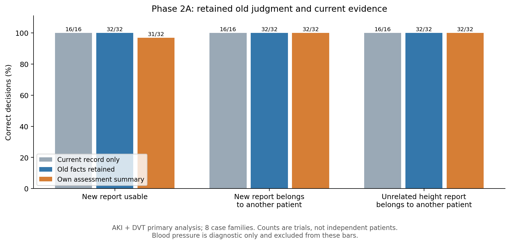
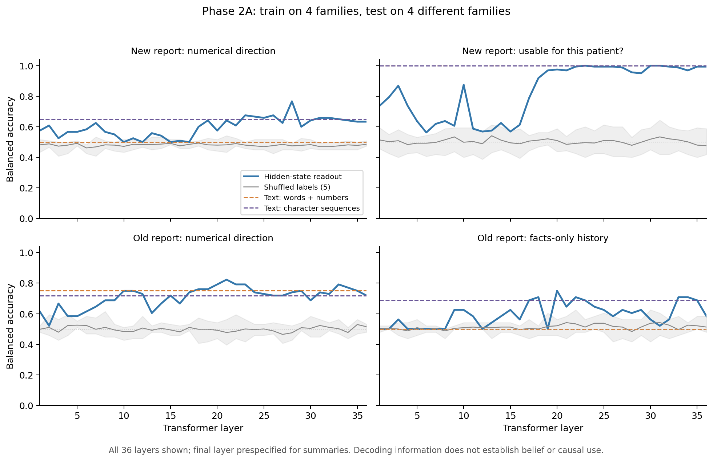

# 阶段2A：保留旧判断，会让模型更难改口吗？

2026-11-18。本阶段实际运行已经完成：24条初始判断、360条后续判断，收费API支出0美元。

**本轮没有发现稳定的“坚持旧错误”。** 肌酐与DVT的主要分析中，239/240次判断正确；血压诊断线120/120正确。这不是整个方向没有价值，而是这组明确给规则、明确撤回旧报告的情境，还不足以产生我们要解释的稳定现象。

## 一个例子

模型先看旧报告，认为“没有达到这条肌酐变化标准”。随后告诉它旧报告属于别人，再给它当前病人的新报告：肌酐16小时内从111升到139。

新报告有效时，模型应按新报告回答“达到标准”；如果新报告也属于别人，就应回答“资料不足”。我们分别保留旧事实、保留旧事实和模型自己的旧结论，观察它是否被旧结论拉回去。这一病例的两类条件都答对了。

这里问的是一道限定医学规则题，不把“达到某条变化标准”扩大为完整诊断。

## 实际如何比较

12个病例骨架：肌酐4个、DVT 4个、血压4个。每个骨架改变旧报告方向、新报告方向、当前报告的来源和历史保留方式，形成360次后续判断。选项映射按病例设置；本阶段没有重新对每条题做三次选项轮换。

肌酐和DVT在前一阶段通过基础校准，240条作为主要分析。血压未通过前一阶段全部门槛，120条单独报告，不混进主要机制统计。

旧判断都是模型实际先做出来的，24/24条初始判断正确。随后历史分为只看当前材料、保留旧事实、再保留实际旧判断的标准化摘要。当前报告则分为有效、关键报告属于别人、只有无关的身高报告属于别人。

## 主要结果

| 历史里保留什么 | 肌酐与DVT正确数 |
|---|---:|
| 只有当前材料 | 48/48 |
| 保留旧事实 | 96/96 |
| 保留旧事实和自己的判断摘要 | 95/96 |

后两组逐条配对，当前输入完全相同，共96对、8个病例骨架。保留旧判断后多错1条，错误率差为1.04个百分点；按病例骨架重采样的95%区间为0—3.13个百分点。病例数很少，不能把这个区间解释为总体效应的可靠边界。

更直接的检查是只看新旧方向相反的条件。保留旧事实和保留自己的判断摘要，分别48/48正确。没有观察到回到旧判断的答案。

唯一错误是`belief_aki_1_no_both_valid_no_own_judgment_summary`：有效新报告给出28小时内118升到125，本应回答“未达到这条标准”，却回答“资料不足”。旧判断也是“未达到”，所以这条错误不是维护旧结论。它的生成解释混淆了肌酐报告与身高报告的归属；这只能作为输出层面的错误线索，不能据此断言内部原因。

血压诊断线120/120正确。这不撤销前一阶段的失败，也不能据此宣布血压跨模板校准已通过：当前数字、报告结构和上下文已经变化，三次选项轮换门槛也没有重测。

## 内部状态读到了什么

保存360份真实内部状态，每份为36层×2560维，位置是读完输入、生成新思考之前。主要读出用4个肌酐/DVT病例骨架训练，另4个测试。全部层保留，下面只按预定规则汇报最后一层。

| 要读出的信息 | 内部状态分类器 | 文字对照：词和数字 | 文字对照：字符片段 |
|---|---:|---:|---:|
| 新报告的数值方向 | 63.3% | 50.0% | 65.0% |
| 新报告能否用于病人 | 99.4% | 100.0% | 100.0% |
| 旧报告的数值方向 | 71.9% | 75.0% | 71.9% |
| 不写出旧结论时，旧报告方向 | 58.3% | 50.0% | 68.8% |

指标把两类标签各占一半，避免只猜多数类拿高分。文字对照不读取模型向量，只使用输入中的文字、数字和字符片段。

**目前没有证明内部读出提供了文字表面之外的信念信息。** 来源能读得很好，但文字对照同样很好；旧方向还能读出一点，不代表模型仍然相信或使用它。我们修正了遗漏单个数字、以及多数类退化的弱文字对照，旧版结果保留作审计，没有拿弱基线制造内部优势。

## 这一轮怎样推动下一轮

已冻结第二组新病例：改用新数字和更简洁的来源表述，减少直接提醒“重新评估旧结论”的句子；新加入检验校准失败、评分尚未实际评估这两类证据不可用情况。在新旧方向相反时，还保留模型实际写出的医学判断原文，去掉独立的选项字母行。

同时对血压做五种修正方法的开发与新病例确认。阶段2A报告只交付上面的已完成结果，不把这两项尚在运行的工作算进来。阶段3的未来更新预测、阶段4的内部因果干预尚未执行。

- [完整行为统计](../runs/phase2_pilot_4b/analysis_v2.json)
- [全部原始回答](../runs/phase2_pilot_4b/predictions.jsonl)
- [唯一错误及完整输入](../runs/phase2_pilot_4b/errors_with_inputs.json)
- [各层读出与随机标签对照](../runs/phase2_pilot_4b/probes_primary/results.json)
- [修正后的文字对照](../runs/phase2_pilot_4b/strong_text_controls.json)
- [本轮方法，用通俗语言解释](PHASE2_METHODS_PLAIN.md)

后续批次现已结束，本文中的后续计划属于当时状态；最终汇总见[本轮完整报告](PHASE2_READ_FIRST.md)。
