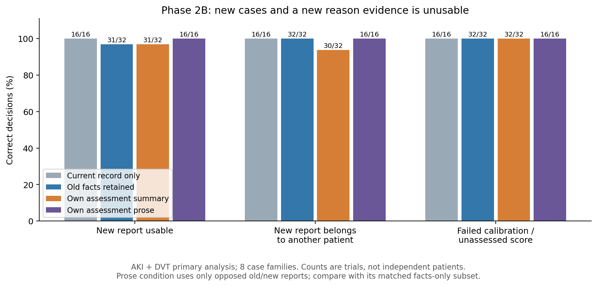
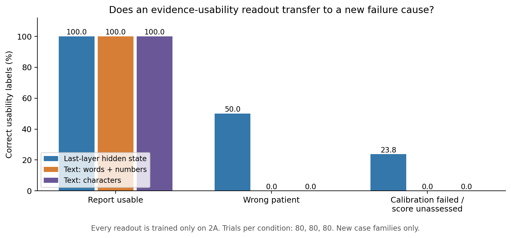
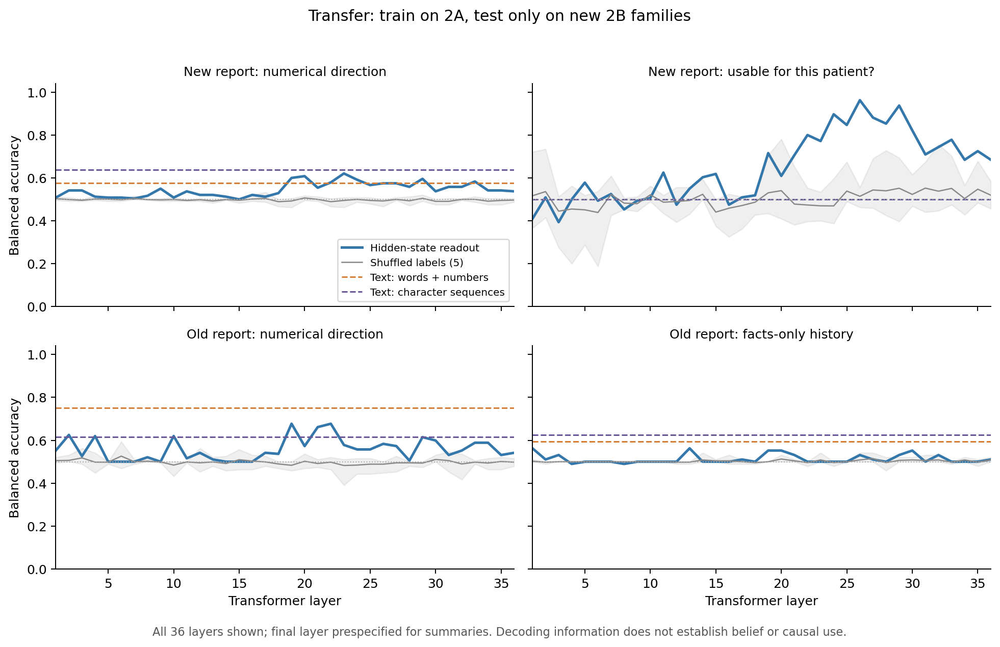

# 阶段2B：换了病例和证据失效原因，结果还成立吗？

2026-11-18。本批16条初始判断、288条后续判断已经完成，保存304份真实内部状态，收费API支出0美元。

**模型大多能按新证据更新；保留旧判断摘要增加了少量错误，但没有形成稳定的“回到旧结论”模式。内部测量的困难更明确：一个在旧题面表现很好的读出器，换题面和取样层后，成绩会明显变化。**

## 这次怎样改实验

8个新数值病例骨架，肌酐、DVT各4个。换了数值和来源表述，去掉直接提醒“旧结论必须重新评估”的句子；仍给出明确规则和三种答案的含义。

新报告有三种情况：可用；属于另一个人；属于当前病人但不能使用——肌酐结果受到校准失败影响，DVT评分只是自动填入、还没有实际评估。这些是受控材料里明确给出的资格条件，不声称指南逐字规定了这些合成叙事。

历史条件保留前三种，再加模型实际写出的旧医学判断原文。原文只删除独立的答案字母行，不人工编造内容，不回放思考块。这个条件只放在新旧报告数值方向相反的分支，所以必须找相同材料逐条配对，不能直接比较它与全部其他试次的总正确率。

## 实际回答

| 历史保留方式 | 后续判断正确数 |
|---|---:|
| 只看当前材料 | 48/48 |
| 保留旧事实 | 95/96 |
| 保留旧事实和自己的判断摘要 | 93/96 |
| 保留旧事实和实际判断原文 | 48/48 |

只看当前材料时，肌酐24/24、DVT 24/24；每类答案也全部正确。本轮没有重新逐题轮换三种选项位置，因此不能把这个检查当成再次完成全部校准流程。

摘要与旧事实逐条比较，96对中多错2条、没有修好其他错误。按病例等权的错误率差为2.08个百分点，病例重采样95%区间为0—5.21个百分点；只有8个骨架，不能据此认定一个稳定总体效应。

实际原文与匹配的旧事实条件都是48/48正确，没有观察到差异。小样本的零差异不证明任何场景下都没有影响。

## 四条错误分别是什么

两条肌酐错误都出现在“当前报告属于别人”的摘要历史条件。打印数字没有达到变化标准，模型便回答“未达到”，没有回答应有的“资料不足”。其中一条旧判断本来是“达到”，最终却跟着当前无效报告的低数值走，因此不是回到旧结论。

另外两条来自同一个DVT情境：当前可用评分是−1，模型回答资料不足。保留旧事实和保留判断摘要都错，不能单独归因于多了一句旧结论。只看当前材料的对应条件答对了。

该DVT病例的初始判断也错了：模型擅自认为评分不应为负。NICE评分表中有扣2分项目，按表相加可以得到−1，所以负号本身不能让题目已核定的评分失效。[NICE NG158表1](https://www.nice.org.uk/guidance/NG158/chapter/recommendations)

16条初始判断中15条正确，这个真实错误没有被删掉或改成正确旧判断。它关联的15条后续历史记录中13条正确、2条错误。原文组中有3条的实际旧判断为资料不足，而非与新数值相反的确定判断；限定初始判断正确后，原文与旧事实的45对仍全部正确。完整分层结果已保存。

## 模型会作答，不等于读出器已经测对

我们只用第一组2A训练内部分类器，直接放到这组新病例；没有用2B标签调整它的参数。下面是事前指定的最后一层结果：

| 读什么 | 内部状态读出 | 文字对照：词和数字 | 文字对照：字符片段 |
|---|---:|---:|---:|
| 新报告数值方向 | 53.8% | 57.5% | 63.8% |
| 新报告能否用于病人 | 68.4% | 50.0% | 50.0% |
| 旧报告数值方向 | 54.2% | 75.0% | 61.5% |
| 不写旧结论时的旧报告方向 | 51.0% | 59.4% | 62.5% |

指标为两类标签等权的正确率。末层来源读出从2A同组留出的99.4%降至跨组的68.4%，不能直接称为通用医学信念测量。

最直观的一点：在“校准失败／评分未实际评估”的80条共同历史条件上，模型最终80/80回答正确；但末层读出器只把其中19/80的报告状态读对。这不证明模型不理解这些情况。我们记录的是展开思考之前的状态，分类器、取样时刻和题面迁移都可能是限制。

同时，**不能只报末层失败就说内部没有这种信息。** 全部36层的曲线显示，中间层的迁移更好；查看2B后，第26层的来源读出最高，为96.25%。这是从2B中选择的峰值，不能作为无偏验证成绩。我们在尚未产生任何2C读出成绩时固定第26层，交给新2C病例检验，预定末层结果也照常保留。

## 下一步为什么要加替代报告

前两组里，关键报告不能用时，正确答案总是资料不足。分类器可能学到的是“目前能否下结论”，而不是“这一份报告的资格”。2C增加另一份可用报告，让第一份报告失效时最终答案也可以保持不变。

我们还分别尝试增加训练表述，以及在答案与报告资格已拆开的病例上训练读出器，再放到未参与训练的数值病例上测。Qwen权重没有修改。它们是测量修正，不能预先写成发现了医学信念。

- [完整行为统计及初始判断分层](../runs/phase2b_confirm_4b/analysis_v2.json)
- [初始实际回答](../runs/phase2b_initial_4b/predictions.jsonl)、[后续实际回答](../runs/phase2b_confirm_4b/predictions.jsonl)
- [全部错误及输入](../runs/phase2b_confirm_4b/errors_with_inputs.json)
- [全部层的读出结果](../runs/phase2b_confirm_4b/transfer_from_2a/results.json)
- [第26层的候选选择记录](../protocol/phase2c_layer_candidate.json)
- [通俗方法说明](PHASE2_METHODS_PLAIN.md)、[设计修订和复现说明](PHASE2_REPRODUCE.md)

后续批次现已结束，本文中的后续计划属于当时状态；最终汇总见[本轮完整报告](PHASE2_READ_FIRST.md)。
