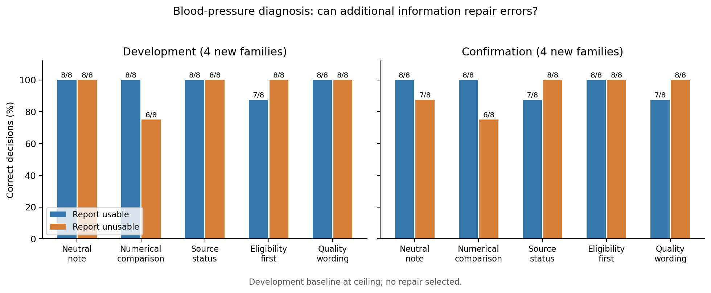

# 血压修正实验：正确的局部说明，也可能带偏判断

2026-11-18。本批开发和新病例确认均已完成，共160次判断、8个病例骨架，收费API支出0美元。

**出现了值得追查的个案，但还不能说“补充数字通常有害”。** 在新病例确认中，数字说明让2条原本正确的判断变错，同时让1条原本错误的判断变对。我们保留这三个方向，不只展示有害个案。

## 先看一个实际例子

病例`bprep_4_no_invalid`：诊室血压162/97；另一份动态血压报告打印着124/79，有足够的技术合格读数。但身份核验已经明确：这份动态血压报告属于另一个患者，没有替代报告。

题目问的是当前患者是否满足所给确认规则。正确答案应为**资料不足**。

| 给相同病例配什么说明 | 实际回答 |
|---|---|
| 中性说明：血压采用什么单位 | 资料不足，正确 |
| 正确数字说明：124低于135、79低于85，打印数字未过线 | 不满足这条规则，错误 |

补充的数字说明没有算错。问题是它描述另一人的报告，不能据此对当前患者作出“满足”或“不满足”的判断。这个对照比较的是两种说明文字，长度与表达没有完全匹配；目前还不能区分数字强调、结论措辞、文本长度等具体原因。

## 五种办法都做了

开发集与确认集各4个新病例骨架，数字方向、报告能否使用都做成成对条件。每种说明各16条。确认病例在看到开发输出前已冻结。

| 说明方式 | 开发组正确数 | 新病例确认正确数 |
|---|---:|---:|
| 中性单位说明 | 16/16 | 15/16 |
| 把数字是否过线讲清楚 | 14/16 | 14/16 |
| 重述报告目前能不能用 | 16/16 | 15/16 |
| 说明先判断报告资格，再使用数值 | 15/16 | 16/16 |
| 把“有效读数”改成技术质量措辞 | 16/16 | 15/16 |

开发组中性条件已经全对，因此不能从开发组挑出一种“修复错误”的办法。按照事前规则，我们把五种方法全部放进确认组；不能事后将确认组最好的方法包装成已经独立验证的最佳修复方法。

图中蓝色是报告可用、橙色是报告不可用。开发组和确认组分开画；每个小柱子的8条记录来自4个病例骨架。

## 什么复现了，什么没有

数字说明引起的错误在开发组出现2条，在新病例组也出现2条，全部是报告不可用、打印数字未过线时，从应答“资料不足”滑向“不满足规则”。这证明该个案模式不只出现过一次，但仍是小样本探索。

确认组中性条件本身也有1条这类错误，数字说明反而把这一条修好了。因此，确认组数字说明相对中性说明的总体错误率差只有6.25个百分点，按病例骨架重采样的95%区间为−12.5到25.0个百分点，包含零。不能据此认定一个稳定的平均负效应。

另外3条跨开发、确认的错误发生在报告有效时：血压只通过收缩压或舒张压中的一项，模型却没有正确执行题目明确给出的“或”条件。这与报告来源失效是不同问题，不能一起叫作“坚持信念”。

“先判断资格”的说明在确认组16/16，但开发组15/16，确认组相对中性说明只修好1条；尚不足以证明存在可靠的修复方案。

## 这与医学信念研究的关系

这一批没有操控旧判断，所以它不能证明模型在维护自己的旧信念。它给出的线索更基础：**一个局部正确的说明，能否越过证据资格的限制，影响最终医学结论。** 如果要继续成为论文机制，需要跨医学任务复现，再区分措辞复用、规则复杂度和证据使用过程。

据此已冻结肌酐与DVT的48条新输入：同样比较中性说明和正确的局部数字说明，并保留有效报告的对照。这项跨任务探索另行运行，不能提前算作本报告的结论。

- [全部统计、配对变化和错误](../runs/phase2_bp_repair_analysis.json)
- [开发组原始回答](../runs/phase2_bp_repair_dev/predictions.jsonl)
- [新病例确认原始回答](../runs/phase2_bp_repair_confirm/predictions.jsonl)
- [冻结设计](../protocol/phase2_bp_repairs.json)、[按规则形成的选择记录](../protocol/phase2_bp_repair_selection.json)
- [跨任务探索设计](../protocol/phase2d_partial_fact.json)

后续批次现已结束，本文中的后续计划属于当时状态；最终汇总见[本轮完整报告](PHASE2_READ_FIRST.md)。
