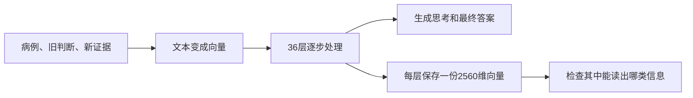

# 我们怎样观察模型的医学信念

我们想问的是：**模型依据什么形成医学判断；依据变了，它怎样改判断；内部哪些信息真的参与了这个过程。** 本轮先把这些问题拆开测，不能把“答错一次”直接叫作“有信念”。

## 从一份报告开始

先让模型看旧报告，实际作出一个医学判断。接着告诉它：旧报告放错了，属于另一个人；再给它当前病人的新报告。

我们复制出几条平行对话。当前病人、新报告、医学规则完全相同，只改变历史里保留什么：

| 历史条件 | 模型看见什么 | 要区分什么 |
|---|---|---|
| 只看现在 | 当前材料和来源更正，没有旧报告内容 | 当前材料本身是否足够清楚 |
| 保留旧事实 | 旧报告还在，但没有旧医学判断 | 单纯旧信息是否干扰 |
| 保留旧判断摘要 | 旧报告还在，再保留模型实际判断的简短摘要 | 多了一句自己的结论，会不会改变更新 |
| 保留旧判断原文 | 保留实际写出的医学判断句，去掉独立的答案字母行 | 摘要可能太弱；保留实际表述会不会不同 |

最后一种只在第二组新病例中使用，而且只测试新旧报告方向相反的情况。因此不能拿它的总正确率直接与其他条件总分比较；要逐条找到相同材料下的配对条件。

每条对话重新运行，历史以文本放回上下文。这不是在读取一个跨对话、一直存在的“心中想法”。

## 三类医学材料分别做什么

- **肌酐变化**：给出前后数值和间隔，只判断是否达到题目限定的一条变化标准。没有达到这一条，不等于没有肾损伤。
- **DVT检查路径**：给出经过评估的Wells评分以及检查可用条件，只选择规则规定的第一项检查。它不是完整诊断。
- **血压确认**：给出诊室血压和动态血压报告，只判断所给确认规则。前一阶段这类题尚未通过全部基础门槛，因此本轮把它单列为错误诊断和修正实验。

数字、规则、来源状态和标准答案都由程序保留，病例不是从真实患者抽取。标准答案来自所给规则；不能把程序检查说成临床专家验证。

## 为什么不只问“支持还是反对”

同一个数值有三种不同情况：确实属于这个病人；属于别人；属于这个病人但检验没有通过校准，或者评分根本没有实际评估。

后两种情况下，这个数值可以清楚地写在报告上，但还不能支持当前病人的判断。正确回答应该是资料不足，而不是把原来的结论反过来。

第一组还加入无关的身高报告。只撤回身高，不应该影响肌酐或DVT路径判断。这样可以区分“看到撤回这个词就改口”和“知道撤回的是哪份依据”。

## 模型内部到底记录了什么

本轮使用本机的Qwen3-4B官方8-bit权重，开启思考生成。这个模型有36个Transformer层，每层隐藏向量有2560个数。

可以把运行过程理解成：

我们在它读完完整输入、还没有生成新的思考或答案时，取最后一个输入位置的向量。每条输入保存36份，总形状是`36 × 2560`。记录的是各层处理后的隐藏状态，最后一层记录位置仍在最终归一化之前。

这相当于拍下它“刚看完题、还没有开始展开思考”的快照。模型可能在之后生成思考文字时才完成计算，因此此时读不出某个数值方向，并不等于它最终不会用这条信息。

本轮没有逐个分析注意力头，也没有改变某个神经元。保存向量、从向量读出信息、改变向量检验因果，是三个不同层次。

## 怎样从一串数读出信息

让一个很简单的分类器学习：某种内部向量，通常对应哪一种标签。它分别回答四个问题：

1. 新报告的数字支持哪个方向？
2. 新报告能不能用于这个病人？
3. 旧报告的数字支持哪个方向？
4. 不把旧结论写在历史里时，还能不能读出旧报告方向？

训练病例和测试病例分开，同一个病例的变体不跨组。第一组用4个病例骨架训练、另4个测试；第二组迁移检查用第一组的8个骨架训练，在完全新的8个骨架上测试。第二组出现的新失效原因不用于选择分类器参数。

图的横轴是模型层数；纵轴是分类器在未参加训练的病例上分辨标签的能力。两类标签的正确率各占一半，避免只猜人数更多的一类也拿到高分。所有36层都画出来，数字摘要固定使用第36层，不在测试集上挑最好看的层。

## 什么结果才算有用

我们还让一个程序只看题目里的词、数字和字符片段，不看模型内部。如果它一样做得好，就不能说内部读出已经揭示了文字表面之外的医学信念。另一个对照把训练标签打乱，检查测量流程是否会凭空产生高分。

最关键的区别是：

| 观察到什么 | 可以说什么 | 还不能说什么 |
|---|---|---|
| 能读出旧报告的方向 | 旧信息仍可恢复 | 模型还相信旧报告 |
| 能读出报告是否可用 | 内部状态含有可用于区分来源条件的信息 | 这套信息实际控制了医学判断 |
| 固定读出器能跨新病例、新失效原因工作 | 读出具有一定迁移能力 | 已找到专门的医学信念部件 |
| 改变候选状态，特定判断随之变化且控制实验通过 | 候选状态可能有局部因果作用 | 模型具有人的信仰或意识 |

因此，前面的方法失效时，我们会修正测量、换新病例再验证。不能为了得到预期结论，把“旧信息存在”直接改名为“旧信念坚持”。

本轮结果见[阶段2报告](PHASE2_READ_FIRST.md)，具体输入和实际回答见[病例说明](PHASE2_CASES.md)。

## 追加的答案混淆对照

前两组中，关键报告不可用总是对应“资料不足”，所以单看内部分类成绩，还分不清读到的是报告状态还是准备给出的答案。第三组增加另一份有效报告R2：第一份R1虽然失效，但R2仍足以支持同一个医学结论。这样，R1是否可用变了，最终应答却可以保持不变。

这一组有8个新数值病例骨架、64条输入，仍是规则明确的测量对照。用前面训练好的读出方法直接测，参数不按这组结果调整；另用只看当前材料的旧组数据训练一次，检查历史长度变化是否影响迁移。实际结果以阶段2汇总报告为准，不能因为设计完成就称为测量通过。
