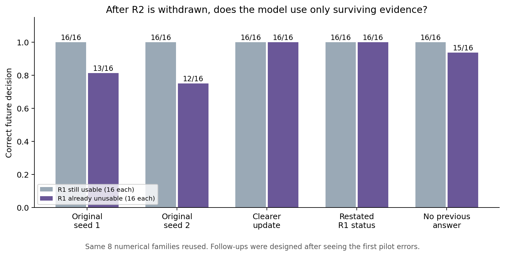

# 后续更新试验：错误、复测与修正

模型当前回答正确以后，撤回支持它的R2报告。若R1本来有效，原结论可以保持；若R1本来属于别人，就应改答资料不足。每种条件32条，使用同一批8个数值病例骨架。

| 条件 | 总正确数 | R1仍有效 | R1本来无效 | 比首次变好／变坏 |
|---|---:|---:|---:|---:|
| 原措辞，首次采样 | 29/32 | 16/16 | 13/16 | 0／0 |
| 原措辞，第二次采样 | 28/32 | 16/16 | 12/16 | 0／1 |
| 更清楚的更新句 | 32/32 | 16/16 | 16/16 | 3／0 |
| 明确重申R1原状态 | 32/32 | 16/16 | 16/16 | 3／0 |
| 删除上一次模型回答 | 31/32 | 16/16 | 15/16 | 3／1 |

## 首次错误的具体病例

DVT病例中，R1评分为4，但属于另一人；R2评分为6，属于当前病人。模型原先正确回答先做超声，并在回答中明确说R1不能用。随后撤回R2，模型却把R1当成可以用，仍选超声。它此前说对了来源状态，不能保证后续正确保留这个状态。

首次3条错误来自两个数值骨架，但共享第3种更新措辞：“R1 has not been amended; retain its previous source status.” 更新后生成的解释把“未修改”读成“仍然有效”。这些解释帮助定位待排查的题面问题，不是可信的内部机制证据。

## 当前内部状态能提前预测吗

在4个训练骨架、4个留出骨架上，用当前答案和任务类别预测是否改口，平衡正确率为50.0%。加入当前内部状态的预定末层为86.4%；只看当前题目及当前回答文字也为86.4%。没有观察到内部状态相对文字基线的增益。

把首次训练所得预测保持不变，对第二随机种子的实际更新重新评分：内部状态83.3%，词文字基线83.3%，字符文字基线83.3%。这仍是同一组病例的采样检查。

这是阶段3的小型预试验。尚未控制当前答案概率；尚未建立“可见文字＋内部状态”对“可见文字”的严格增量模型；没有内部因果干预。不能写成完整机制验证。

## 全部错误列表

**原措辞，首次采样**

- `answer_control_dvt_2_yes_wrong_patient_backup_after_r2_withdrawal`：应为 `unknown`，实际 `yes`。
- `answer_control_dvt_2_no_wrong_patient_backup_after_r2_withdrawal`：应为 `unknown`，实际 `no`。
- `answer_control_aki_2_no_wrong_patient_backup_after_r2_withdrawal`：应为 `unknown`，实际 `no`。

**原措辞，第二次采样**

- `answer_control_aki_2_yes_wrong_patient_backup_after_r2_withdrawal`：应为 `unknown`，实际 `yes`。
- `answer_control_aki_2_no_wrong_patient_backup_after_r2_withdrawal`：应为 `unknown`，实际 `no`。
- `answer_control_dvt_2_yes_wrong_patient_backup_after_r2_withdrawal`：应为 `unknown`，实际 `yes`。
- `answer_control_dvt_2_no_wrong_patient_backup_after_r2_withdrawal`：应为 `unknown`，实际 `no`。

**更清楚的更新句**

无错误。

**明确重申R1原状态**

无错误。

**删除上一次模型回答**

- `answer_control_dvt_0_yes_wrong_patient_backup_after_r2_withdrawal_without_previous_answer`：应为 `unknown`，实际 `yes`。

## 可复查材料

[完整设计及修订](../protocol/phase3_update_repairs.json)、[汇总JSON](../runs/phase3_followup_summary.json)、[首次输入](../data/phase3_future_pilot.jsonl)、[修正输入](../data/phase3_update_repairs.jsonl)。所有原始输出保存在三个运行目录的 `predictions.jsonl`，没有删除失败案例。
