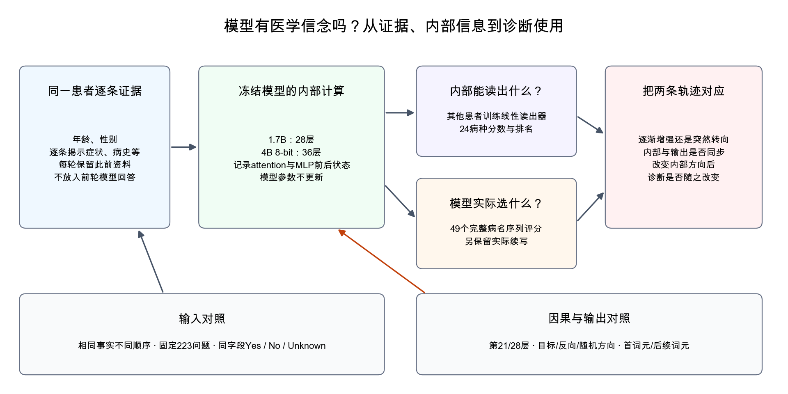
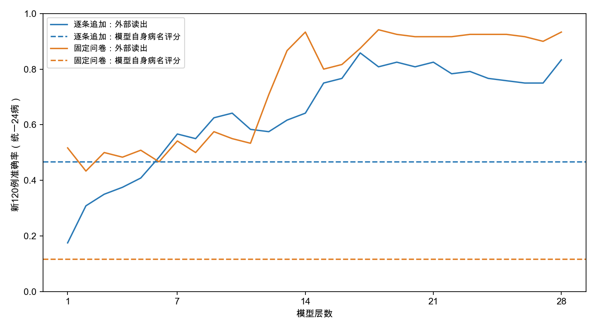
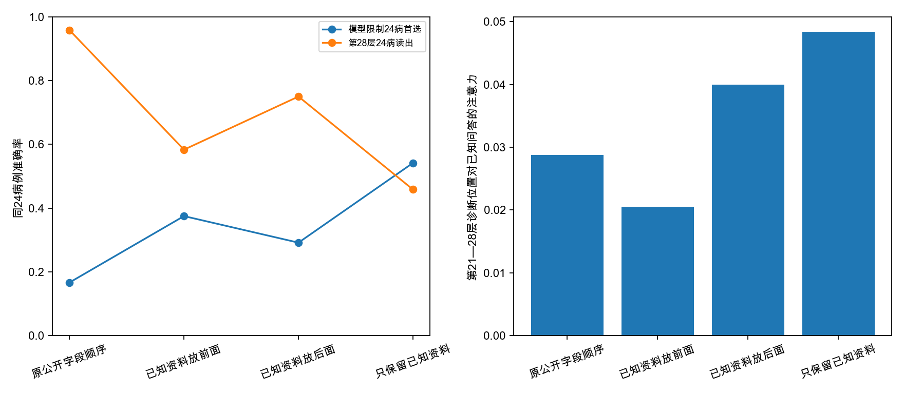
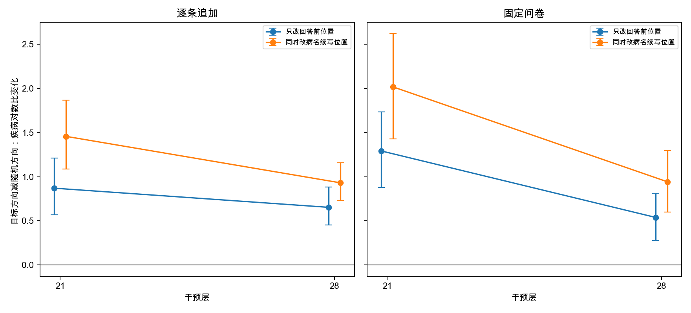
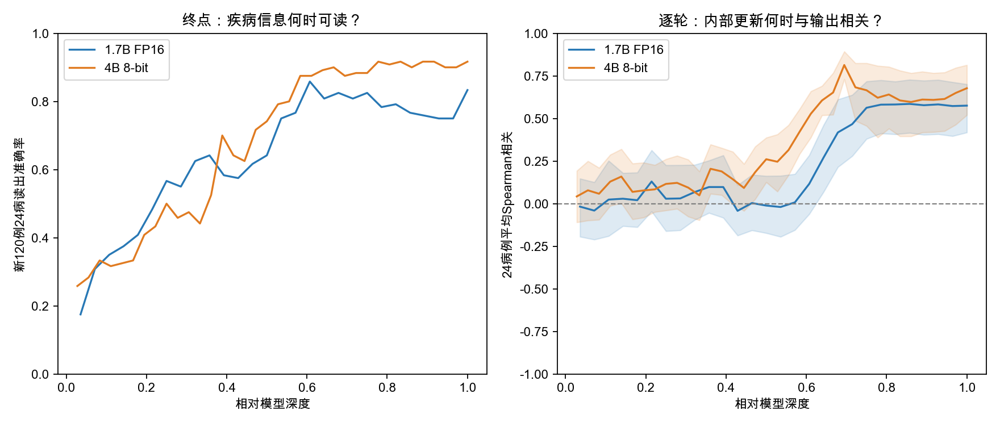

> 本文件保留v0.4历史版本。v0.5完整论述见[中文论文](10_FULL_PAPER_ZH.md)、[最新论证架构](11_ARGUMENT_ARCHITECTURE.md)及[英文ACL稿](submission/main.pdf)。

# 模型有医学信念吗？
## 从逐条证据到内部疾病信息与诊断选择

*Do Language Models Have Medical Beliefs? From Sequential Evidence to Internal Disease Information and Diagnostic Choice*

中文研究稿 v0.4 · 2026-11-19。本文以冻结记录中的完成实验为依据；实验登记、逐病例数据和代码随文提供。

## 摘要

医学证据进入语言模型后，能否形成既可被读出、又实际支配诊断的疾病状态？我们将这一问题分为输出支持、内部可读信息和因果作用三个层次。在DDxPlus模拟病例中，使用旧120例训练外部读出器，在另一数据划分的新120例、24种疾病上测试，并对预定24例追踪全部184次证据更新。对Qwen3-1.7B，同样的患者事实从逐条追加改为固定问卷后，第28层疾病读出由100/120提高至112/120，而原模型在同24类中的病名排序由56/120降至14/120。诊断切换时，后层读出首选约有一半保持不变。位置对照进一步发现，把已知事实移到问卷末尾增加了回答位置对这些事实的注意力，却没有改善诊断。我们通过疾病方向干预、肯否对照和另一模型配置复核，区分信息保留、语义取值、输出偏向与病名生成路径。8项预定目标方向减随机方向的输出分差检验均通过Holm校正，但当前剂量没有新增正确诊断。4B配置的同24病末层读出仍高于原生排名（110/120对82/120），且同24例固定问卷使诊断从16例正确降至4例。 本文据此将医学信念作为需要同时接受表示与作用检验的研究对象；外部读出高分本身不足以证明模型已形成并使用正确诊断。

## 1　引言

一份模拟病例记录了右耳疼痛、近期针对耳部感染使用口服抗生素，以及发热等信息，来源诊断为急性中耳炎。逐条输入这些资料时，模型在看到抗生素病史后选择中耳炎，并在其后保持这一诊断。然而，把相同事实填入完整问卷、其余项目明确标为未知后，模型从头到尾选择慢阻肺急性加重或感染。与此同时，一个只用其他患者训练的简单读出器，仍能从后层状态识别出中耳炎。

这个例子提出的不是“模型有没有记住某种疾病”，而是一个更具体的问题：**当医学信息已经进入内部状态，什么决定这些信息能否成为模型自己的诊断？** 病例仅用于说明问题，来自实验后选取的展示案例；结论由独立120例终点评估及预定24例完整轨迹支持。[完整病例和各轮证据](../results/14_fixed_panel/cases/ddx_test_0041136.md)

已有研究直接检验医学诊断更新的方向、证据顺序与历史判断影响，也有医学内部表示和激活干预研究。因此，非单调更新、顺序敏感或中间表示可读都不能单独构成本文的贡献。[诊断概率一致性](https://www.mdpi.com/2504-4990/8/11/369)、[纵向临床更新](https://arxiv.org/abs/2610.02684)、[医学知识地图](https://arxiv.org/abs/2510.11390)

本文将这些问题放在同一个患者的证据轨迹上：每次揭示资料，记录模型对全部候选的支持，读取各层状态，再通过受控改动检验状态是否影响相应疾病。实验发现，信息可读性、对证据的注意力和最终诊断质量并不一致。我们由此分析医学信息的**保留与使用之间的分离**，而非把探针的高准确率直接命名为模型的内在正确答案。

本文的实验贡献包括：（1）在相同患者事实下，量化输入呈现对内部可读性和原生诊断的不同影响；（2）将完整逐轮轨迹连接到各层状态、计算步骤和定向干预；（3）以肯否、位置、候选顺序和病名词元对照限定机制解释，并在另一模型配置上复核。研究不以提出诊断分类器或发布排行榜为目标。

## 2　研究对象与测量

### 2.1　病例、来源标签与证据轮次

数据来自DDxPlus，一套带症状、病史和参考鉴别诊断的合成病例。该来源便于精确控制已知事实，但不等于真实临床患者。[DDxPlus](https://proceedings.neurips.cc/paper_files/paper/2022/hash/cae73a974390c0edd95ae7aeae09139c-Abstract.html)

主实验使用旧validate划分的120例训练读出器，另从test划分按固定哈希抽取24病种各5例，共120例，覆盖6个疾病组。选样要求年龄18—90岁、至少5个证据组，并排除与此前病例完全相同的事实集合；去重忽略年龄和性别。两组均来自同一生成来源。预定24个新病例保留全部证据前缀，合计208个前缀、184次新增证据。该24例按独立哈希选择，并非每病各1例，也不是按有趣结果挑选。

每轮从头输入截至当前已经获知的事实，不输入上轮回答。轮次表示资料逐步可得，不表示患者病情在真实时间中进展。第0轮含来源的初始证据组；之后按固定顺序揭示其余证据组。一个组可能包括疼痛位置、程度等多个关联字段。完整事实另做逆序、乱序对照。

来源标签用于终点命中评价；参考鉴别诊断用于补充评价。新120例中，标签同时为参考鉴别诊断最高项的为79例。早期证据没有逐轮标准后验，因此“先命中后偏离标签”是轨迹描述，不能直接等同于临床推理错误。

### 2.2　同一事实的两种输入

**逐条追加：**仅显示当前已揭示的问答。**固定问卷：**对所有患者显示相同223个字段，已揭示答案按来源填写，其余标为Unknown，并明确Unknown不等于No。两种输入保留相同患者事实，但同时改变了长度、位置和未知字段的可见性；后续专门分解这些影响。

固定问题列表消除了“问题是否出现”的变化，但“哪个答案已知”仍可能携带标签线索。因此另设已记录位置保留、具体取值隐藏的对照，并报告文本和记录模式分类基线。本文不以固定问卷宣称消除了全部数据捷径。

### 2.3　诊断支持：模型自己更倾向什么

主候选空间为49个完整病名。固定JSON回答前缀后，对每个规范病名及闭合符、EOS进行教师强制完整序列评分：

\[
L_t(d)=\sum_j\log P_\theta(y_j(d)\mid E_t,y_{<j}(d)),\quad
q_t(d)=\frac{\exp L_t(d)}{\sum_{k\in D}\exp L_t(k)}.
\]

q表示这些候选字符串之间的相对支持。它不等于经过临床校准的患病概率，也不同于询问模型“你有多少把握”得到的口头概率。记录同时保留未归一化分数、逐词元分数、规范字符串总质量、长度归一化评分和贪心自由续写。

首选改变和大幅更新分开：前者为相邻轮最高分疾病不同；后者为至少一个候选的q变化达到50个百分点，另报告10和25个百分点阈值。所有干预中的疾病对比较均固定目标与竞争者，避免比较对象变化造成虚假转向。

### 2.4　内部信息：状态里能读出什么

Qwen3-1.7B有28层，隐藏维2048。我们在诊断回答开始前的位置，保存每层进入状态、attention增量、attention后状态、MLP增量和离层状态，并记录16个查询头对输入组的注意力。注意力范围是该诊断位置，不是所有位置的完整注意力矩阵。

各层离层向量经L2归一化及训练集均值中心化，用旧120例拟合24类线性岭回归读出器。主正则系数0.1，0.01与1作敏感性检验；新120例及其所有前缀不参与拟合或层位选择。读出分数只用于分类、排名和固定疾病对分差，不称为各层疾病概率。

读出器获得病例标签监督，原模型没有接受该任务适配。两者比较用于研究状态包含的信息与原有输出之间的差距，不是等监督条件的算法竞赛。直接比较限制到同24疾病；49病结果另列。后续也实际将提示候选改成24种，以区分事后重排与实际缩小任务。

### 2.5　统计单位与执行

模型参数在全部实验中冻结；随证据改变的是激活、注意力和输出，不是层权重。采用直接作答设置，关闭显式thinking；没有检验长推理链的作用。病例是统计单位，逐轮指标先在病例内汇总，95%区间按病例bootstrap；固定训练头的区间不包含重抽训练病例的不确定性。8项预定疾病方向主对比使用配对符号置换及Holm校正。后续追踪明确标为探索性，不追溯包装成预注册发现。

## 3　从表面判断到内部信息

### 3.1　证据更新既有连续移动，也有突然转向

在24条完整轨迹、184次证据更新中，逐条追加产生77次49病首选切换，69次单病支持至少变化50个百分点；固定问卷分别为23次和21次。逐条追加有11/24例曾命中标签后偏离，固定问卷为5/24。固定问卷较少切换，却不代表它更可靠：它的终点准确率更低，常常稳定地偏向共同疾病。

相同完整事实逆序后，追加式首选在9/24例改变；乱序为6/24。病例的最终事实相同，诊断仍依赖呈现顺序。自然证据没有每轮精确后验，因此本文不把每次大幅变化都判为不合理，而进一步询问内部状态是否同步改变。

### 3.2　内部更容易读出疾病，输出却更差

| 新120例终点 | 逐条追加 | 固定问卷 |
|---|---:|---:|
| 原模型，49病 | 44/120（36.7%） | 10/120（8.3%） |
| 原模型，限制到24病 | 56/120（46.7%） | 14/120（11.7%） |
| 第7层外部读出，24病 | 68/120（56.7%） | 65/120（54.2%） |
| 第14层外部读出，24病 | 77/120（64.2%） | 112/120（93.3%） |
| 第21层外部读出，24病 | 99/120（82.5%） | 110/120（91.7%） |
| 第28层外部读出，24病 | 100/120（83.3%） | 112/120（93.3%） |

固定问卷的第28层读出与原生24类排名相差81.7个百分点，病例配对95%区间为[74.2,88.3]；追加式相差36.7个百分点，[27.5,46.7]。两种呈现的49病首选在105/120例不同。固定问卷中，85/120例选择慢阻肺急性加重或感染，而该病不在此次抽取的24种标签病之中。

这个结果确立了同一事实下的信息可读性与诊断选择分离。它并不要求把固定问卷理解为更优医学理解：固定字段可能让外部读出器更容易识别记录模式。主张应止于“可用于识别标签的信息保留在状态中，原有输出却没有同样可靠地利用它”。

### 3.3　输出换病，并不总伴随读出换病

将输出和读出统一为24类后，追加式产生59次输出首选切换，固定问卷16次。按发生切换的病例先求比例，第21和28层读出首选保持率分别均为58.2%（追加式）与54.5%（固定问卷）。保持首选不等于向量没有变化，也不代表该首选必然正确；它说明两个测量对象的转向没有一一对应。

连续分数分析进一步说明，这种分离不等于完全无关。对固定疾病对，第28层读出分差更新与原输出对数分差更新的病例平均Spearman相关，追加式为0.575，固定问卷为0.319；同方向比例分别为73.9%与62.6%。因此，首选不一致可以与连续变化相关同时存在，呈现影响的是两者联系的程度，而不只是有没有疾病信息。[连续更新分析](../results/16_update_mechanism/NATURAL_ALIGNMENT.md)

我们进一步对每次更新固定“标签病—前轮最强非标签病”，将离层读出分差变化分解为进入层变化、attention步骤变化与MLP步骤变化。该分解定位分差在哪里增减，但不能把外部读出分量当成模块的医学因果贡献。作用检验见第5节。

## 4　哪些因素改变了信息的使用

120例逐层逐头观察中，回答前位置的第21—28层平均注意力，分配给已知患者问答的质量为追加式4.23%、固定问卷2.92%。该差异与长度、分组和格式共同变化，不能作为忽略证据的因果证明。下面用相同长度的对照进一步检验。[逐层逐头图谱](../results/16_update_mechanism/ATTENTION_ATLAS.md)

### 4.1　更多注意力没有带来更好诊断

在预定24例上，将完整223字段中的已知问答全部移到最前或最后，保留相同事实、未知项和候选。两条件在全部24例上token数相同。已知问答放最后时，后层诊断位置对这些问答的平均注意力质量从2.05%升到3.99%，但49病终点命中从7/24降至2/24；慢阻肺相关选择从17/24增至22/24。

准确率差的双侧配对置换p=0.0634，不报告为通过0.05显著性阈值。标签相对支持平均下降0.2185，探索性p=0.0070，未作追踪指标多重比较校正。该结果足以反驳“此设置中把事实移到末尾就改善诊断”的简单预测，不证明注意力本身造成错误。

删除Unknown字段、保留所有已知事实及其公开字段顺序后，终点命中从原完整问卷的3/24提高到12/24。这是输入简化对照，不是减少医学证据。外部读出器在改版问卷上的准确率也变化，因其只在原固定问卷训练；跨版下降不能解释为医学信息从内部消失。

### 4.2　共同诊断偏向来自哪里

原候选表第一项恰为慢阻肺急性加重或感染，因此追加两组控制：无患者症状事实的空输入，以及完整事实下的候选反转/固定轮换。所有分数还原到同49疾病顺序。

| 同24例条件 | 首选慢阻肺相关病 | 该病平均相对支持 | 选择当前候选第一项 |
|---|---:|---:|---:|
| 无症状、无问卷 | 24/24 | 0.9950 | 24/24 |
| 无症状、完整空问卷 | 24/24 | 0.9990 | 24/24 |
| 完整事实、原候选顺序 | 17/24 | 0.6527 | 17/24 |
| 完整事实、候选反转 | 2/24 | 0.1322 | 0/24 |
| 完整事实、候选轮换 | 8/24 | 0.2782 | 0/24 |

慢阻肺偏向在没有问卷时已经存在，不能归为问卷独自创造了这一诊断偏好。移动候选明显改变选择频数，但模型并未继续选择新的第一项，因而也不是简单的首项复制规则。候选反转与轮换后的来源标签命中分别为4/24与5/24；改变集中偏向仍未恢复追加式的11/24水平。以上为探索性条件比较，空输入不计诊断准确率。[背景与顺序对照](../results/20_template_prior/RESULTS.md)

进一步固定系数1，将完整事实病名对数分数减去匹配年龄性别、候选顺序的空输入分数。该分析不使用测试标签调参，借鉴已有contextual calibration。追加式命中从11/24变为14/24；固定问卷从3/24变为5/24，问卷的慢阻肺选择从17/24降至0/24。**消除共同答案集中并未恢复可靠诊断**，说明单一空输入分数校正不足以解释或解决全部差距。差值分数也不是临床后验，背景与证据可能相互作用。[评分对照](../results/20_template_prior/SCORE_CONTRAST.md)、[方法先例](https://proceedings.mlr.press/v139/zhao21c.html)

### 4.3　答案的肯否是否真的进入状态

对24例各选一个距中间轮最近的单字段二元证据组，固定问题、位置和其余答案，只比较Unknown、来源Yes和反事实No。Yes/No在全部24例上token长度相同，两个提示只有该答案不同。

Yes与No在5/24例改变49病首选，平均分布JS为0.1001，[0.0164,0.2079]；第21层读出首选在7/24例改变，第28层在4/24例改变。一个具体病例中，“是否曾患心包炎”的Yes使输出转向心包炎，No与Unknown仍选择慢阻肺相关诊断。可见模型对具体答案值有反应，而非只看问题是否出现。

以Unknown为共同起点，Yes和No的状态更新方向在第21、28层的平均余弦分别为0.259和0.316。共同分量包含“答案从未知变成已知”，不能仅凭余弦为正就断言模型把有和没有理解成同一件事。该对照提供取值敏感性；反事实No没有新的来源疾病标签，不计诊断准确率。[全部24例肯否对照](../results/17_answer_polarity/RESULTS.md)

## 5　从“可读出”到“能控制诊断”

### 5.1　定向干预与随机方向对照

仅用旧患者训练得到的读出权重，构造标签病与竞争病的差方向。新24例各取预定中间轮，在第21或28层沿该方向加入原状态范数5%的增量，并比较反向、同范数正交随机方向及零干预；2%剂量用于锚点敏感性。竞争病为原模型24类中最高的非标签病。靶向标签只在离线实验中使用，没有进入自然诊断提示。

干预分为仅回答前锚点，以及锚点加整个教师强制续写位置。后者包含病名、JSON闭合符和EOS，因此另分解病名词元与格式词元贡献。共672个干预条件、48个零干预。主要独立判据是原模型目标病相对竞争病的完整序列对数比，不能用读出器自己的分差被推高作为成功证据。

48/48个零干预均与原记录精确一致，全部672个条件进入分析。8个预定目标减随机方向对比均为正，Holm校正p≤0.00065。第21层仅锚点的目标/竞争病对数比增益，追加式为0.870，[0.568,1.213]；固定问卷为1.291，[0.880,1.733]。覆盖全部续写位置时，分别为1.457和2.017。反向干预的平均效应相反，2%锚点剂量的效应小于5%剂量。

| 呈现 | 干预位置 | 层 | 目标减随机：对数比增益 | 同首词元选择性增益 | Holm p |
|---|---|---:|---:|---:|---:|
| 追加 | 锚点 | 21 | 0.870 | 0.134 | 0.00040 |
| 追加 | 锚点 | 28 | 0.653 | 0.000 | 0.00040 |
| 追加 | 全续写 | 21 | 1.457 | 0.794 | 0.00040 |
| 追加 | 全续写 | 28 | 0.931 | 0.216 | 0.00040 |
| 问卷 | 锚点 | 21 | 1.291 | 0.050 | 0.00040 |
| 问卷 | 锚点 | 28 | 0.539 | 0.000 | 0.00065 |
| 问卷 | 全续写 | 21 | 2.017 | 0.586 | 0.00040 |
| 问卷 | 全续写 | 28 | 0.943 | 0.242 | 0.00040 |

同首词元选择性只适用于13/24例，属于描述性补充。第21层锚点在追加式中可区分共享开头的疾病，增益0.134，[0.044,0.242]；固定问卷为0.050，区间跨零。第28层锚点的该效应精确为零。覆盖续写位置后，两种呈现、两层均有正的平均同首词元选择性，支持作用超出仅改变病名开头；但这些位置本身参与病名生成，尚不等同于自然更新的医学概念中介。

病名词元承担了几乎全部目标减随机的平均效应；格式词元贡献的平均绝对值在8组中均小于4×10⁻⁸。该结果排除了本次效应主要由JSON闭合符或EOS得分变化造成的解释。

这些作用没有带来新的正确诊断。8种5%目标方向条件均未出现由错转对或由对转错。以第21层全续写条件为例，追加式中间轮仍为10/24命中，问卷仍为5/24。事后比较标签病与49病最强其他病：原本错误病例的落后分差中位数分别为10.681和22.119，而干预分差增益中位数为1.166和1.516。方向可以移动输出，但当前剂量没有跨过这些病例的诊断决策边界。

这使“内部信息未被使用”得到更精确的修正：疾病相关方向具有输出作用，问题在于这种作用并未自动取得足以改变首选正确性的强度。该实验检验了方向的局部作用，未估计自然证据效应中有多少经由这些方向中介。[全部主结果](../results/15_disease_directions/RESULTS.md)、[分数与决策边界](../results/15_disease_directions/DECISION_GAPS.md)

### 5.2　最后一层的变化，为什么可能只是病名开头变化

在最后一层回答前位置修改MLP输出或离层状态，该层供后续词元使用的KV已经由修改前输入生成，也没有更后层能把改后的状态写进缓存。因此，对固定候选续写评分，只有第一个输出词元受影响。同首词元两疾病之间的完整序列对数比不会改变。

旧24例记录中的第28层MLP替换，后续词元分数变化及同首词元疾病对变化均为精确零。实际分词里，肺炎、肺栓塞、肺部肿瘤与惊恐发作共享开头词元P；多种Acute疾病共享Ac。因此推动一个开头并不等于选择性推动一个医学概念。这是干预位置的架构性质，不是本文提出的新定理。

自然新增证据会改变整段输入的多个状态和缓存，能够区分共享首词元的疾病，不受上述单点限制。全部续写位置干预和更早层干预用于进一步检验这种区别。[分解结果](../results/13_token_path/RESULTS.md)、[测量推导](09_MEASUREMENT_APPENDIX.md)

## 6　另一模型配置上的复核

在已有Qwen3-4B 8-bit配置上，使用相同旧120例训练和新120例测试，并记录相同24例的全部前缀。该模型有36层、隐藏维2560、32个查询注意力头。总计424次追加式观测，另加24次固定问卷终点复核；没有运行4B方向干预，也没有训练4B固定问卷读出头。

| 新120例追加式终点 | 1.7B FP16 | 4B 8-bit |
|---|---:|---:|
| 原模型，49病 | 44/120 | 75/120 |
| 原模型，限制24病 | 56/120 | 82/120 |
| 四分之三深度外部读出 | 99/120（L21） | 106/120（L27） |
| 最后层外部读出 | 100/120（L28） | 110/120（L36） |

4B末层读出与原生24类排名差23.3个百分点，[14.2,32.5]。同184次更新产生55次49病首选切换、53次大幅支持变化，9/24例曾命中标签后偏离。同24病输出切换时，第36层读出首选保持率为51.4%，按有切换的21例先病例内汇总。

逐层连续关系也得到描述性复核：4B第9、18、27、36层内部读出分差与原输出分差更新的病例平均相关分别为0.116、0.261、0.665、0.677。最后层同向比例为81.4%。两模型均呈现后半段更新关系增强，但本研究未预定或因果定位某个唯一转折层。

固定问卷的影响也出现在4B：同24例完整事实，追加式命中16/24，固定问卷4/24，配对差−50个百分点，[−70.8,−29.2]。不过集中选择的疾病发生变化：4B问卷10/24选肺栓塞、4/24选慢阻肺相关诊断；1.7B问卷17/24选慢阻肺相关诊断。复现的是呈现导致诊断明显恶化的现象，具体疾病偏向并不相同。

4B实际贪心续写同样命中75/120；117/120次为可解析规范候选，字符串总质量中位数0.99994，没有低于0.1的病例，序列总分与每词元平均分首选119/120一致。该配置的主要差距不是仅由未生成规范回答造成。

参数规模和精度同时变化，因此结论是另一模型配置的复核，不是纯规模因果效应；两模型来自同一家族、同一模拟病例来源。[4B全部结果](../results/18_model_replication/RESULTS.md)、[同24例完整轨迹](../results/18_model_replication/CASE_ATLAS.md)

## 7　稳健性与替代解释

**评分接口。** 1.7B新120例的规范字符串总质量中位数，追加式为0.9928，固定问卷0.9888；总质量小于0.1分别有14例与1例。贪心自由续写命中分别为38/120与10/120，完整序列评分为44/120与10/120。序列总分与每词元平均分的首选一致率分别为90%与95%。核心呈现差异也出现在自由续写中，但不能把规范字符串归一化当作天然校准。

**候选范围。** 主读出为24类，原输出另报告49类。实际将提示候选缩为24类，在24例中，固定问卷命中为6/24，追加式15/24；原49提示事后限制24类分别为4/24和12/24。候选范围确有影响，却没有消除该小样本上的可读性—输出差距；对照没有消除监督差异。

**来源参照。** 只保留标签也为参考鉴别诊断首位的79例，同24病比较仍有明显差距：追加式原模型42/79、末层读出67/79；固定问卷原模型10/79、末层读出77/79。主结果并非仅由来源标签和参考首位不一致造成。[分层数据](../results/14_fixed_panel/stratified_metrics.csv)

**数据结构。** 旧120例训练、新120例测试的简单文本及记录模式分类器仍接近或达到满分：完整文本120/120，仅问题文字119/120，记录位置120/120。这说明同一模拟来源有很强的可学习对应关系。它既不证明训练测试重复，也不证明可以替代真实临床诊断或不再需要模型推理。该分支单独保留，不作为本文算法贡献。[保留的分类器结果](../results/11_disease_information/FOLLOWUP_RESERVED.md)、[数据审计](../results/14_fixed_panel/data_audit.json)

**测量与数值。** 状态保存后核对哈希；检查每层残差相加与层间连续性、注意力重建、缓存评分与完整前向、零干预、训练测试病例隔离及模型权重前后哈希。完整检查数值在机器可读验证报告中保留。[交付验证](../protocol/BELIEF_V2_DELIVERY_VERIFICATION.json)

## 8　相关工作

**医学更新与信念修正。** 医学脚本一致性测试评价新线索的判断方向，临床纵向研究分析旧评估对当前判断的影响；DDxPlus上的一致性工作已覆盖顺序和冗余。DeReLab及其他信念修正任务研究支持或反对证据到来后的坚持、撤回与轨迹。本文当前不输入先前判断，也没有主动选择证据，因而研究对象是既定资料如何被编码并用于诊断。[SCT](https://doi.org/10.1056/AIdbp2500120)、[纵向临床更新](https://arxiv.org/abs/2610.02684)、[概率一致性](https://www.mdpi.com/2504-4990/8/11/369)、[DeReLab](https://aclanthology.org/2026.emnlp-main.1625/)

**医学内部表示。** 医学知识地图已经结合层表示、删层及激活替换，并报告内部医学进程表示的非单调现象。我们的关注点是同一患者逐条证据、可读疾病信息与原模型病名选择之间的联系，不声称首次读取医学信息或首次发现非单调性。[医学知识地图](https://arxiv.org/abs/2510.11390)

**读出与任务作用。** 高探针准确率不蕴含属性被原任务使用，探针也可能利用上下文线性特征学习任务。这些先例直接要求把本文的读出结果与输出干预分开。简单读出器优于原模型不是独立的新机制，贡献取决于我们对其具体条件和计算作用的解释。[Probing the Probing Paradigm](https://aclanthology.org/2021.eacl-main.295/)、[Classifier Probes May Just Learn from Linear Context Features](https://aclanthology.org/2020.coling-main.450/)

**表示方向干预。** ITI已使用激活方向改变模型回答的真实性。本文不提出新的steering算法，而利用独立患者的疾病方向，区分输出分数被推动与正确诊断被改变。[Inference-Time Intervention](https://arxiv.org/abs/2306.03341)

**字符串、否定与解释。** 表面形式竞争说明答案字符串分数不等于概念正确性；否定探针已研究肯否敏感性。本文的同首词元分解和Unknown/Yes/No对照用于排除具体替代解释，工具本身不宣称创新。[Surface Form Competition](https://aclanthology.org/2021.emnlp-main.564/)、[Negated and Misprimed Probes](https://aclanthology.org/2020.acl-main.698/)

完整46项文献记录及本轮补充保留各自核查范围。本文的差异是具体研究问题和实验证据，不以未查到同名标题作为“从未有人做过”的依据。[逐篇对照](06_INTRODUCTION_RELATED_WORK.md)、[机制文献补充](08_MECHANISM_RELATED_WORK_ADDENDUM.md)

## 9　讨论与结论

本研究将医学信念拆成三个可检验层次：内部保留的信息、这些信息的局部输出作用，以及它们是否足以改变诊断。实验显示三者相关但不等价：新证据会改变疾病相关状态，后层变化与输出更新具有正相关，独立患者学得的疾病方向也能定向推动病名支持。然而，固定问卷可提高信息可读性却降低诊断表现；局部方向干预可推动分数却没有新增正确诊断；扣除空输入偏向可消除共同选病，却只恢复少量正确病例。

因此，当前数据支持的是**有作用但未能可靠决定诊断的疾病相关信息**。这修正了两种过强说法：既不是内部信息完全无用，也不能凭高读出准确率断言模型已经作出了正确诊断。输入背景、候选呈现和输出生成位置共同影响信息如何体现为答案。

两模型配置上的总体差距和呈现效应，使分析超出单个病例；首词元对照和决策边界分析则使内部干预的解释更加具体。本文没有定位一个唯一医学神经回路，也未完成自然证据的因果中介估计。其贡献在于把这些可区分的层次放到同一患者的完整证据轨迹上测量，并给出可以复核的作用及成立条件。

## 10　适用范围与研究材料

本轮对象是单一合成病例来源、固定49候选和两个同家族模型配置；1.7B采用FP16，4B采用8-bit量化。所有主实验关闭显式thinking，没有前轮回答历史，尚未检验其他模型家族、真实病历自由诊断或主动问诊。事实顺序不代表疾病进展；来源标签不能为每一前缀或反事实提供唯一正确诊断。对原始标签的评估不含新增临床审核，本研究结论定位于语言模型计算行为。

固定问卷与原追加式同时改变多项输入属性，后续控制已经分解了若干因素，但不是完整的因果中介模型。外部探针接受标签监督、表示干预可能离开自然状态分布、方向干预已知目标标签；因此不据此提出可部署的诊断改进算法。注意力测量与模块分差分解用于定位，不能代替特定头的因果干预。

全部图提供PNG与PDF，病例证据、每轮输出、各层状态、干预原始记录、代码及协议可逐项追溯。API费用为0美元。[结果总览](../results/21_current_synthesis/RESULTS.md)、[24例轨迹](../results/14_fixed_panel/CASE_ATLAS.md)、[复现步骤](../protocol/BELIEF_V2_REPRODUCE.md)
