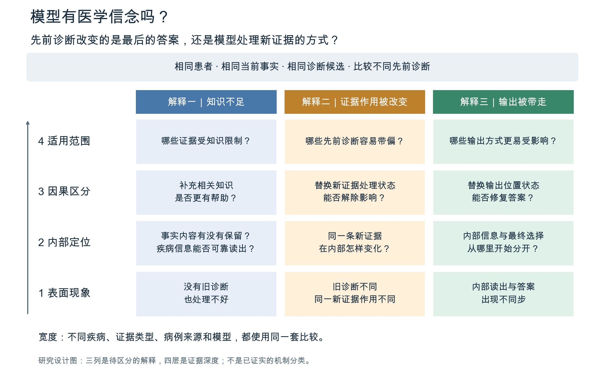

# 模型有医学信念吗？——重新确定论文要解释什么

2026-11-19 · v0.7研究重构。本文更新问题和论证，不宣称完成了新的机制实验。旧稿、原始记录和失败结果全部保留。

## 先把判断说清楚

**现在有足够的现象值得研究，但还没有一个经得起检验的中心机制发现。** 上版把“轨迹、探针、注意力、干预、换模型”依次排列，读者看到了我们做了什么，却不清楚这些实验共同解释了什么。再增加同类病例，能够提高统计把握，不能自动补上这个缺口。

论文继续研究医学信念：新证据到来后，模型怎样形成、修正和落实诊断。我们把这个大问题集中到一个能被实验回答的矛盾：

> **同一份医学事实，为什么会因为先前诊断不同而产生不同结论？变的是最后的答案，还是模型处理新证据的方式？**

先前诊断是我们用来检验机制的变量，研究对象仍是医学证据如何被采用。正常修正、被带偏和重新恢复都进入同一分析；不能只挑模型犯错的病例。

## 先看一个能讲明白的例子

MedQA的一道题：55岁男性，长期关节疼痛。模型前四轮都选择“骨关节炎”；加入手指末端关节结节这条原文后，转向“强直性脊柱炎”，后续两轮没有回来。完整题目的来源答案是骨关节炎。把同一批事实倒序呈现，它又选择了骨关节炎。

这是我们实际观察到的结果。它提出了问题，却还没有解释原因：模型是不懂这条体征，受上下文牵引，还是生成病名时出了偏差？而且这个病例加入错误旧诊断后反而答对，说明不能给每个例子都套上“旧诊断必然有害”的故事。[原题、逐轮记录及全部对照](../../results/26_external_medqa/cases/medqa_test_0177.md)

## 这栋楼怎样搭

横向是三种**相互竞争、也可能并存的解释**；纵向是每种解释都必须经过的证据层次。模型大小、疾病种类和病例来源贯穿整张表。

| 证据层次 | 解释一：没有掌握所需知识 | 解释二：旧诊断改变了证据的作用 | 解释三：证据信息还在，答案被带走 |
|---|---|---|---|
| 表面发生了什么 | 没有旧诊断时也处理不好 | 同一条事实，在不同旧诊断下推动不同方向 | 内部读出与最后选择不同步 |
| 内部哪里不同 | 能否保留体征、否定、时间等内容 | 新证据进入时，哪些内容及疾病关系发生变化 | 疾病相关信息如何到达输出位置 |
| 什么干预能区分 | 提供相关知识后是否改善，匹配无关提示 | 替换新证据处理位置的状态，是否恢复更新 | 替换输出位置的状态，是否主要修复答案 |
| 能解释多大范围 | 哪类证据确实受知识限制 | 哪些疾病、证据和先前判断容易产生这种影响 | 哪些输出方式、模型配置更容易出现分离 |

**一行是解释深度，一列是一种可能原因。** 三列使用相同病例、相同诊断候选和相同评价，最后比较哪种解释覆盖哪些情况，而不是每个实验单独得出一句结论。

## 现有结果放在哪一层

| 现有结果 | 已经回答了什么 | 下一层尚缺什么 |
|---|---|---|
| 同24病，1.7B末层读出194/240，模型病名评分105/240 | 两种测量确实存在差距 | 问题文字分类器235/240：必须先分清病例格式线索与医学内容 |
| 87道原题加入错误旧诊断，答对数从45降到30 | 历史判断能损害终点诊断 | 是否改变了对**同一条新证据**的处理，而不只是重复病名 |
| 新重算24例：两侧首选都变12例；只输出变6例；只读出变1例；都不变5例 | 历史影响存在不同反应组合 | 首选不变不等于内部状态不变；这四格还不是四种机制 |
| 自然更新中的疾病方向在末层有可复现的评分作用 | 该局部方向参与了病名评分 | 末层锚点干预主要作用于首词元，还没有定位医学证据的处理过程 |

此前“模型早就知道正确诊断，只是没有说出来”的措辞应撤回。更准确的判断是：**某些疾病相关信息可被外部读出，但这些信息是什么、模型怎样使用它们，仍需区分。** [数值和解释审计](EVIDENCE_AUDIT.md)

## 什么样的结果才值得成为中心发现

**候选结论A：先前诊断改变的，不只是答案，还有同一条新证据的作用。** 要看到逐条证据的配对差异，排除病名重复和提示格式，再用证据处理位置的干预复现或解除这种差异。

**候选结论B：部分错误发生在“已经更新”到“说出诊断”之间。** 要证明与证据有关的信息可靠保留、能够跨病例读出，并且干预输出环节比干预证据环节更能解除该类错误。只有读出准确率更高不够。

**候选结论C：错误有不同来源，同一种修复对不同错误有不同效果。** 若知识补充、证据状态替换和输出状态替换分别修复不同病例，而且能在未见病例中预测这种差异，文章就得到了一套有解释力的机制分型。

这些是待验证的结论。最终可能只支持其中一个，也可能发现现象主要来自数据线索或病名接口；届时应相应收缩主张。已有研究已涉及临床锚定、内部读出和干预，本研究的创新需要落在**被证实的区别及其解释能力**上。[近邻研究与定位](EVIDENCE_AUDIT.md#直接影响定位的已有工作)

## 正文怎么讲

1. **一个矛盾**：同样的医学事实，为什么得到不同诊断？用上述原题开场，随后给全体病例结果。
2. **三种解释**：先承认表面相同的错误可能来自不同环节，写出各自能被推翻的预测。
3. **配对检验**：固定新证据，改变先前诊断；同时观察事实内容、疾病信息和最终答案。
4. **因果区分**：分别动证据处理环节和输出环节，检验哪类错误能被解除。正文的重点放在这里。
5. **适用范围**：同一套判据跨疾病组、证据类型、来源和模型验证；解释什么时候成立、什么时候失效。

病例轨迹是入口，内部测量是证据，干预负责区分原因，跨病例检验决定结论范围。注意力图只用于定位候选位置，不单独承担机制结论。

**下一步最优先的是做出区分三种解释的实验。** 先用现有病例完成定位和测量验证，再冻结判据、扩大到未见病例；不继续以“又跑了几千个条件”作为论文前进的主要依据。[具体执行设计](EXPERIMENT_DESIGN.md)
