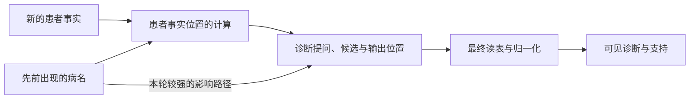

# 文章怎样一层层讲清楚医学信念

工作题目：**模型有医学信念吗？诊断历史如何进入证据更新与答案形成**。

读者应先看到一个完整病人的判断变化，再看到同一种现象在总体中占多少，最后才进入模型。不要从层号、读出器准确率或数据集清单开始。

## 入口：同一患者，旧病名改变了后来发生什么

MedQA病例medqa_train_09811的来源答案是系统性红斑狼疮。中性历史下，模型沿全部13组原文一直首选该答案；错误历史下，模型第2组也曾转向它，但第6组后转回播散性淋球菌关节炎，直到完整检查输入后仍未改回。展示四候选支持和完整证据，而不把这一个例子当总体结论。

这个例子引出三个可以彼此区分的问题：

| 要解释什么 | 为什么不能只看最终准确率 | 本轮对应证据 |
|---|---|---|
| 新事实怎样改变疾病判断 | 总分看不到先改对又离开的过程 | 全部94例逐组轨迹与520例严格文本终点复核 |
| 旧病名如何与新事实竞争 | 错误历史既可能改变证据作用，也可能直接压向某个答案 | 中性/错误/未采纳病名对照；同一末组证据的配对增量 |
| 图里的内部变化是否真能控制答案 | 原输出头可能在某层突然放大差距；大变化不等于关键开关 | 状态替换、attention路径阻断、末层MLP失败检验及尺度分解 |

## 第一层：先建立总体事实

540例来自三个来源，另报告严格520例。中性历史和错误历史下，完整病名评分及实际生成均下降；仅提及一个未采纳病名也会造成下降。总体结果、各来源、开发/确认分开。对MMLU小样本的宽区间照实报告，不用“每个来源都显著”概括。

追加同格式轮换：把四个候选依次写入未采纳字段。严格47例上，被提及候选得到的平均支持为42.6%（1.7B）和35.9%（4B），高于没有病名选择性作用时的25%。这说明具体出现哪个病名就能改变支持的分配，不只是JSON多一个字段。

## 第二层：拆开“答案偏了”和“证据不再起作用”

错误历史下，新证据的作用仍与中性历史有正相关，但一部分病例出现反向更新。给出有符号效应、绝对差异和方向变化。证据倒序总分不变却有93例换诊断，说明稳定总分与稳定判断并非一回事。

这一层的结论不是“模型都拒绝证据”。它要明确：历史造成的整体偏移与对每条证据的响应，是两个不同的量。

## 第三层：把时间和网络深度放到同一张图里

横轴原文逐组加入，纵轴模型层。上方展示实际病名首选，下面展示四候选代码投影。对应原文与候选，读者能看见朝哪个病移动。所有94例均给出，不只挑异常。早层代码一致性低的部分明确标出测量能力有限。

再把终点每层拆成attention和MLP，展示历史分差不是一路同向积累，而有放大与抵消。1.7B和4B的层读表分别画，不能用同一个绝对层号比较两种深度。

## 第四层：问“动哪里真的能改判断”

第14/21层的新事实、旧事实与诊断位置替换，是自然状态对照；两个同范数随机方向和自身替换帮助排除任意扰动。输出位置的效应不等于历史影响只起源于输出，因此继续对历史→事实与历史→诊断段两条路分别阻断。

完成的通路实验在两个配置上得到一致差异：阻断历史直达诊断段，历史效应大幅减弱；只阻断历史进入患者事实位置，效应仍很强。原确认48例中，错误历史影响由−6.84降至−0.37（1.7B）、由−11.00降至−0.43（4B）。中性历史正常作答没有随之明显下降。这是本轮最主要的内部机制结果，诊断段包含任务、候选与输出位置。

最后一层MLP的读表增幅很大，但换入中性历史的MLP并没有可靠胜过随机扰动。尺度分解说明，读表的大部分末层跳变是已有差距被放大。这一失败结果正好回答“能从内部读到变化，是否就抓到了医学信念开关”。

## 第五层：模型能力和适用范围

4B在同94例答题更准，但错误历史仍导致下降。大小与精度同时变化，不能从两个配置宣称普遍规模规律。三个考试来源增加来源覆盖；真实临床时间线、多模型家族、自动回填自生成诊断和医学专用模型留作明确的后续验证轴。

## 主文应保留的图

1. 一个患者的逐证据四候选轨迹，连接逐层图；随后立即给全体分布。
2. 三来源历史对照和实际生成复核。
3. 同一新增证据的配对作用，以及证据倒序的个体转移。
4. 全体逐层代码可靠性、模块读表与跨配置比较。
5. 内部位置干预和两路阻断。
6. 末层大跳变、替换失败、读表尺度分解，作为机制判断的关键反例。

将所有病例图谱、每层每头注意力、逐患者数据、词元概率、完整代码和审计放附录。主文不堆阶段编号，不把实验数量作为结论。

## 三部分怎样共同构成文章

逐轮轨迹观察新事实进入之后发生什么；历史对照与路径干预区分两种输入如何汇入诊断；末层检验分析汇入后的差距怎样被输出读表放大。三部分共同解释同一个判断过程。
