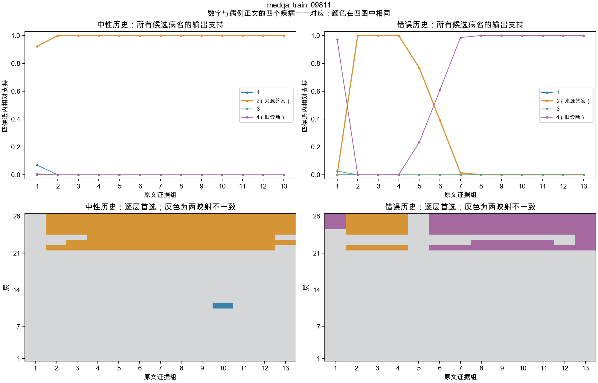
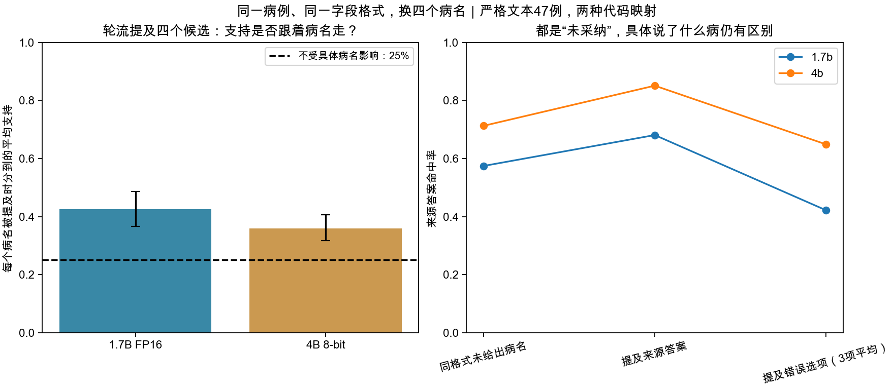
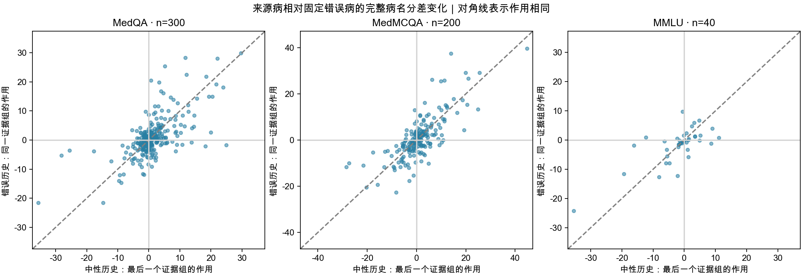
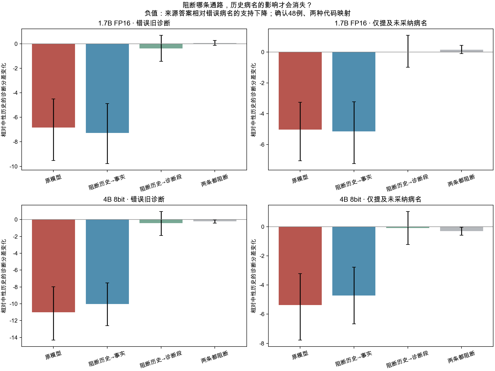
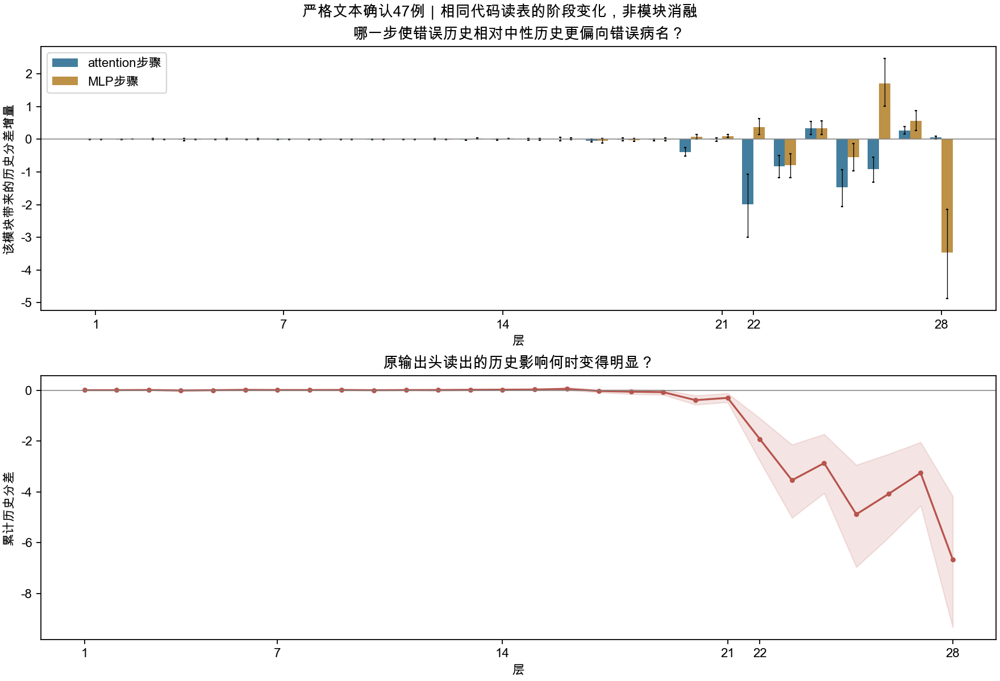
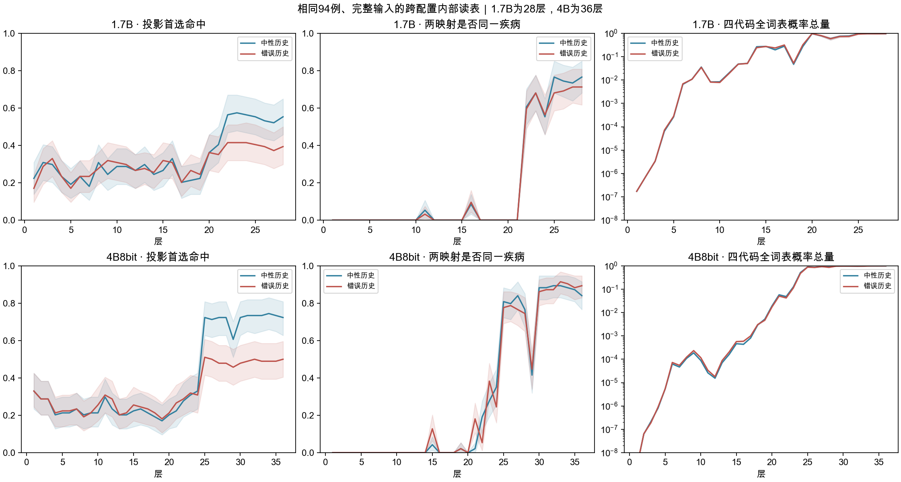

# 模型有医学信念吗？诊断历史如何进入证据更新与答案形成

## 摘要

当新的患者事实到来时，语言模型如何更新其诊断倾向，先前出现的病名又如何参与这一过程？我们在MedQA、MedMCQA和MMLU的540个新增诊断病例上固定患者原文，配对操作中性、错误与未采纳候选历史；对94例展开每个累计证据前缀的28层记录，并在4B配置复核。实验同时测量完整病名评分、真实生成、候选代码投影、内部位置替换与注意力通路。错误历史与未采纳候选均可降低表现，尽管新增证据仍对判断产生影响。两个配置的通路阻断一致显示：历史影响主要经由直接通向诊断作答段的连接传播，阻断其进入患者事实位置的连接并未相应消除影响。末层读表的大变化也不等于一个有效的疾病偏向开关：自然MLP状态替换没有可靠改善，读表增幅主要来自尺度放大。本文以逐病例轨迹和总体配对实验，将医学信念的形成、历史依赖及读出尺度区分开来。

## 1 引言

一份医学病例的最终诊断掩盖了判断的形成过程。模型可能早已选中来源答案，随后又离开；也可能在新事实到来后改变候选支持，却仍被一个旧病名牵引。若只统计完整病例答对多少，这些情况会被混合在同一个总分中。

已有研究已观察到临床模型受到[先前评估](https://aclanthology.org/2026.emnlp-main.2434/)和[叙述方式](https://arxiv.org/abs/2607.27384v3)的影响，并通过[激活干预](https://aclanthology.org/2026.acl-srw.54.pdf)研究医疗模型中的偏差。本文进一步区分同一患者中的几个计算关系：证据怎样推动候选诊断；未采纳病名和先前诊断怎样进入该过程；内部读表中显著的变化是否真的能够改变答案。

我们保持病例事实固定，首先建立患者级配对结果，再沿证据轮次与网络深度追踪状态，最后干预具体位置和信息连接。所有病例均保留原始选项和来源答案，所有内部病例均给出图谱；文本审计和失败检验一并报告。模型参数冻结，“信念更新”指随上下文变化的诊断支持与内部计算变化。

## 2 研究设计

研究采用三个考试来源540例，开发181例、确认359例。主模型Qwen3-1.7B FP16；完整内部轨迹94例，同病例以Qwen3-4B 8-bit复核。除明确提供来源答案的oracle历史正对照外，来源答案用于评分及固定对照选择，不输入患者事实；每轮是重新输入累计原文和固定历史，并非自主回填上一轮答案。运行后按原文进行严格质量审计，形成520例敏感性队列。

输出与内部测量的定义、患者级统计、随机/反向/自身干预、源数据和实现细节见[完整方法](METHODS.md)。最直接的研究先例与贡献边界见[相关工作](RELATED_WORK.md)。

## 3 从患者轨迹到总体结果

### 3.1 一个患者的诊断轨迹

一位患者逐步提供关节症状、既往情况、查体和化验。原题最终答案是**系统性红斑狼疮**。我们保持患者原文不变，只改变上下文中先前的诊断。

没有先前定论时，模型沿13组输入一直选择红斑狼疮。先前被写成“播散性淋球菌关节炎”时，它第2组一度转回红斑狼疮，第6组后又转回旧病名，直到最后的化验输入仍未改回。

| 原文组 | 中性历史的首选 | 错误历史的首选 | 错误历史下对红斑狼疮的相对支持 |
|---:|---|---|---:|
| 1 | 系统性红斑狼疮 | 播散性淋球菌关节炎 | 0.18% |
| 2 | 系统性红斑狼疮 | 系统性红斑狼疮 | 99.96% |
| 5 | 系统性红斑狼疮 | 系统性红斑狼疮 | 76.62% |
| 6 | 系统性红斑狼疮 | 播散性淋球菌关节炎 | 39.22% |
| 13 | 系统性红斑狼疮 | 播散性淋球菌关节炎 | <0.01% |

这里的支持只在本例四个候选里比较。中途没有独立诊断标签，所以只描述模型怎样移动；完整输入才用原题答案评价。[查看该例全部证据、四病名曲线与逐层图](../../results/34_multisource_depth/cases/medqa_train_09811.md)。

这是一例说明，下面的结论来自全部病例，不按异常大小挑选。

### 3.2 多来源总体

| 来源 | 新增病例 | 中性历史答对 | 错误旧诊断答对 | 只提及未采纳病名答对 |
|---|---:|---:|---:|---:|
| MedQA | 300 | 177 | 128 | 131 |
| MedMCQA | 200 | 105 | 86 | 93 |
| MMLU | 40 | 20 | 18 | 18 |
| 合计 | 540 | 302 | 232 | 242 |

这是 **540例、三个公开考试来源**，保留原文、原选项和来源答案；没有让模型编造病例。主模型Qwen3-1.7B。全部540例记录加入最后一组前后的28层；94例展开全部537个累计前缀，并在同94例上复核4B配置。

文字审计标出20例任务尾语或缺失引用材料；严格520例中，中性、错误历史、仅提及分别答对 **289/224/234** 例，历史效应保持。内部图谱严格子集为92例；确认内部子集为47例。所有原540例结果仍保留。[数据来源与审计](../../research_v4/DATA_CARD.md) · [严格子集结果](../../results/38_text_quality/RESULTS.md)。

## 4 历史病名对诊断的选择性作用

在540例中，错误历史相对中性历史的完整病名准确率变化为 **-12.96个百分点，95%CI [-17.04, -8.89]**；仅提及条件相对变化为 **-11.11个百分点，95%CI [-15.00, -7.22]**。实际贪心生成也从 **297/540降至229/540**，因此现象不只出现在候选评分表中。MMLU样本较少，其来源单独估计区间较宽。

为进一步检查病名本身的选择性作用，我们保持字段格式不变，把四个候选轮流放进“未采纳候选”字段；另设同格式空病名。若具体提到哪个病完全不影响输出，每个病被提到时拿到的支持平均应为25%。

| 模型 | 严格病例 | 被提及病名的平均支持，95%CI | 25%基准以上的量 |
|---|---:|---|---|
| 1.7b | 47 | 42.60% [36.69, 48.73] | 17.60个百分点，95%CI [11.69, 23.73] |
| 4b | 47 | 35.92% [31.75, 40.70] | 10.92个百分点，95%CI [6.75, 15.70] |

这个追加控制回答的是支持是否跟着未采纳的具体病名走。它不要求模型先明确作出那个诊断。[同格式病名轮换结果](../../results/41_name_counterbalance/RESULTS.md)。

## 5 证据响应与历史偏移

同一最后证据组，在中性与错误历史下的作用仍有正相关：MedQA为0.578、MedMCQA为0.716、MMLU为0.649。与此同时，126/540例出现了方向相反且两侧变化均超过预定阈值的更新。

因此要分开看两件事：**旧病名把诊断分布整体推向哪里；新事实又在此基础上推动了多少。** 平均交互接近0不代表每例都相同，单例反向也不代表模型普遍拒绝证据。

在94条完整轨迹中，中性历史有47例全程不换首选，29例曾选中最终来源答案后又离开；错误历史分别为56例和14例。这里保留早改对、晚改对、先选中又离开、始终不变等全部轨迹。

把完整证据组倒序后，总准确率仍为315/540，但 **93例换了诊断**：36例从对变错、36例从错变对，另21例在错误候选之间移动。总分相同会掩盖个体判断的不稳定。

[全部逐组轨迹与顺序控制](../../results/37_behavior_checks/RESULTS.md)。

## 6 内部位置与信息通路

在原先划定的48例确认队列中，第21层诊断位置的自然状态替换，相对同位置、同范数随机替换，改善来源病相对错误病的分差 **4.55，95%CI [2.51, 6.54]**，并使10/48例换了首选。同层新、旧事实位置替换的作用很小；跨位置自然差的大小不同，因此继续做路径检验。

我们分别阻断历史进入患者事实位置、以及历史直接进入后面的诊断任务/候选/输出位置。每种阻断都重新比较中性与错误/提及历史，并检查正常作答是否受损。

**两个模型都支持同一个解释：旧病名主要通过直接通向后续诊断作答部分的连接影响选择，而不必先经过患者事实位置。**

在原先划定的48例确认病例上，分别关闭两条连接。下表量的是旧诊断让模型向错误候选偏了多少：负值越大，偏向越强；接近0表示这一历史影响较小。数值是来源答案与固定错误候选的对数分数差的变化，不是准确率或患病概率。

| 连接设置 | 1.7B错误历史影响，95%CI | 4B错误历史影响，95%CI |
|---|---|---|
| 都保留 | −6.84 [−9.53, −4.50] | −11.00 [−14.31, −7.97] |
| 不让历史进入患者事实位置 | −7.27 [−9.78, −4.89] | −10.02 [−12.61, −7.53] |
| 不让历史直接进入诊断作答段 | −0.37 [−1.43, 0.69] | −0.43 [−1.88, 0.94] |

关闭直达诊断段的连接，相对原模型的配对衰减分别为 **6.47 [4.00, 9.05]** 和 **10.56 [7.50, 13.89]**，两者Holm校正p均为0.00050。仅提及未采纳病名时也出现同样的路径差异。

这个结果不是靠让模型无法正常回答得到的：中性历史下，1.7B命中率由57.29%变为58.33%，4B由68.75%变为73.96%；四个答案代码的总概率接近1。这些命中率先在每病例的两套代码映射内平均，不能直接当作整数患者数。

去掉1例有任务尾语的病例后，严格47例中，错误历史的影响同样由 **−6.66变为−0.21（1.7B）**、**−10.99变为−0.34（4B）**。这支持本轮的通路定位。这里的“诊断段”包含提问、候选和输出位置，不只指最后一个词元或最后一层；经事实路径仍可有小的残余影响，当前实验没有证明其严格为零。

[自然位置替换](../../results/33_multisource_causality/RESULTS.md) · [未采纳病名的替换](../../results/35_unendorsed_name/RESULTS.md) · [完整通路结果](../../results/36_history_routes/RESULTS.md)。

## 7 读表放大与因果干预

同一个病人的每轮输入，我们都保存四个候选的逐层读表；并检查换一套答案代码后，是否还指向同一疾病。1.7B早层大多不能稳定使用这套代码读表，后层才逐渐能稳定区分候选。灰色区域表示两套代码不一致，不给它强行起一个疾病名字。

把末层再拆开，严格47例队列中，最后MLP步骤的历史分差变化为 **−3.47**。看图很容易把它当成关键开关；但换入中性历史的末层MLP后，相对随机扰动的命中率增益只有 **0.53个百分点，95%CI [−3.19, 4.26]**，没有可靠改善。

继续分解输出读表：末层前后的归一化增益约为 **1.85–1.86倍**；上述−3.47变化中，尺度项为 **−3.33**，分子项为 **−0.13**。这里的代数分解说明：**图上的大部分末层跳变，是已有差距被读表放大了。** 它不能直接当作模型在该层突然获得新医学知识的证据。

[逐模块结果](../../results/39_module_readout/RESULTS.md) · [末层替换的失败检验](../../results/40_final_mlp/RESULTS.md) · [尺度分解](../../results/40_final_mlp/NORMALIZATION.md)。

每轮变化的是模型激活、注意力和输出支持；模型参数始终冻结，权重文件前后哈希一致。

## 8 跨配置复核

同94例完整病名评分，中性历史下1.7B答对48例、4B答对71例；错误历史下分别为39例和56例。**4B答题更准，旧诊断的影响仍然存在。** 1.7B为FP16、4B为8-bit，这两种配置不足以单独判断规模规律。

[逐层与跨配置结果](../../results/34_multisource_depth/RESULTS.md)。

## 9 讨论与后续检验

本文将可见的诊断支持、患者事实位置的计算状态、诊断位置的状态以及输出读表区分为相联系的测量对象。当前结果支持一个具体关系：新事实仍推动候选判断，旧病名又可经直接通向诊断作答段的连接影响选择。这种影响并不要求先通过患者事实位置传播；同时，单个层的投影跳变可能被尺度放大。完整病例准确率、轨迹稳定性与内部可干预性分别提供不同证据。

现有研究范围是英文考试诊断题、同一模型家族的两个配置和直接作答方式。下一项扩展应在真实纵向临床数据、其他模型家族、医学专用模型及自动传递自产诊断的条件下，检验本轮具体的路径与尺度结论。末层追加实验与病名轮换是在主观察后提出，作为探索性控制；后续独立样本应保持对应操作固定。

## 10 结语

医学判断的变化需要同时从证据、历史与内部计算观察。本文的配对设计和完整图谱把“更新了什么”“历史从哪里进入”和“读表怎样放大变化”变成可复核的问题，为进一步研究模型医学信念提供了具体的机制证据与明确的检验对象。
