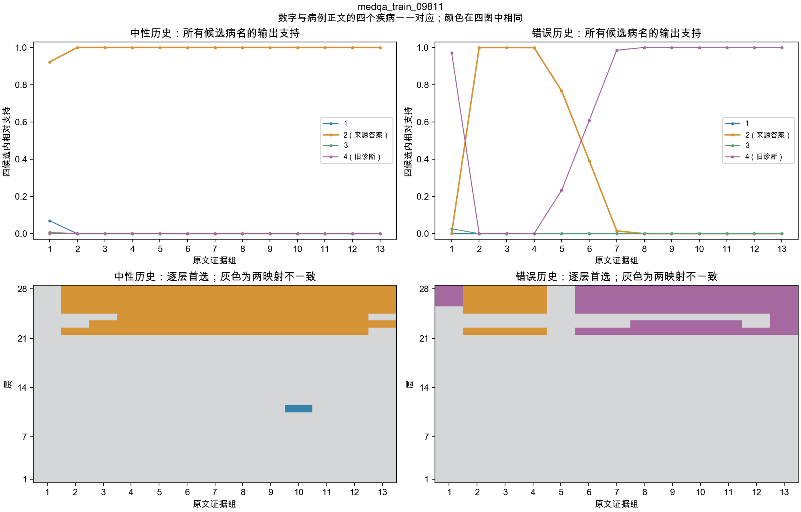
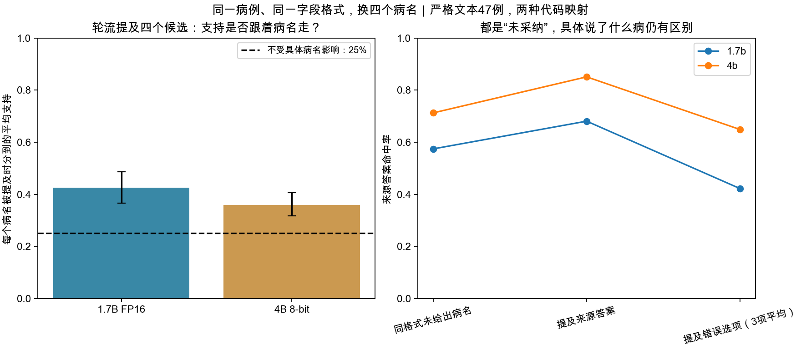
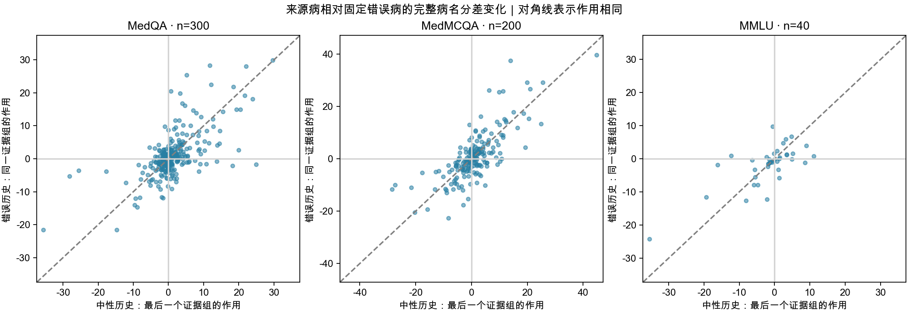
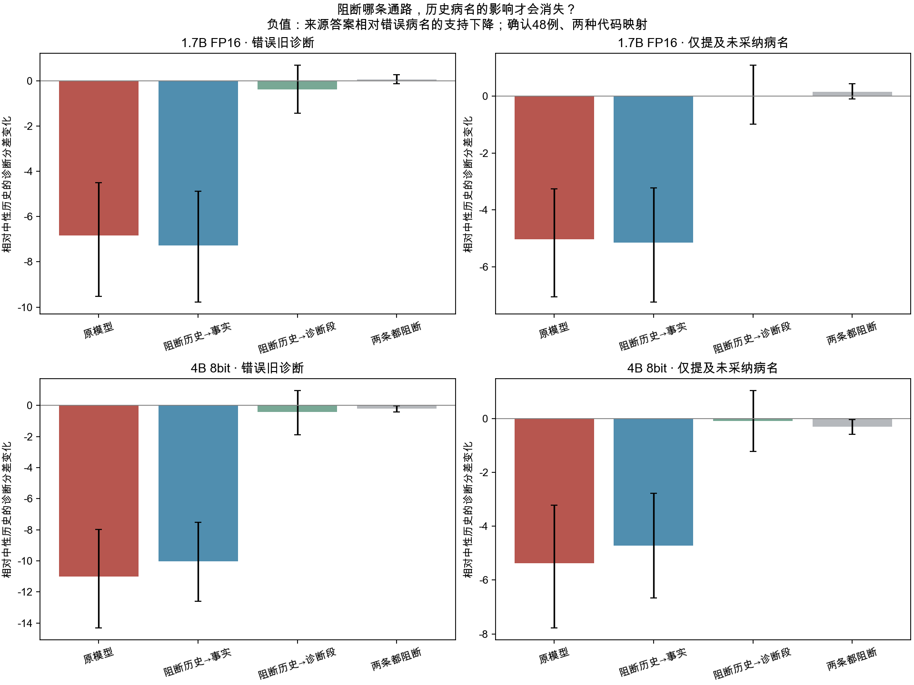
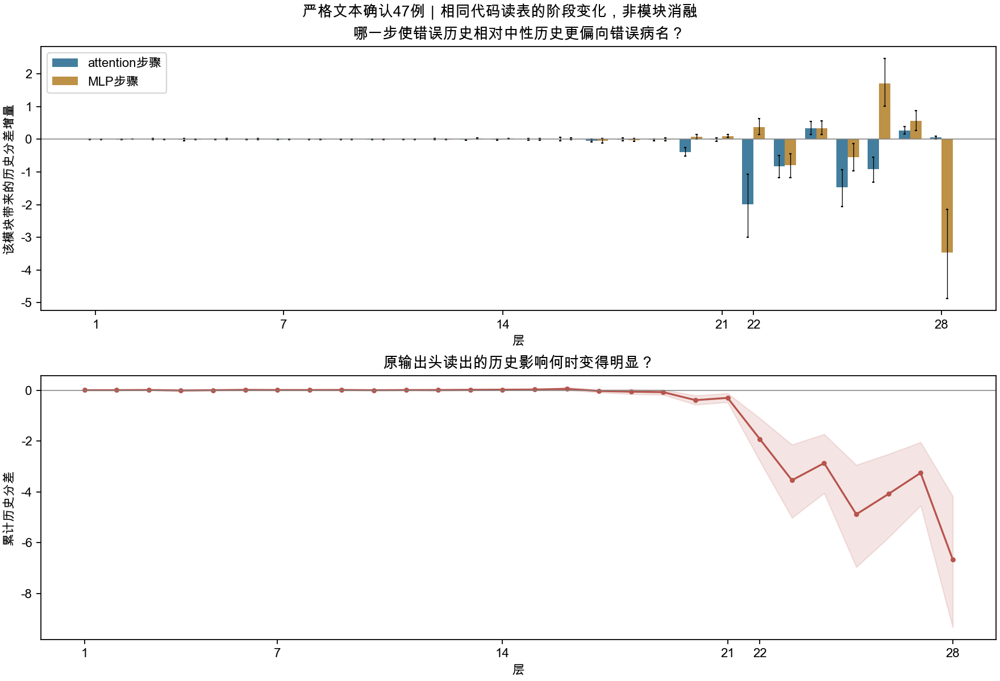
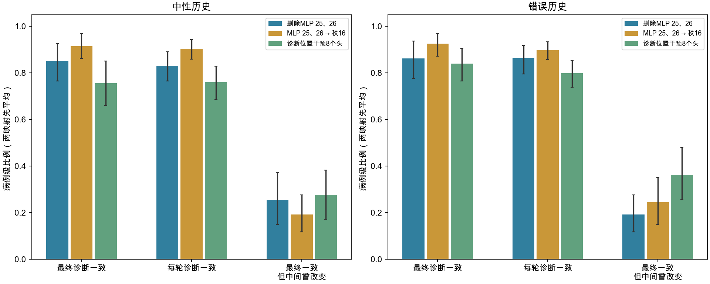
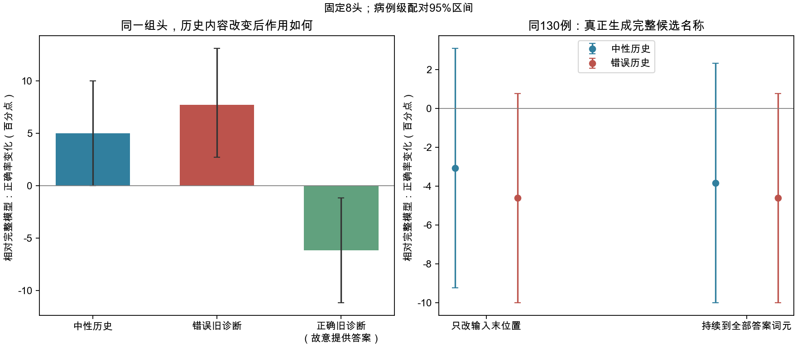
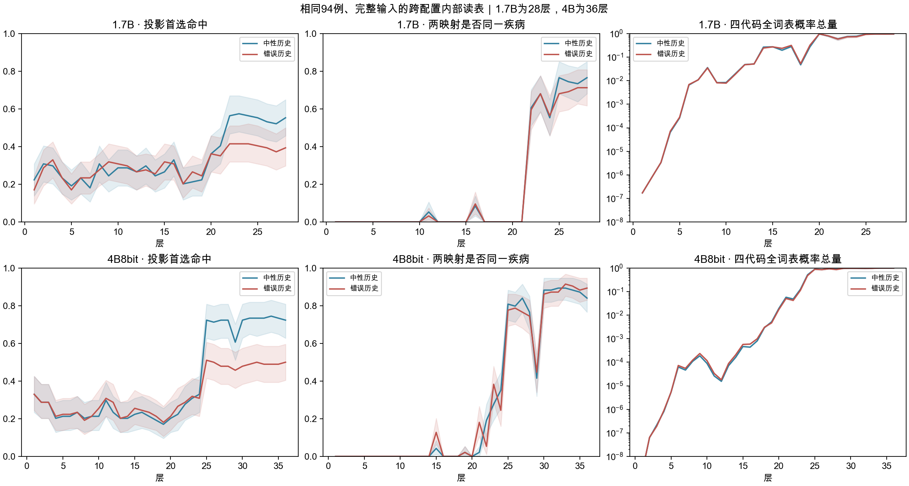

# 模型有医学信念吗？证据更新、历史利用与诊断计算的可替代性

## 摘要

当患者事实逐步增加时，语言模型的诊断倾向怎样更新，哪些内部计算决定了这种变化？我们在MedQA、MedMCQA与MMLU的540个诊断类题目上配对操作事实与历史，对94例展开内部轨迹，并在严格520例中进行结构研究。研究依次比较候选支持、逐层投影、实际干预与计算替换。两个模型配置中的路径实验显示，旧病名可直接通过诊断作答段影响选择；内部读表的大变化也可能来自尺度放大。进一步在1.7B模型中定位全部层与头：固定8头干预在345例与另130例上提高错误历史下的代码选择正确率，但损害正确历史利用，且未改善完整候选生成。同层高历史注意力头的干预反而降低表现。第25、26层MLP的小型替换使整模型参数减少4.38%，并恢复直接删除丢失的部分诊断功能；47例逐证据复核显示，约19%—24%的轨迹最终判断相同，中途仍发生改变。结果将医学信念的证据响应、历史利用、作答接口与结构保持联系起来，并说明这些能力需要分别检验。

## 1 引言

一份医学病例的最终诊断掩盖了判断的形成过程。模型可能早已选中来源答案，随后又离开；也可能在新事实到来后改变候选支持，却仍被一个旧病名牵引。若只统计完整病例答对多少，这些情况会被混合在同一个总分中。

已有研究已观察到临床模型受到[先前评估](https://aclanthology.org/2026.emnlp-main.2434/)和[叙述方式](https://arxiv.org/abs/2607.27384v3)的影响，并通过[激活干预](https://aclanthology.org/2026.acl-srw.54.pdf)研究医疗模型中的偏差。本文进一步区分同一患者中的几个计算关系：证据怎样推动候选诊断；未采纳病名和先前诊断怎样进入该过程；内部读表中显著的变化是否真的能够改变答案。

我们保持病例事实固定，首先建立患者级配对结果，再沿证据轮次与网络深度追踪状态，最后干预具体位置和信息连接。所有病例均保留原始选项和来源答案，所有内部病例均给出图谱；文本审计和失败检验一并报告。模型参数冻结，“信念更新”指随上下文变化的诊断支持与内部计算变化。

内部分析进一步面临一个检验：如果我们找到了真正参与诊断的计算，能否减少它的规模，或减弱其中传播错误历史的作用？我们同时检查来源答案正确率、与原模型的个体诊断一致率以及逐证据更新路径。一个部件可能可替代，却仍影响中间判断；同一组头可能传递正确历史，也可能传递错误历史。代码选择与完整候选生成的配对实验进一步检验这种作用能否跨作答形式保持。

## 2 研究设计

研究采用三个考试来源540例，开发181例、确认359例。主模型Qwen3-1.7B FP16；完整内部轨迹94例，同病例以Qwen3-4B 8-bit复核。除明确提供来源答案的oracle历史正对照外，来源答案用于评分及固定对照选择，不输入患者事实；每轮是重新输入累计原文和固定历史，并非自主回填上一轮答案。运行后按原文进行严格质量审计，形成520例敏感性队列。

输出与内部测量的定义、患者级统计、随机/反向/自身干预、源数据和实现细节见[v0.8方法](../v08_multisource/METHODS.md)；新增结构实验见[测量与设计](../../research_v5_structural/MEASUREMENT.md)。最直接的研究先例与贡献边界见[v0.8相关工作](../v08_multisource/RELATED_WORK.md)及[新增结构相关工作](../../research_v5_structural/RELATED_WORK.md)。

新增结构实验在严格520例中分离18例定位与拟合、27例组合开发、345例首批结构验证、130例随后冻结的复核。后两批未用于本轮位置选择和模块拟合；它们已有旧版原模型记录，不称全新收集的数据。60例名称生成与47例逐层结构轨迹是345例的子集，不重复计入病例数。结构改动仅在Qwen3-1.7B验证；4B结果对应前述历史通路实验。

## 3 从患者轨迹到总体结果

### 3.1 一个患者的诊断轨迹

一位患者逐步提供关节症状、既往情况、查体和化验。原题最终答案是**系统性红斑狼疮**。我们保持患者原文不变，只改变上下文中先前的诊断。

没有先前定论时，模型沿13组输入一直选择红斑狼疮。先前被写成“播散性淋球菌关节炎”时，它第2组一度转回红斑狼疮，第6组后又转回旧病名，直到最后的化验输入仍未改回。

| 原文组 | 中性历史的首选 | 错误历史的首选 | 错误历史下对红斑狼疮的相对支持 |
|---:|---|---|---:|
| 1 | 系统性红斑狼疮 | 播散性淋球菌关节炎 | 0.18% |
| 2 | 系统性红斑狼疮 | 系统性红斑狼疮 | 99.96% |
| 5 | 系统性红斑狼疮 | 系统性红斑狼疮 | 76.62% |
| 6 | 系统性红斑狼疮 | 播散性淋球菌关节炎 | 39.22% |
| 13 | 系统性红斑狼疮 | 播散性淋球菌关节炎 | <0.01% |

这里的支持只在本例四个候选里比较。中途没有独立诊断标签，所以只描述模型怎样移动；完整输入才用原题答案评价。[查看该例全部证据、四病名曲线与逐层图](../../results/34_multisource_depth/cases/medqa_train_09811.md)。

这是一例说明，下面的结论来自全部病例，不按异常大小挑选。

### 3.2 多来源总体

| 来源 | 新增病例 | 中性历史答对 | 错误旧诊断答对 | 只提及未采纳病名答对 |
|---|---:|---:|---:|---:|
| MedQA | 300 | 177 | 128 | 131 |
| MedMCQA | 200 | 105 | 86 | 93 |
| MMLU | 40 | 20 | 18 | 18 |
| 合计 | 540 | 302 | 232 | 242 |

这是 **540例、三个公开考试来源**，保留原文、原选项和来源答案；没有让模型编造病例。主模型Qwen3-1.7B。全部540例记录加入最后一组前后的28层；94例展开全部537个累计前缀，并在同94例上复核4B配置。

文字审计标出20例任务尾语或缺失引用材料；严格520例中，中性、错误历史、仅提及分别答对 **289/224/234** 例，历史效应保持。内部图谱严格子集为92例；确认内部子集为47例。所有原540例结果仍保留。[数据来源与审计](../../research_v4/DATA_CARD.md) · [严格子集结果](../../results/38_text_quality/RESULTS.md)。

## 4 历史病名对诊断的选择性作用

在540例中，错误历史相对中性历史的完整病名准确率变化为 **-12.96个百分点，95%CI [-17.04, -8.89]**；仅提及条件相对变化为 **-11.11个百分点，95%CI [-15.00, -7.22]**。实际贪心生成也从 **297/540降至229/540**，因此现象不只出现在候选评分表中。MMLU样本较少，其来源单独估计区间较宽。

为进一步检查病名本身的选择性作用，我们保持字段格式不变，把四个候选轮流放进“未采纳候选”字段；另设同格式空病名。若具体提到哪个病完全不影响输出，每个病被提到时拿到的支持平均应为25%。

| 模型 | 严格病例 | 被提及病名的平均支持，95%CI | 25%基准以上的量 |
|---|---:|---|---|
| 1.7b | 47 | 42.60% [36.69, 48.73] | 17.60个百分点，95%CI [11.69, 23.73] |
| 4b | 47 | 35.92% [31.75, 40.70] | 10.92个百分点，95%CI [6.75, 15.70] |

这个追加控制回答的是支持是否跟着未采纳的具体病名走。它不要求模型先明确作出那个诊断。[同格式病名轮换结果](../../results/41_name_counterbalance/RESULTS.md)。

## 5 证据响应与历史偏移

同一最后证据组，在中性与错误历史下的作用仍有正相关：MedQA为0.578、MedMCQA为0.716、MMLU为0.649。与此同时，126/540例出现了方向相反且两侧变化均超过预定阈值的更新。

因此要分开看两件事：**旧病名把诊断分布整体推向哪里；新事实又在此基础上推动了多少。** 平均交互接近0不代表每例都相同，单例反向也不代表模型普遍拒绝证据。

在94条完整轨迹中，中性历史有47例全程不换首选，29例曾选中最终来源答案后又离开；错误历史分别为56例和14例。这里保留早改对、晚改对、先选中又离开、始终不变等全部轨迹。

把完整证据组倒序后，总准确率仍为315/540，但 **93例换了诊断**：36例从对变错、36例从错变对，另21例在错误候选之间移动。总分相同会掩盖个体判断的不稳定。

[全部逐组轨迹与顺序控制](../../results/37_behavior_checks/RESULTS.md)。

## 6 内部位置与信息通路

在原先划定的48例确认队列中，第21层诊断位置的自然状态替换，相对同位置、同范数随机替换，改善来源病相对错误病的分差 **4.55，95%CI [2.51, 6.54]**，并使10/48例换了首选。同层新、旧事实位置替换的作用很小；跨位置自然差的大小不同，因此继续做路径检验。

我们分别阻断历史进入患者事实位置、以及历史直接进入后面的诊断任务/候选/输出位置。每种阻断都重新比较中性与错误/提及历史，并检查正常作答是否受损。

**两个模型都支持同一个解释：旧病名主要通过直接通向后续诊断作答部分的连接影响选择，而不必先经过患者事实位置。**

在原先划定的48例确认病例上，分别关闭两条连接。下表量的是旧诊断让模型向错误候选偏了多少：负值越大，偏向越强；接近0表示这一历史影响较小。数值是来源答案与固定错误候选的对数分数差的变化，不是准确率或患病概率。

| 连接设置 | 1.7B错误历史影响，95%CI | 4B错误历史影响，95%CI |
|---|---|---|
| 都保留 | −6.84 [−9.53, −4.50] | −11.00 [−14.31, −7.97] |
| 不让历史进入患者事实位置 | −7.27 [−9.78, −4.89] | −10.02 [−12.61, −7.53] |
| 不让历史直接进入诊断作答段 | −0.37 [−1.43, 0.69] | −0.43 [−1.88, 0.94] |

关闭直达诊断段的连接，相对原模型的配对衰减分别为 **6.47 [4.00, 9.05]** 和 **10.56 [7.50, 13.89]**，两者Holm校正p均为0.00050。仅提及未采纳病名时也出现同样的路径差异。

这个结果不是靠让模型无法正常回答得到的：中性历史下，1.7B命中率由57.29%变为58.33%，4B由68.75%变为73.96%；四个答案代码的总概率接近1。这些命中率先在每病例的两套代码映射内平均，不能直接当作整数患者数。

去掉1例有任务尾语的病例后，严格47例中，错误历史的影响同样由 **−6.66变为−0.21（1.7B）**、**−10.99变为−0.34（4B）**。这支持本轮的通路定位。这里的“诊断段”包含提问、候选和输出位置，不只指最后一个词元或最后一层；经事实路径仍可有小的残余影响，当前实验没有证明其严格为零。

[自然位置替换](../../results/33_multisource_causality/RESULTS.md) · [未采纳病名的替换](../../results/35_unendorsed_name/RESULTS.md) · [完整通路结果](../../results/36_history_routes/RESULTS.md)。

## 7 读表放大与因果干预

同一个病人的每轮输入，我们都保存四个候选的逐层读表；并检查换一套答案代码后，是否还指向同一疾病。1.7B早层大多不能稳定使用这套代码读表，后层才逐渐能稳定区分候选。灰色区域表示两套代码不一致，不给它强行起一个疾病名字。

把末层再拆开，严格47例队列中，最后MLP步骤的历史分差变化为 **−3.47**。看图很容易把它当成关键开关；但换入中性历史的末层MLP后，相对随机扰动的命中率增益只有 **0.53个百分点，95%CI [−3.19, 4.26]**，没有可靠改善。

继续分解输出读表：末层前后的归一化增益约为 **1.85–1.86倍**；上述−3.47变化中，尺度项为 **−3.33**，分子项为 **−0.13**。这里的代数分解说明：**图上的大部分末层跳变，是已有差距被读表放大了。** 它不能直接当作模型在该层突然获得新医学知识的证据。

[逐模块结果](../../results/39_module_readout/RESULTS.md) · [末层替换的失败检验](../../results/40_final_mlp/RESULTS.md) · [尺度分解](../../results/40_final_mlp/NORMALIZATION.md)。

每轮变化的是模型激活、注意力和输出支持；原模型权重文件保持不变。下一节另拟合小型替换模块并改变运行时结构。

## 8 从内部机制到结构取舍

### 8.1 什么最接近最终诊断，什么真正影响诊断

在严格92例、521个累计前缀的投影中，第25层与同轮最终诊断已达到93.5%／94.3%的一致率（中性／错误历史）。但18例穷尽定位显示，第3层MLP和第20层注意力仍对最终诊断有强作用：分别删除它们，改变69.4%／72.2%及61.1%／44.4%的首选。**答案在后面变得容易读出来，前面的计算仍可能是形成答案所必需的。**

注意力大也不自动意味着作用大：448个头的历史注意力与删除后分布变化的描述性Spearman相关为0.285／0.272。我们依据实际重算后的答案变化定位部件。[每层、每头定位与数值对照](../../results/42_structural_localization/RESULTS.md)。

### 8.2 真正改结构以后发生了什么

定位18例、组合开发27例、结构留出345例互不重叠。留出来源为MedQA194、MedMCQA125、MMLU26。首批结构实验的独立病例总数为390，60例生成与47例轨迹均为345例的子集；另130例用于随后冻结的注意力头复核，见第7节。

| 结构 | 参数减少 | 中性：正确率 / 原诊断一致率 | 错误历史：正确率 / 原诊断一致率 |
|---|---:|---:|---:|
| 完整模型 | 0.00% | 58.26% / 100.00% | 40.00% / 100.00% |
| 运行前27层 | 2.93% | 58.84% / 97.25% | 40.43% / 95.94% |
| 删MLP 25、26 | 4.39% | 57.25% / 89.71% | 38.99% / 87.97% |
| MLP 25、26 → 秩16 | 4.38% | 59.42% / 94.35% | 41.74% / 92.17% |
| 删第27整层 | 2.93% | 58.55% / 96.23% | 40.14% / 96.23% |
| 诊断位置干预8个头 | 0.00% | 59.42% / 84.06% | 48.26% / 79.42% |
| 对照：删MLP 24、28 | 4.39% | 59.13% / 94.78% | 40.00% / 92.17% |
| 对照：删第14、26整层 | 5.85% | 49.57% / 64.06% | 38.41% / 65.07% |
| MLP 25、26 → 秩64 | 4.36% | 58.99% / 95.80% | 41.45% / 93.19% |

两套代码映射先在同病例内平均。正确率检查来源答案；一致率检查是否保留原模型答案，二者不能互换。完整病例级95%区间和分来源表见[留出结果](../../results/44_structural_holdout/RESULTS.md)。

**只运行前27层**，中性与错误历史分别保留97.25%、95.94%的原诊断。准确率相对完整模型变化为0.58% [-0.43, 1.59]、0.43% [-1.01, 1.88]（差值按百分点解释）。整模型参数减少2.93%。

**删除第25、26层MLP**，准确率变化为-1.01% [-2.90, 0.87]／-1.01% [-3.04, 1.01]；但10.29%／12.03%的原诊断发生变化。总体分数接近，不能据此说这两处没有作用。

**用小模块替代这两处MLP**，每处由37,748,736参数变为69,632参数。相对直接删除，原诊断一致率分别提高4.64% [2.46, 6.96]和4.20% [1.74, 6.67]。这直接量化小模块补回了多少功能。与完整模型相比，来源答案命中变化为1.16% [-0.43, 2.75]／1.74% [-0.14, 3.48]。模块用18例内部向量拟合，没有以疾病标签作为拟合目标；开发阶段的结构选择使用了答案评分。

替换后完整模型为1,645,216,768参数，整体减少4.38%。7万参数仅是一个替换部件的大小，并不是完整诊断模型大小。[开发选择与拟合](../../results/43_structural_development/RESULTS.md)。

### 8.3 错误历史是否随简化而消失

完整模型中，中性与错误历史正确率相差18.26个百分点；秩16替换后仍相差17.68个百分点。局部计算可以简化，旧病名的牵引仍然存在。可压缩性与去偏能力需要分别解释。

诊断位置8个头的固定干预，相对完整模型的准确率变化为1.16% [-1.45, 3.91]／8.26% [5.36, 11.16]。它只在输入最后位置移除这些头的贡献，参数数没有减少。其两历史间的配对作用差以及修复/损坏均保留在[配对对照](../../results/44_structural_holdout/paired_contrasts.json)。

### 8.4 最后答得一样，中间会不会走不同的路

全部47例、289个累计证据前缀，比较完整模型、删MLP、小模块替换与8头干预。每个条件保留28层投影，完整模型保留28×16头的注意力。图谱涵盖全部病例。

| 结构 | 历史 | 最终与原模型一致 | 各轮与原模型一致 | 最终一致、但中间曾改变 |
|---|---|---|---|---|
| 删MLP 25、26 | 中性 | 85.11% [76.60, 92.55] | 83.02% [76.53, 89.03] | 25.53% [14.89, 37.23] |
| 删MLP 25、26 | 错误历史 | 86.17% [77.66, 93.62] | 86.35% [79.59, 91.82] | 19.15% [11.70, 27.66] |
| MLP 25、26 → 秩16 | 中性 | 91.49% [86.17, 96.81] | 90.37% [85.93, 94.38] | 19.15% [11.70, 27.66] |
| MLP 25、26 → 秩16 | 错误历史 | 92.55% [87.23, 96.81] | 89.69% [85.68, 93.42] | 24.47% [14.89, 35.11] |
| 诊断位置干预8个头 | 中性 | 75.53% [65.96, 85.11] | 75.97% [68.53, 82.95] | 27.66% [17.02, 38.30] |
| 诊断位置干预8个头 | 错误历史 | 84.04% [76.60, 90.43] | 79.89% [73.79, 85.28] | 36.17% [25.53, 47.87] |

读图：前两组柱子越高，保留原判断越多；第三组专门数“最后相同、但前面至少一次选了不同疾病”的轨迹。中间轮没有独立的唯一诊断标签，这里衡量路径改变，不自动将所有中途变化叫作错误。

[47例完整原文、逐轮候选与逐层图](../../results/45_structural_synthesis/CASE_ATLAS.md) · [总体动态结果](../../results/45_structural_synthesis/RESULTS.md)。

### 8.5 实际病名与实际速度

代码选择之外，另在固定60例上实际生成完整候选文本；未解析或不在候选中的输出计错。

| 结构 | 中性答对/60 | 错误历史答对/60 | 相对预填充耗时，95%CI |
|---|---:|---:|---|
| 完整模型 | 37 | 29 | 1.000 |
| 运行前27层 | 35 | 29 | 0.948 [0.912, 0.978] |
| 删MLP 25、26 | 34 | 26 | 0.952 [0.949, 0.954] |
| MLP 25、26 → 秩16 | 35 | 26 | 0.956 [0.951, 0.963] |
| 删第27整层 | 36 | 27 | 0.969 [0.942, 0.988] |
| 诊断位置干预8个头 | 35 | 28 | 1.003 [1.000, 1.006] |
| 对照：删MLP 24、28 | 33 | 23 | 0.952 [0.935, 0.972] |
| 对照：删第14、26整层 | 32 | 18 | 0.925 [0.917, 0.935] |
| MLP 25、26 → 秩64 | 35 | 27 | 0.950 [0.947, 0.953] |

耗时<1表示更快。计时为Apple M2 Pro上6例、两历史、3次交错配对重复的同步预填充与最终词表输出，不包含分词、模型加载和持续生成。参数减少与速度提升分别核实。

### 8.6 对照怎样约束结论

秩16相对秩64的原诊断一致率差：中性-1.45% [-2.46, -0.58]；错误历史-1.01% [-2.32, 0.14]。差值按百分点解释。

所选MLP删除相对深度匹配随机删除的一致率差：中性-5.07% [-7.54, -2.61]；错误历史-4.20% [-7.25, -1.01]。差值按百分点解释。

开发集上“小模块比大模块更忠实”的现象没有在345例复现：秩64的原诊断一致率点估计在两种历史下都更高，中性条件的差异区间不跨0。两种秩的正确率差异则都没有明确方向。因此不能把开发阶段的反常现象写成已确认发现。相关比较为探索性区间，不按留出表现重新选层或挑秩。

线性替换、删层和医学内部定位都有直接先例。本研究应将贡献放在证据更新、历史竞争、内部计算与结构取舍之间的关系；[同类工作比较](../../research_v5_structural/RELATED_WORK.md)列出LASER、ReplaceMe、医学transcoder及PH3等具体研究。

### 8.7 在另外130例上复核注意力头作用

这批MedQA82、MedMCQA48未参与本轮结构选择及首批345例检验。固定两个同层随机集合与一个同层高历史注意力集合，保持每层头数相同；另测试来源答案被明确写为旧诊断的oracle正对照。

| 结构 | 历史 | 来源答案命中 | 相对完整模型变化，95%CI |
|---|---|---|---|
| 完整模型 | neutral | 51.15% [43.46, 58.85] | 0.00% [0.00, 0.00] |
| 完整模型 | wrong | 35.00% [27.69, 42.32] | 0.00% [0.00, 0.00] |
| 所选8个头 | neutral | 56.15% [48.46, 63.85] | 5.00% [0.00, 10.00] |
| 所选8个头 | wrong | 42.69% [35.00, 50.77] | 7.69% [2.69, 13.08] |
| 同层随机集合1 | neutral | 50.38% [42.69, 58.08] | -0.77% [-3.08, 1.54] |
| 同层随机集合1 | wrong | 35.38% [28.46, 43.08] | 0.38% [-2.31, 3.08] |
| 同层随机集合2 | neutral | 50.00% [42.69, 57.31] | -1.15% [-4.23, 1.54] |
| 同层随机集合2 | wrong | 32.69% [25.77, 40.00] | -2.31% [-5.00, 0.38] |
| 同层高历史注意力集合 | neutral | 46.92% [39.23, 54.62] | -4.23% [-7.69, -0.77] |
| 同层高历史注意力集合 | wrong | 28.46% [21.54, 35.38] | -6.54% [-11.15, -2.31] |

[第二批完整结果、同层对照与实际候选生成](../../results/46_structural_head_followup/RESULTS.md)。两批结构验证合计475例，加上45例定位/开发，共覆盖严格520例。第二批由第一批结果触发，报告保留这个先后关系，不称一次性事先设计的全部实验。

### 8.8 同一部件的作用，取决于历史内容与作答接口

所选8头干预在另外130例的错误历史代码选择中，从35.00%提高到42.69%，配对差7.69个百分点，95%CI [2.69, 13.08]。同层随机集合1、2及高历史注意力集合分别达到35.38%、32.69%、28.46%；所选头相对三个对照的配对检验经Holm校正均小于0.01。三个对照均排除所选头。**看历史更多并不意味着关闭后更能改善诊断，必须直接检验该计算的作用。**

当历史明确给出来源答案时，同样的8头干预使代码命中从81.92%降至75.77%，差−6.15个百分点，95%CI [−11.15, −1.15]。干预在错误历史下的作用比正确历史下高13.85个百分点，[7.69, 20.38]。这一oracle对照支持这组头参与旧诊断利用的解释；它们既可能传递帮助，也可能传递误导，并非普遍无用的组件。

同130例错误历史下，完整候选生成中原模型答对54例，首步关头和持续关头都答对48例；两者相对原模型差均为−4.62个百分点，[−10.00, 0.77]。中性条件分别为70、66、65例。延长同一干预没有改善完整生成。代码收益减去名称生成收益的同病例配对差为12.31个百分点，[5.38, 20.00]；该比较包含两映射代码接口与原顺序名称接口的设计差异，尚未单独分离编码和顺序。**这组部件改变了特定作答过程，代码选择的改善不能直接解释为医学知识增强。**

首批60例也保留在报告中；在同60例上代码与名称干预收益的差异区间跨0。130例配对结果提供了更清楚的接口差异，但不删除第一批结果。[同病例接口统计](../../results/46_structural_head_followup/INTERFACE_AND_HISTORY.md)。

具体到导管内乳头状瘤病例，干预使最后一组事实后两套编码均转回来源答案，第23—28层的投影也一致改变；早期轮次仍有编码分歧。小MLP替换并未修好这个病例，而是在总体上恢复直接删除所丢失的功能。这说明“替代计算”和“减轻旧诊断牵引”是不同目标。[逐轮、逐层中文解释](../../research_v5_structural/ONE_CASE_EXPLAINED.md)。

据此，下一阶段应检验条件性地调节历史通路，以及用完整名称与逐证据过程共同约束小模块拟合。本轮没有训练这样的条件门控，也没有把两种改动组合成已验证成品。

## 9 跨配置复核

同94例完整病名评分，中性历史下1.7B答对48例、4B答对71例；错误历史下分别为39例和56例。**4B答题更准，旧诊断的影响仍然存在。** 1.7B为FP16、4B为8-bit，这两种配置不足以单独判断规模规律。

[逐层与跨配置结果](../../results/34_multisource_depth/RESULTS.md)。

## 10 讨论与后续检验

结构结果提供了两种不同的证据。小MLP替换表明部分计算可以用简单映射近似，同时保留大部分原选择；它没有证明模型的全部医学判断都能压缩到这个小模块。头干预的正确/错误历史对照表明，同一计算的作用会随内容改变；完整名称生成又显示，这种改善依赖当前作答接口。因而本研究对医学信念的解释需要同时指定输入证据、历史与输出任务，不能仅将一个高支持读数或一组头当作独立的疾病信念本体。

只测终点还会低估结构改变的作用。小模块替换在47例中保留约92%的最终选择，但全部轨迹中仍有约19%—24%出现最终相同、中途不同。对医疗证据更新的结构优化，应同时衡量终点、个体判断和更新过程；当前实验尚未区分所有中途改变是否有益，因为中间轮没有独立唯一真值。

本文将可见的诊断支持、患者事实位置的计算状态、诊断位置的状态以及输出读表区分为相联系的测量对象。当前结果支持一个具体关系：新事实仍推动候选判断，旧病名又可经直接通向诊断作答段的连接影响选择。这种影响并不要求先通过患者事实位置传播；同时，单个层的投影跳变可能被尺度放大。完整病例准确率、轨迹稳定性与内部可干预性分别提供不同证据。新增结构实验进一步把这些区别变成可操作的检验：小模块能补回部分诊断功能，局部简化仍保留明显的历史影响。评价结构不能只看总体分数，还要检查同一病例的终点与逐证据过程。

现有研究范围是英文考试诊断题、同一模型家族的两个配置和直接作答方式。下一项扩展应在真实纵向临床数据、其他模型家族、医学专用模型及自动传递自产诊断的条件下，检验本轮具体的路径与尺度结论。末层追加实验与病名轮换是在主观察后提出，作为探索性控制；后续独立样本应保持对应操作固定。

## 11 结语

医学判断的变化需要同时从证据、历史与内部计算观察。本文的配对设计和完整图谱把“更新了什么”“历史从哪里进入”和“读表怎样放大变化”变成可复核的问题，为进一步研究模型医学信念提供了具体的机制证据与明确的检验对象。
