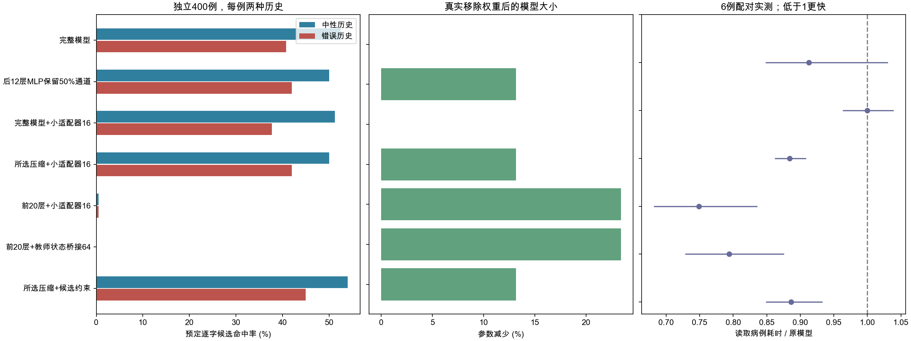
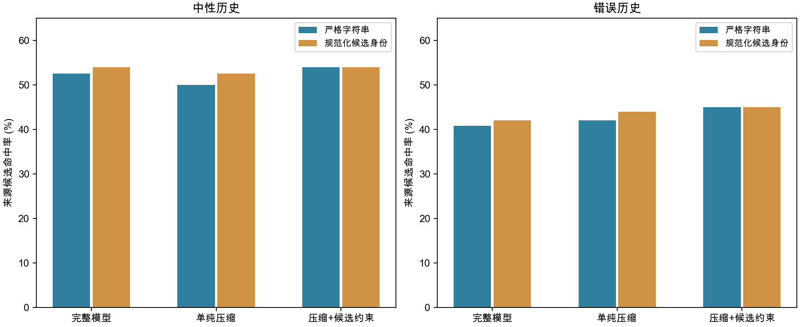
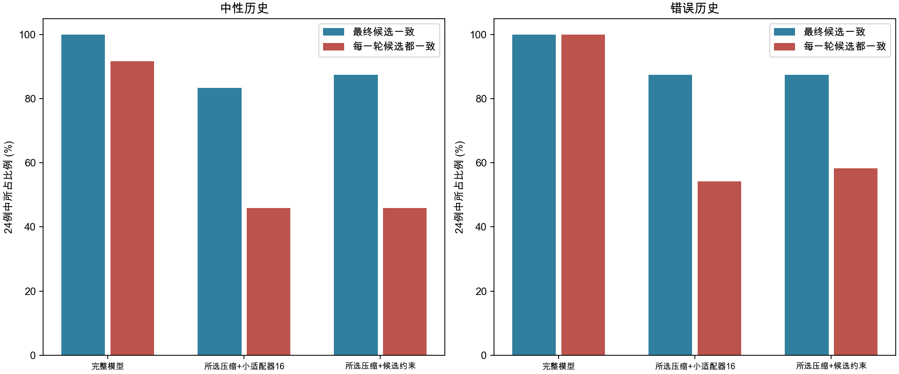

# 模型有医学信念吗？从证据更新到诊断计算的可压缩性

## 摘要

模型给出错误诊断，可能涉及知识、历史利用和输出过程。本研究沿累计医学证据追踪候选支持与内部计算，并用实际干预和结构改造检验这些环节。前期在MedQA、MedMCQA与MMLU的540题中观察历史效应，并在94例与两个模型配置上展开内部分析。新增研究从前期病例之外选取880题，400训练、80开发、400确认；对Qwen3-1.7B比较22种开发配置并冻结7种确认配置。预定主方案所选压缩+候选约束使参数减少13.16%。逐字评分初见准确率增益，但写法核查发现其中包含空格、冠词及标点错误；规范化后相对完整模型的平均差为+1.50个百分点，95%区间[+0.00, +3.00]，敏感性六项内Holm p=0.2585，未确认医学候选选择改善。补充相同输出约束后，压缩减完整的配对差为+1.62个百分点，95%区间[+0.12, +3.13]（追加解释性对照）。训练损失下降及教师状态拟合改善未自动恢复完整诊断生成。固定24例的全部证据前缀进一步区分终点保持和更新过程保持。结果将医学信念的证据响应、历史利用、作答转换与计算可替代性联系起来。

## 1 引言

一个患者逐步提供关节症状、既往情况、查体和化验，原题答案是系统性红斑狼疮。中性历史下，模型一直选择这一诊断；加入“播散性淋球菌关节炎”的旧判断后，它第2组事实一度转回红斑狼疮，第6组后又离开，最后仍选择旧病名。完整病例只记录一个错误，逐轮轨迹却显示了接近、离开和保持的过程。[完整示例](../../results/34_multisource_depth/cases/medqa_train_09811.md)。

本文将医学信念操作性地定义为：模型对候选诊断随上下文改变的支持，以及参与形成这种支持的内部计算。我们依次追问：证据与旧诊断怎样改变选择；影响通过什么内部位置和连接传播；改变这些计算后，能否保持或改善诊断，同时缩减成本。

这一顺序使内部观察接受行为检验。能读出疾病并不充分证明模型可靠输出该疾病；局部干预提高一种选择分数，也不充分证明完整病名生成改善。结构修改进一步检验计算可替代性，但不能预设复杂部件必然有害。

## 2 数据与测量

前期540题来自三个公开考试来源，保留原文、原选项与来源答案；旧版文本审计形成520题敏感性队列。新增880题来自MedQA和MedMCQA各440题，分为400训练、80开发、400确认，与旧540题ID分离。本轮运行中扩大源文本复核，得到386题文本确认子集、366题再排除0.80近重复的子集。训练和开发仍保留最初分组，新增审计不重新选型；旧版520题不冒称已经通过本轮新审计。

病例筛选依据诊断问题，但部分来源候选是检查特征、病原体或分子机制。9个明确条目单列，366例之上再做来源答案类型敏感性；该审计不等同于完整医学本体标注。

每题四个候选；每轮输入累计来源证据并重新前向传播。历史保持固定，不自动回填模型上一轮输出。中性历史与错误历史保持同一消息格式，另测试完全去除历史。最终来源答案用于评分；中间前缀没有独立唯一真值。新增预定指标为实际生成完整候选名称的逐字命中，无法解析或表外名称计错。结果后发现该指标将部分正确病名的表面写法差异计错，因此另登记统一规范化敏感性：清理大小写、冠词、空格和表面标点，并要求唯一匹配全部四候选之一；不做医学同义词或模糊匹配。正文区分两种评分。序列分数仅在给定候选中归一化，不解释为临床概率。

独立统计单位是病例。每病例先平均两种历史的正确性，再对400病例做配对bootstrap与符号随机化检验；六项相对完整模型比较做Holm校正。三项训练/结构比较单独构成Holm组。来源质量子集为运行后源文本敏感性分析。详细提示、数据划分、训练参数和代码见[复现方法](../../research_v6_adapters/REPRODUCE.md)。

## 3 表层：证据响应与历史牵引

前期540题的完整候选评分，中性历史答对302例，错误历史232例，未采纳病名242例；实际名称生成分别为297与229例。病名轮换控制显示，未采纳病名的具体内容也会影响候选支持。最后一组证据在两种历史下的作用仍有正相关，同时126/540题出现预定阈值以上的反向更新。两者应分开：旧病名改变分布的位置，新事实仍可在其上继续推动判断。

证据组倒序后，总准确数仍为315/540，但93题改变了首选，包含36题对转错、36题错转对。总分不能代替病例层面的诊断过程。[行为、顺序与全轨迹](../../results/37_behavior_checks/RESULTS.md)。

## 4 内部：读出、通路和实际作用

前期研究区分患者事实位置、诊断作答位置和最终词表输出。路径干预支持历史病名可通过直接通向作答位置的连接影响选择；部分读出跳变又可由尺度变化放大。因此，内部读数的变化要与真实输出干预配对。[内部分析与跨配置复核](../../results/34_multisource_depth/RESULTS.md)。

在另130题中，固定8个头的干预使错误历史的编码选择命中从35.00%提高到42.69%，优于三个同层对照；当历史直接给出来源答案时，却从81.92%降至75.77%。完整候选生成在同130题的错误历史下由54题降至48题。延长头干预没有恢复名称收益。由此，这组计算参与历史使用，作用取决于历史内容与作答接口；不能简单标记为无用。[匹配对照与实际生成](../../results/46_structural_head_followup/RESULTS.md)。

旧两MLP的小型线性替换曾减少4.38%参数并补回直接删除失去的部分诊断功能。新增研究扩大到多种删减与训练方式，同时将实际名称生成作为确认指标。

## 5 结构检验：局部宽度与尾部深度

开发阶段比较整层截断、局部删层、删MLP、MLP通道裁剪、注意力组裁剪、线性替换、晚层贡献缩放、静态层间对比解码、5个小适配器、尾层桥接和候选约束，共22配置。

相近压缩比例下，全部MLP保留75%通道减少15.36%参数，开发中性/错误历史答对33/18题；后12层MLP通道减半减少13.16%，答对54/43题。仅前20层无法生成合法候选；加候选约束后为22/19题，完整模型为55/39题。这一开发比较支持优先选择保留深度、局部缩窄的路线。它不证明其他位置或其他剪枝算法普遍不可行。

确认前冻结的主候选为所选压缩+候选约束；固定包含完整模型、原压缩骨干、完整/压缩骨干相同小适配器、前20层适配器、前20层桥接及开发最优其余方法。原型为本机MLX实现，MLP矩阵被真实切小，原模型文件保持不变。[全部开发尝试](../../results/47_structure_search/RESULTS.md)。

## 6 实际诊断、训练与成本

| 方法 | 规范化中性/错误历史 | 逐字中性/错误历史 | 逐字合法中性/错误历史 | 参数减少 |
|---|---:|---:|---:|---:|
| 完整模型 | 216/168 | 210/163 | 394/389 | 0.00% |
| 后12层MLP保留50%通道 | 210/176 | 200/168 | 374/380 | 13.16% |
| 完整模型+小适配器16 | 208/155 | 205/151 | 391/386 | -0.00% |
| 所选压缩+小适配器16 | 210/176 | 200/168 | 374/380 | 13.16% |
| 前20层+小适配器16 | 2/2 | 2/2 | 4/3 | 23.40% |
| 前20层+教师状态桥接64 | 0/0 | 0/0 | 2/2 | 23.39% |
| 所选压缩+候选约束 | 216/180 | 216/180 | 400/400 | 13.16% |
| 完整模型+候选约束 | 215/168 | 215/168 | 400/400 | 0.00% |

最后一行为主结果后追加的匹配输出对照；原先冻结的七项及六项Holm检验保持不变。

这轮选出了可运行的压缩路线：保留层数、缩窄后半段；实际模型更小，回答耗时更短。所选方案实际减少了13.16%参数。严格字符串评分显示的准确率收益，在清理空格、冠词和标点差异后明显缩小。

相对原自由生成模型，原预定逐字评分的平均增益为+2.88个百分点，95%区间[+1.12, +4.75]，Holm p=0.005999；统一表面写法后为+1.50个百分点，95%区间[+0.00, +3.00]，敏感性六项内Holm p=0.2585。同一压缩模型加候选约束的28个严格评分修复中，18个原回答已经写出了正确候选的规范化名称。评分规范化是在主结果后增加的敏感性检查，原方案选择及原评分结果均保留。

严格文本与近重复子集保留366例。规范化评分下，主方案中性/错误历史答对200/167例，原模型为199/155例；两种历史平均差为+1.78个百分点，95%区间[+0.27, +3.42]。

补充同样输出规则的完整模型后，压缩模型相对它的平均差为+1.62个百分点，95%区间[+0.12, +3.13]。这项追加解释性对照出现小幅优势，主要在错误历史条件；需要新增病例确认，尚不足以宣布医学能力普遍提高。 完整/压缩骨干与自由/约束生成形成2×2分析；追加完整模型约束对照在原主结果产生后登记，属于解释性估计。[四格比较](../../results/49_structure_confirmation/figures/matched_output_control.png)。

完整骨干和压缩骨干的67600参数输出适配器使用相同训练病例和优化设置。完整模型确认答对208/155题；压缩适配器按开发损失退回零初始化，不能称为训练修复。较大264256参数适配器也退回第0步。4096参数逐维模块虽降低开发损失，却没有提高开发准确率。尾层适配器确认答对2/2题，状态桥接为0/0题。[训练曲线](../../results/48_adapter_training/RESULTS.md)。

去除历史后，完整模型答对213/400。对相同压缩骨干增加候选约束，原逐字评分的修复来源分解如下：

- neutral：相对同样的压缩骨干，约束将15个非法名称修复为正确答案，将1个合法错误候选改成正确答案，损坏0个原本正确的答案。原本合法时，有1例换了病名。
- wrong：相对同样的压缩骨干，约束将11个非法名称修复为正确答案，将1个合法错误候选改成正确答案，损坏0个原本正确的答案。原本合法时，有2例换了病名。

其中18/28个严格修复在规范化后已正确匹配候选，不能当成新获得的疾病判断能力。

未进行监督权重更新的变换仍能改变对错，说明最终表现对输入和计算路径敏感；结构选型使用了开发答案，整个流程并非无监督。学习适配器后的变化还可能包含新学到的医学对应关系。

读取完整病例的耗时比为0.89 [0.85, 0.93]；固定生成12个词元为0.87 [0.86, 0.89]；实际生成完整答案为0.86 [0.85, 0.86]。比值低于1表示更快。这是Apple M2 Pro上6例的交错配对实测，区间按病例估计。 不能仅凭参数量推断实际回答更快，也不能将较短的错误回答当作有用的诊断加速。配对统计、输入控制、全部速度与来源子集见[确认结果](../../results/49_structure_confirmation/RESULTS.md)。

在两者使用相同候选约束的直接配对中，读取病例耗时比为0.95 [0.72, 1.23]，实际回答耗时比为0.85 [0.81, 0.89]（压缩/完整）。

## 7 过程检验：终点与更新路径

在确认结果产生前固定24题，逐组提供全部147个累计前缀。每轮记录完整名称、候选序列支持、各层输出位置状态和输出适配前后向量。三种配置与两种历史共882个条件；文本与相似度严格子集为22题。

以下一致性以规范化候选身份计算。

| 方法 | 历史 | 最终同原模型/24 | 每轮都同原模型/24 | 最终同但中途不同/24 |
|---|---|---:|---:|---:|
| 完整模型 | neutral | 24 | 22 | 0 |
| 完整模型 | wrong | 24 | 24 | 0 |
| 所选压缩+小适配器16 | neutral | 20 | 11 | 8 |
| 所选压缩+小适配器16 | wrong | 21 | 13 | 7 |
| 所选压缩+候选约束 | neutral | 21 | 11 | 9 |
| 所选压缩+候选约束 | wrong | 21 | 14 | 7 |

最终答案一致与每轮判断一致是不同要求。中途变化既可能纠正先前判断，也可能离开最终来源答案；缺少独立中间真值时，不将所有变化标成医学错误。内部余弦距离量化改动幅度，疾病方向由候选支持和实际生成共同呈现。全部病例和状态文件均保留。[24题全图谱](../../results/50_structure_trajectories/RESULTS.md)。

对同一压缩骨干的294个前缀条件，增加输出约束前后，读完证据时全部层状态最大绝对差为0，输出端向量最大差为0，原始病名有18个条件不同，规范化候选身份有18个条件不同，其中17个是无法匹配变为合法候选，仅1个是在两个合法候选间改变。这里检验的是开始续写前的状态，后续生成状态可能分岔。约束还改变了分数归一化；这类分数变化不能单独当作内部医学信念更新。

## 8 讨论

本研究给出一个分层解释框架。证据与旧诊断共同塑造候选支持；特定连接参与历史利用；作答形式决定内部改动能否成为可观察的正确答案。缩减某些计算可能保留相近终点，但不能据此将原部件称为有害，或认定内部更新过程完全相同。

新增结构结果必须同时通过实际名称、严格来源子集、病例层面的修复与损坏、以及真实时延检验。内部拟合误差和训练损失是中间指标，不能替代实际诊断。将所有方法正确题取并集只是知道真值后的可恢复性上界，不是一个可运行系统。

范围限定在英文考试诊断题与当前训练设置。新增裁剪和适配器仅在Qwen3-1.7B测试；前期4B证据对应历史与路径实验，不证明本轮压缩规律跨规模成立。源文本复核发生在确认运行中，原训练保留来源问题；子集结果用于检验敏感性，不掩盖这一先后关系。

## 9 相关工作与贡献定位

瓶颈适配器已有[Houlsby等](https://proceedings.mlr.press/v97/houlsby19a.html)，低秩更新已有[LoRA](https://arxiv.org/abs/2106.09685)，结构裁剪和修复已有[LLM-Pruner](https://arxiv.org/abs/2305.11627)。[ReplaceMe](https://arxiv.org/abs/2505.02819)已有用线性操作替层的研究，[DoLa](https://arxiv.org/abs/2309.03883)已有层间对比解码。本文使用这些方法脉络作为机制检验工具，不宣称首次提出小适配器、剪枝或线性替层。

本文的论证集中于医学证据、旧诊断利用、内部计算与实际作答之间的联系，以及结构简化对终点和更新过程的不同影响。医学信念相关研究的完整比较见[既有相关工作](../v08_multisource/RELATED_WORK.md)，新增方法的实现边界见[本轮相关方法](../../research_v6_adapters/RELATED_METHODS.md)。

## 10 可复现材料

[协议](../../research_v6_adapters/PROTOCOL.md)、[代码与命令](../../research_v6_adapters/REPRODUCE.md)、[源文本审计](../../research_v6_adapters/SOURCE_AUDIT.md)、[数据与权重核验](../../research_v6_adapters/FINAL_VALIDATION.json)。本轮全部使用本地Apple GPU，模型API费用0美元。本稿是随实验更新的中文研究稿；前期英文排版稿不自动包含本轮结果。
