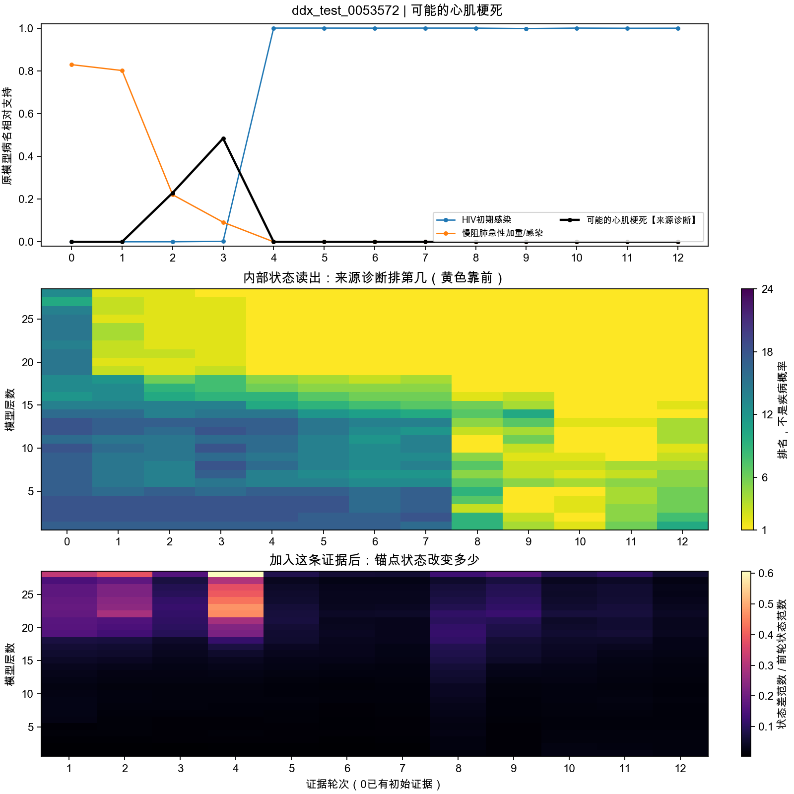
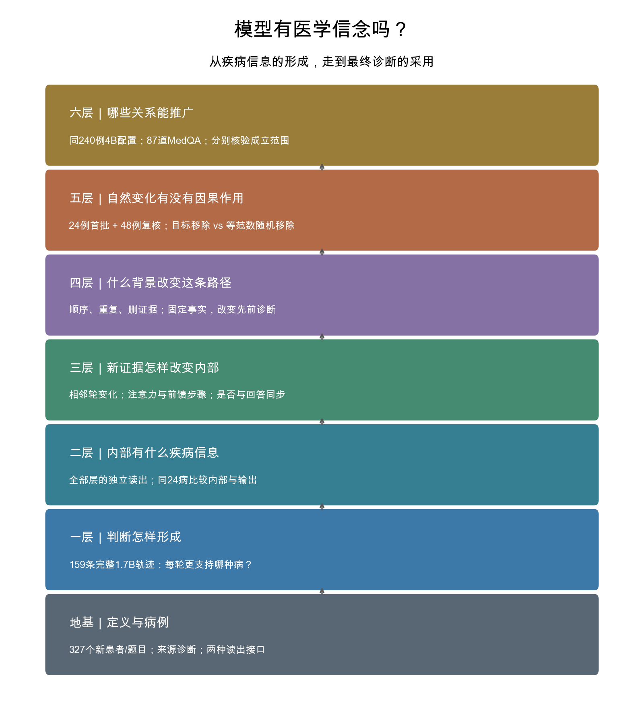
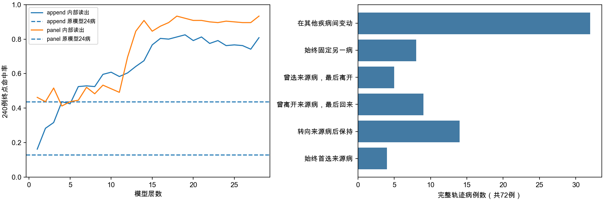
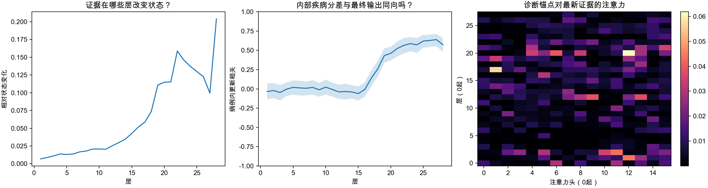
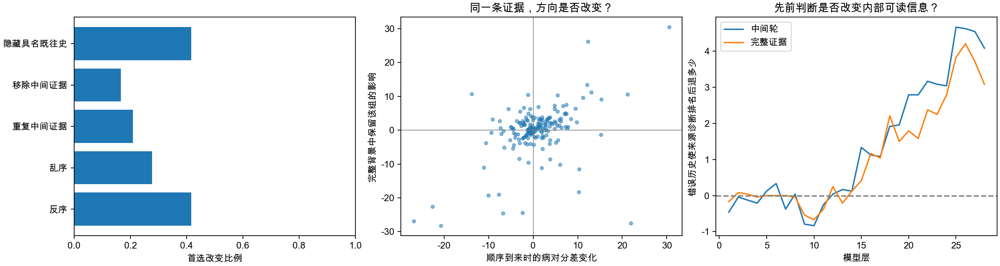
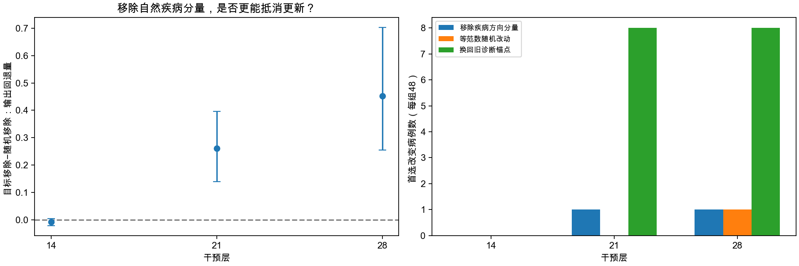
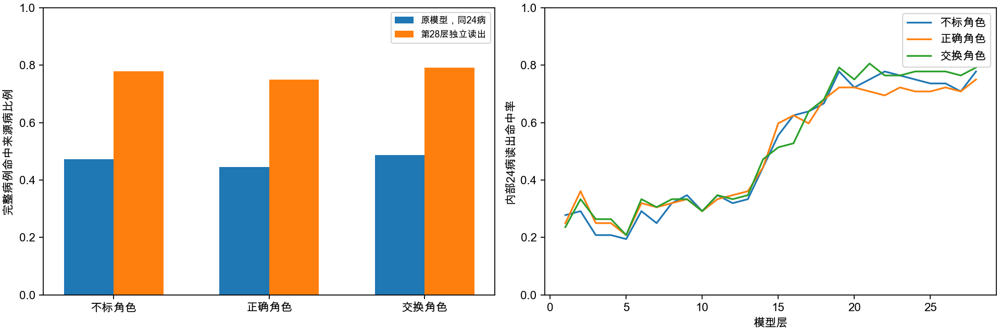

# 模型有医学信念吗？从证据进入到诊断输出的逐层分析

版本：v0.6；日期：2026-11-19。全部本轮实验已完成并核验。本文是研究稿，旧v0.5保留。新一轮共327个独立患者/题目、4832个模型观测或干预条件；API费用0美元。

## 摘要

医学模型的判断不是一个病名，而是证据逐步进入后形成、更新并参与输出的过程。我们在240个新的DDxPlus模拟患者和87道MedQA原始诊断题上，记录每轮原模型的疾病评分、所有层的内部状态和注意力，并用旧患者训练、在本轮冻结的读出器识别内部疾病信息。统一24病比较中，1.7B原模型在完整病例上命中105/240，最后一层读出命中194/240；固定问卷呈现下则为31/240与224/240。内部信息与输出并非完全脱离：最后一层的病对分差更新和原模型更新在患者内相关0.573。第28层的疾病方向分量在两批独立患者中都表现出对原生诊断分差的特异作用。 在外部病例中，错误的先前诊断使终点命中从45/87降至30/87。研究得到的整体解释是：**疾病信息的可识别性、随证据更新、以及被最终诊断采用，是三个相关但不等同的环节。**

## 1. 从一个能看懂的病例开始

### 1.1 先看答案：检查更多了，诊断却转走了

一道原始医学考试题描述：55岁男性，退役运动员，手腕和膝盖疼痛多年。原题答案是**骨关节炎**。前四段材料进入后，模型一直选择骨关节炎。第五段加入手指远端关节的无痛结节，模型突然转为**强直性脊柱炎**；后面继续加入拇指根部压痛、膝关节增大和活动时疼痛摩擦感，也没有转回来。

把完整事实的顺序反过来，模型又选回骨关节炎。事实没有增加或减少，答案却改变了。[查看这道原题的全部轮次与图](../results/26_external_medqa/cases/medqa_test_0177.md)。同一例的错误历史条件反而恢复来源答案，说明历史影响并不是每例都朝坏方向走；正文报告的是全部87题的配对结果。

这个例子把问题讲清楚：**更多材料不是一个自动把答案推向真相的过程。我们需要打开模型，看它每一步到底改了什么。**

### 1.2 再看内部：答案转走时，内部的疾病信息也一起转走了吗？

有一个模拟患者，完整记录的来源诊断是“可能的非ST段抬高/ ST段抬高型心肌梗死”。这里只用它说明测量过程，不把模拟记录当成真实典型患者。输入最初逐步加入乏力、糖尿病、早发心血管病家族史及旅行史。到第3轮，原模型首选心肌梗死，候选内相对支持约48.4%；第28层读出也首选心肌梗死。

第4轮加入“患者HIV阳性”这条既往史。原模型突然把“HIV初期感染”排到第一，相对支持超过99.99%。此后记录继续加入胸痛、气短、既往心梗/心绞痛等信息，原模型到终点仍首选HIV初期感染；第28层读出首选则保持心肌梗死。

| 关键时点 | 新增内容 | 原模型首选 | 第28层独立读出首选 |
|---|---|---|---|
| 第3轮 | 已有心血管风险资料及旅行史 | 心肌梗死 | 心肌梗死 |
| 第4轮 | HIV阳性既往史 | HIV初期感染 | 心肌梗死 |
| 第8轮 | 胸痛资料 | HIV初期感染 | 心肌梗死 |
| 第11轮 | 既往心梗/心绞痛 | HIV初期感染 | 心肌梗死 |
| 终点 | 全部记录 | HIV初期感染 | 心肌梗死 |

这里最值得研究的不是“模型答错了”，而是**同一证据进入模型后，可读的疾病信息与它说出的病名为什么分开了**。首选不变也不代表整个内部状态没变。这个病例只是解释入口，下面的判断来自全部预选病例。

原始病例及每轮图：[ddx_test_0053572](../results/23_new_patients/cases/ddx_test_0053572.md)。来源记录为19岁女性的模拟患者；病例的现实典型性不是本实验的前提。

读图方法：最上面看模型给各病的相对支持；中间每列是一轮、每行是一层，黄色表示来源病在内部读出中排名靠前；最下面的亮色表示加入这条证据后，该层状态变化较大。第4轮上面的病名偏向跳走了，中间的后层仍把心肌梗死排在前面，下面同时显示状态确实变了。

## 2. 整栋楼的结构：每一层解决上一层留下的问题

| 层次 | 核心问题 | 本轮证据 | 带向下一层的问题 |
|---|---|---|---|
| 地基 | 我们说的医学信念具体测什么？ | 相同病例、候选疾病、固定读出器、来源诊断 | 先观察判断怎样形成 |
| 第一层 | 判断是慢慢形成，还是会突然转向？ | 159条完整轨迹、1173次证据更新 | 转向时里面发生了什么？ |
| 第二层 | 内部是否包含比答案更完整的疾病信息？ | 240例所有层读出、同24病配对 | 可读信息有没有参与当前判断？ |
| 第三层 | 哪些计算步骤把新证据变成诊断变化？ | 相邻轮状态差、注意力/前馈步骤分解 | 为什么同一事实有时产生不同作用？ |
| 第四层 | 先前判断和已有背景如何影响更新？ | 正误历史、顺序、重复、逐组删除 | 内部变化究竟是原因还是伴随现象？ |
| 第五层 | 删除实际发生的内部变化会怎样？ | 24例首批＋48例复核的自然分量移除 | 结论能否跨病例来源和模型配置？ |
| 第六层 | 哪些关系稳定，哪些有条件？ | 4B同患者复核、87道外部题、事实角色探索 | 形成医学信念的总体解释 |

## 3. 地基：病例、真实答案与测量

### 3.1 病例怎样统一

DDxPlus新增240例，每种病10例，共24病、6个疾病组，来自官方test split；与旧队列不存在相同事实集合。旧120例仅用于训练读出器，本轮没有重新选参数。完整轨迹预选每病3例，共72例；其中每病1例进入首批因果实验，另外每病2例进入独立患者复核。因此既可以做所有病统一的分析，也可以按疾病组比较。

外部来源是87道MedQA原始四选项诊断题，含84种不同来源答案。病例内容按原文切分，没有用模型合成新病例。每轮加入一段原文；列表保留在同一个片段中，所以“一轮”不一定只包含一个临床事实。最终切分通过原文内容重建核验。

DDxPlus的pathology和MedQA的原始答案作为**完整病例的终点标签**。中间轮尚未给全事实，不能把“不等于最终疾病”一概认定为错误；我们记录它何时接近、离开、返回最终疾病。DDxPlus来源诊断与来源鉴别诊断最高分项在171/240例一致，主要终点始终使用pathology，并单独检查一致子集。

### 3.2 每一轮具体测什么

1. **它想说什么病。** 对每个完整候选病名逐词元计算log条件概率，再在候选中归一化。原模型首选是得分最高的病。DDxPlus保留49病评分，和内部读出比较时统一为24病；MedQA保留原题4个选项。另存自然贪心续写、每个词元分数、全部规范病名的总概率质量。
2. **各层能读出什么病。** 在最终诊断提示位置提取每层状态，使用旧120例训练的线性读出器，输出24病的分数和排序。它是一个独立测量工具，分数不是原模型自己报出的概率。
3. **新证据改了什么。** 同一患者前后两轮相减，记录所有层的状态移动，以及来源病与竞争病的分差改变。
4. **计算在哪一步改变。** 每层保存入层状态、注意力增量、注意力后状态、前馈增量与离层状态。将同一个读出函数作用于这些状态，分解各步骤对可读疾病分差的变化。
5. **注意力指向什么。** 保存所有层、所有查询头从诊断锚点指向证据、候选和格式部分的注意力；深度轨迹还保存从该锚点到每个输入token的注意力和头输出。它不是每个输入位置之间的完整注意力矩阵。注意力回答信息访问问题，单独的高注意力不等于该证据对答案有因果作用。

模型在推理时权重不变。发生变化的是中间状态、注意力分配和输出分数。内部实验修改的是某次推理中的局部状态，不是重新训练模型。

### 3.3 统一统计单位

终点按患者统计，动态指标先患者内汇总再跨患者平均，避免长病例权重过大。区间为患者bootstrap 95%区间；二元结果全0或全1时用精确二项边界区间。主要因果比较用20000次患者符号置换，对预定三层做Holm校正。首批24与复核48分开判断。跨模型比较使用相同患者；两种来源分别报告，不把49选1和4选1准确率混为一谈。

## 4. 第一层：判断经常跳变，也会离开曾经选中的最终疾病

72条DDxPlus轨迹中，60例至少改变过一次首选；567次证据加入中，有170次首选切换。56例至少出现一次某候选支持改变50个百分点以上。87条MedQA轨迹中，56例至少改变一次首选，606次更新产生107次首选切换。

| 完整路径类型 | DDxPlus，72例 | MedQA，87例 |
|---|---:|---:|
| 始终首选来源病 | 4 | 16 |
| 转向来源病后保持 | 14 | 21 |
| 曾离开来源病，最后回来 | 9 | 8 |
| 曾选来源病，最后离开 | 5 | 12 |
| 始终固定另一病 | 8 | 15 |
| 在其他疾病间变动 | 32 | 15 |

相对最终来源诊断，DDxPlus有14/72例曾选中又离开，MedQA为20/87例。最大单次变化占整条路径总变动的患者平均比例分别是43.0%和58.8%。因此，“不断加入证据”并不表现为对某病平滑、单向地增加信心；一部分路径由少数明显转折主导。这里的50个百分点来自候选内支持，不能读作真实患病概率变化。

所有路径均公开在项目的病例图册中，包括稳定正确、后来转对、转错再回来、最后离开、始终另一病和其他病之间跳动。分类是对已观察路径的描述，不是预设模型必须具有六种心理机制。

## 5. 第二层：内部可读信息与输出选择存在系统性差距

| 模型与输入 | 原模型49病命中 | 原模型同24病命中 | 最后一层24病读出命中 |
|---|---:|---:|---:|
| 1.7B，逐条输入 | 89/240 | 105/240 | 194/240 |
| 1.7B，固定问卷 | 25/240 | 31/240 | 224/240 |
| 4B，逐条输入 | 142/240 | 159/240 | 226/240 |

1.7B逐条输入下，读出相对原模型同24病的配对优势为37.1个百分点（95%CI [30.0, 44.2]）。双方都对93例、只有读出对101例、只有原模型对12例、双方都错34例。这个结果说明可读信息比当前输出更充分，同时保留了读出器也会犯错的事实。

固定问卷在所有病例中放置相同的问题行，未提供答案的行显示Unknown。已知事实相同，但呈现更长、加入更多未回答问题。原模型同24病命中降到31/240，而对应呈现的独立读出命中224/240。这里使用分别在旧患者上训练的append/panel读出器，因此可以比较各呈现中的信息可读性，不能把跨呈现差异当成同一个读出器的不变性。

| 疾病组 | 患者数 | 原模型同24病命中 | 第28层读出命中 |
|---|---:|---:|---:|
| 心血管 | 40 | 11 | 27 |
| 消化 | 40 | 23 | 36 |
| 耳鼻喉 | 30 | 11 | 22 |
| 神经 | 40 | 22 | 35 |
| 呼吸 | 60 | 32 | 47 |
| 全身性 | 30 | 6 | 27 |

差距出现在全部六组。测量接口审计也没有消除它：只看贪心输出正好落在规范候选内的171例，原模型同24病命中88例，内部读出141例；完整候选质量不低于0.5的173例，为88与143。它不是完全由候选病名漏掉输出造成的。

左图实线表示各层能读对多少患者，虚线表示原模型最终自己选对多少；右图包含全部72条轨迹的路径类型。append是逐条事实，panel是固定问卷，两者均使用同240个患者。

### 一个必须解释清楚的对照

| 不使用语言模型的输入 | 简单分类器命中 |
|---|---:|
| 完整问答文本 | 239/240 |
| 只有问题，不看患者回答 | 235/240 |
| 证据字段与取值 | 240/240 |
| 只看哪些字段被记录 | 236/240 |

问题文本与字段是否出现本身具有很强预测力，说明模拟数据的记录规则提供了捷径。因而读出成功能证明“状态中存在可分辨的来源疾病信息”，还不能单独证明深层医学推理。所谓“小分类器特别准”不是本文的医学突破；它是解释内部读出时必须纳入的实验结果。外部MedQA用于检验行为更新与局部状态作用，没有把DDxPlus的24病读出器套到84种外部答案上。

## 6. 第三层：信息可读，与信息参与输出，随深度呈现不同关系

第14层已能读对162/240例；但该层内部病对分差更新与原模型更新的患者内相关为-0.040 [-0.125, 0.048]。到第21层，读出195/240，更新相关为0.525 [0.421, 0.617]；第28层读出194/240，更新相关为0.573 [0.480, 0.660]。

因此我们看到两条不同曲线：**能不能从状态辨认疾病**，以及**这轮状态变化是否和最终输出一起变化**。中层已有信息可读，后层的自然更新才更紧密地联系输出。这个跨层观察比“第几层最准”更能解释信息怎样变成判断；它仍然需要下一层因果实验检验。

在原模型同24病发生首选切换的轮次中，第28层读出首选保持不变的患者平均比例为52.7% [42.3%, 63.4%]。这并不与分差相关矛盾：首选可以没变，但领先程度已经改变。把竞争疾病固定为整条路径同一个病，最终层相关仍为0.462 [0.351, 0.568]，说明关联不完全由每轮重新选竞争病造成。

步骤分解中，注意力步骤与前馈步骤的作用随层不同；第22层的注意力读出变化较大，最后一层的前馈读出变化较大。这是对冻结读出函数的计算分解，不是用投影大小宣布某层是唯一“医学信念层”。[全部逐层更新](../results/23_new_patients/layer_updates.csv)和[全疾病转移](../results/27_building_synthesis/all_disease_transitions.csv)可直接复算。

从左到右依次回答：状态变了多少、疾病分差变化有没有跟输出一起变、各层各注意力头看了多少最新证据。中图接近0表示关系弱，越接近1表示更同步；右图的亮色只能说明注意力较多，因果作用由后面的干预检验。

## 7. 第四层：同样的事实，受什么背景影响？

### 7.1 当前事实相同，改变先前诊断

24例使用相同当前事实与消息格式，分别提供来源病或预定错误病作为先前判断。来源病是离线控制所用标签，不是模型额外推理得来的结果。

| 证据阶段 | 正确历史时命中来源病 | 错误历史时命中来源病 | 原模型首选改变 | 最后层读出首选改变 |
|---|---:|---:|---:|---:|
| 中间轮 | 23/24 | 1/24 | 22/24 | 16/24 |
| 完整事实 | 23/24 | 2/24 | 21/24 | 13/24 |

两种历史之间，错误病相对来源病的原生分差差距，从中间到终点变化为-0.267 [-6.198, 5.244]。区间包含0，未观察到补齐事实后历史影响明确减弱。

影响也进入了可读的内部状态：完整事实下，错误历史使第28层读出的来源病排名平均后退3.083 [1.417, 5.083]位。我们据此判断，旧诊断的影响不只体现在最终病名上。这个测量仍可能包含对先前病名文字的编码，不能直接把排名变化当成临床后验概率。

历史提示明确写了“先前判断可能错误，请仅根据当前累计发现重新判断”；提供的历史是一个先前assistant诊断JSON。正/误历史都使用相同结构。结果因而描述在该提示与任务下，先前诊断如何影响重新计算。

外部87道MedQA中，完整事实不变，加入一个错误的先前诊断后，命中由45/87变为30/87，配对变化-17.2个百分点（95%CI [-27.6, -6.9]）。选中所给错误病的病例从14/87增至37/87。这里与无历史比较，增加了先前判断消息；DDxPlus的正/误历史配对进一步控制了消息结构。

### 7.2 同一批事实，改变顺序、重复或背景

72例DDxPlus终点反序引发首选变化41.7% [30.6%, 52.8%]，乱序为27.8% [18.1%, 38.9%]。外部MedQA反序变化23/87，乱序13/87；准确率净变化的区间都包含0。这意味着顺序改变会重新分配谁对谁错，不能仅用总体准确率稳定来认定判断稳定。

对24例逐一移除完整证据组，共208个删组条件。固定同一病对，比较一条证据“刚到来时”的作用和“置于完整背景时”的作用。184次非微小可比较更新中，67次方向相反；患者平均比例为37.2% [32.6%, 42.1%]。同一证据的作用依赖背景，这在医学推理中可能合理，不能直接把方向反转称为错误机制。

重复中间证据会改变首选的比例为20.8% [4.2%, 37.5%]。删除信息与重复信息的语义不同，完整的各条件记录单独保存。本文不把这些已知行为敏感性分别包装成独立创新，而用它们说明内部信息被采用的条件。

右图大于0，表示错误历史使来源病在内部读出中的排名后退。中图位于左上或右下的点，表示同一证据在两种背景下对固定病对的作用方向相反。

## 8. 第五层：从相关走到局部因果检验

### 8.1 删掉真正发生的更新，而不是任意向正确病推一下

在预先指定的中间轮，记新证据前后诊断位置状态差为Δh。旧患者训练的读出器给出来源病与竞争病的方向v。我们从新状态中减去自然变化沿该方向的分量(Δh·v)v；输入的新证据保留。与同样大小、正交随机方向的改动比较，另有零改动和完整旧锚点替换。预定第14、21、28层分别检验。

输出指标是原模型病对log分差向原更新反方向回退多少，再做目标移除减随机移除。它衡量对自然更新方向的抵消，原更新本身可以是对的也可以是错的。不是把“读出器自己的分数被降低”当成因果证据。

### 8.2 首批与独立患者复核

**第28层的疾病方向分量在两批独立患者中都表现出对原生诊断分差的特异作用。**

| 层 | 首批24例：目标−随机回退，95%CI | Holm p | 独立48例：目标−随机回退，95%CI | Holm p |
|---|---|---:|---|---:|
| 14 | 0.009 [-0.008, 0.029] | 0.3632 | -0.008 [-0.021, 0.004] | 0.2546 |
| 21 | 0.273 [0.041, 0.558] | 0.0578 | 0.262 [0.139, 0.397] | 0.0002 |
| 28 | 0.645 [0.297, 1.110] | 0.0013 | 0.453 [0.255, 0.702] | 0.0001 |

第28层目标移除改变原模型49病首选，首批为1/24，复核为1/48。分数受到影响和跨过首选边界是不同结果；本实验直接报告两者。所有零干预均复现相应基线，最大log概率误差分别为0.000000与0.000000。

左图高于0表示移除疾病方向比随机改动更能抵消原来的更新，竖线是患者95%区间；右图直接数最后的首选病有没有改变。首批24例与这里的48例分开检验，只有第28层在两批都通过预定校正标准。

### 8.3 外部原题中的自然状态作用

**在外部MedQA的第21、28层，把诊断位置的状态换回前一轮，比等范数随机改动更能抵消原来的诊断更新。**

| 层 | 旧状态替换−随机回退，95%CI | Holm p | 旧状态替换改变首选 |
|---|---|---:|---:|
| 14 | 0.002 [-0.051, 0.054] | 0.9276 | 0/87 |
| 21 | 4.150 [3.049, 5.443] | 0.0001 | 13/87 |
| 28 | 5.018 [3.668, 6.620] | 0.0001 | 17/87 |

外部实验替换整个局部状态差，没有使用疾病方向读出器。它支持或否定的是自然局部状态的方向性作用，与DDxPlus的疾病方向特异性是互补证据，不是同一个效应的直接合并复现。

### 8.4 因果结论准确落在哪里

干预只发生在最终诊断提示的一个位置，其余位置与已计算的缓存保持不变。尤其在最后一层，改动只能直接影响病名第一个输出词元的分数；两病名若首词元相同，它们的相对分差不会由该干预改变。这是干预位置的架构性质。我们据此把结论落在“局部疾病相关变化影响原生病名评分”，不把一个位置的操控外推为整个疾病信念已被整体替换。

## 9. 第六层：模型配置、外部来源与一个解释检验

4B在相同240例的原生49病命中为142/240，相对1.7B配对变化22.1个百分点（95%CI [14.2, 30.0]）；同24病比较中，内部读出与原生输出仍相差27.9个百分点（95%CI [22.1, 33.8]）。24例配对完整轨迹中，最终层更新相关为0.762 [0.593, 0.876]。模型规模与权重精度在本次配置中同时不同，因此这是配置复核，不能单独归因于规模。

外部MedQA不用问卷记录格式，也没有DDxPlus的24病类别体系。这里仍出现明显跳变、曾选中来源病后离开、先前错误诊断影响，以及可直接检验的内部状态作用。这扩展了研究范围；外部来源是否具有同样的可读疾病表示，需要另训练独立外部读出器，本轮没有假装已经做过。

### 9.1 触发病例提出的解释：是不是把病史误当当前诊断？

开头病例引出一个可检验解释：HIV阳性既往史可能夺走了当前疾病的输出。我们对全部72个预选轨迹病例补做三种标签：正确标注来源既往史/当前表现、统一未指定、交换两种角色。事实内容与顺序一致，三种条件共用标签解释。角色来自来源is_antecedent字段，不使用答案生成提示。

| 角色条件 | 原模型49病命中 | 原模型同24病命中 | 第28层读出命中 |
|---|---:|---:|---:|
| 角色未指定 | 31/72 | 34/72 | 56/72 |
| 来源角色正确 | 28/72 | 32/72 | 54/72 |
| 来源角色互换 | 29/72 | 35/72 | 57/72 |

**明确标注既往史与当前表现，没有带来明确的总体诊断改善。** 正确角色相对未指定角色，原模型49病的配对变化为-4.2个百分点（95%CI [-11.1, 2.8]）。这是看到触发病例后提出的探索，使用同批患者，因此不称为独立验证。它检验一个具体解释能不能改善整体表现；交换角色是反事实元数据，不当成相同临床语义。

触发病例本身更能说明为什么要看全体：未指定角色时原模型选HIV初期感染；正确角色时改选肺栓塞；交换角色时反而选回来源病心肌梗死。第28层读出在三种条件下都首选心肌梗死。这个个例不能支持“角色标签正确就会诊断正确”，而72例总体也没有支持这种简单修复。

## 10. 与已有研究的区别

行为层面，DDxPlus上的自报诊断概率一致性、证据顺序和重复已经被[Arun等](https://www.mdpi.com/2504-4990/8/11/369)系统研究；[Zeng与Zhang](https://arxiv.org/abs/2610.02684)研究纵向临床判断中的历史影响；[MED-STRESS](https://aclanthology.org/2026.acl-long.395/)研究临床社会压力下的正确判断崩溃，[MedEinst](https://aclanthology.org/2026.acl-long.1847/)研究诊断陷阱，[MedEVM](https://arxiv.org/abs/2609.35627)研究动态医学证据价值。[DERELAB](https://aclanthology.org/2026.emnlp-main.1625/)研究通用可撤销推理与确认偏差。因此，“模型会被旧判断带偏”不是本文独立的新发现。

内部层面，[Medical Interpretability and Knowledge Maps](https://proceedings.iclr.cc/paper_files/paper/2026/hash/17aa70697d6cd35835f201c6fb0a2fd5-Abstract-Conference.html)已经结合医学表示可视化、层移除与激活修补；[belief-state geometry](https://arxiv.org/abs/2609.17376)已经在控制任务中结合信念读出与干预；[医学上下文/参数知识冲突探针](https://www.sciencedirect.com/science/article/pii/S095741742602628X)也区分内部检测与外部行为，并做steering。因此，仅展示“内部读得出、外部答不对”或“方向可以操控”也不足以构成本研究贡献。

本文的实质是把**同一个患者、自然到来的每条证据、跨层疾病信息、原生完整病名评分、配对背景控制、自然更新分量移除及独立患者复核**串成一条可检验的解释链。贡献应以本轮实际成立的关系为准，而不以“此前从没人想到医学信念”为前提。[完整对照表](../research_v3/RELATED_WORK_POSITION.md)记录来源及检索范围。

## 11. 讨论：这里的医学信念是什么？

我们用三个互相约束的量回答标题：状态中能辨认什么病；新证据使这种疾病信息怎样变化；这种变化是否实际影响诊断。结果支持一个分层解释：模型能保留疾病相关线索，后层自然变化与诊断更新产生更紧密联系，但最终输出仍受呈现和先前判断影响。**内部有信息，不保证输出采用；信息参与分数，也不保证足够改变首选。**

这也解释为什么文章不能停在“找到一个特别准的小分类器”。内部读出得到额外标签监督，模拟记录还带有强预测结构。它的作用是把本来混在一个答案里的不同环节拆开，帮助研究信息在哪一步保留、改变、失去输出上的优势。

从临床输出的行为分析，到所有层的自然更新，再到局部因果干预，本文已经构成完整的实验逻辑。结论的范围是两种Qwen3配置、两个公开病例来源及明确指定的测量接口；扩大模型家族或建设临床系统属于后续工作，而不是本轮未完成的实验任务。

## 12. 可复现材料与边界

全部4832个观测/干预条件与协议清单一致；状态文件哈希、候选概率计算、词元分数求和、注意力重构、零干预复现以及模型参数文件不变均已校验。推理使用本地M2 Pro GPU；1.7B为FP16、4B为8-bit权重配置，均关闭显式thinking。患者轨迹输入没有把之前模型答案自动带回；历史判断只在指定对照中加入。

本研究没有逐轮临床后验真值，没有为删证据或交换角色伪造新诊断。完整病名相对支持不等于临床患病概率。疾病组是研究组织方式。冻结读出器使用单一训练队列；自然干预的零/随机对照控制局部数值与方向，不能证明干预完全处于自然状态分布。

## 13. 阅读与复算入口

- [全部72条DDxPlus轨迹](../results/23_new_patients/CASE_ATLAS.md)：每例逐轮证据、首选、疾病支持与所有层的来源病排名。
- [全部87条MedQA轨迹](../results/26_external_medqa/CASE_ATLAS.md)：原文分段、答案与每轮原模型支持。
- [4B同患者复核](../results/28_new_4b_replication/RESULTS.md)。
- [历史、顺序与证据背景](../results/25_history_and_evidence/RESULTS.md)。
- [自然分量首批](../results/24_natural_update_causality/RESULTS.md)、[独立48例复核](../results/24_natural_update_causality/replication/RESULTS.md)、[外部状态干预](../results/29_external_internal_causality/RESULTS.md)。
- [事实角色解释检验](../results/30_role_binding/RESULTS.md)。
- [所有疾病、所有层分数导出](../results/27_building_synthesis/score_export_manifest.json)、[最终核验](../results/27_building_synthesis/validation.json)。

本轮费用：付费模型API 0美元。全部结论对应已完成结果，不以未来计划代替实验。
