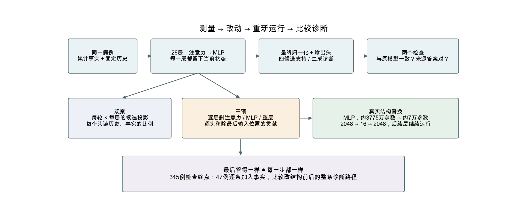

# 怎样从内部测量医学判断，再检验能否简化模型

这轮研究沿着同一个问题展开：患者信息逐步增加时，模型怎样形成诊断；哪些计算决定了这个过程；其中哪些计算可以省掉，哪些会把判断带偏。

## 1. 每一轮究竟看什么

每个病例有原数据集给出的完整题干、四个候选和最终答案。按原文顺序把题干拆成若干组，第t轮只给前t组；每轮重新前向计算。模型没有把上一轮自行生成的答案带入下一轮。本轮使用固定的中性历史或固定的错误旧诊断，研究相同事实在两种背景下怎样被处理。最终答案来自题库；中途信息不全时，没有另造一个“本轮唯一正确诊断”。

模型是Qwen3-1.7B，有28个Transformer层。每层包含注意力计算和MLP计算。所有原模型权重在实验中保持不变；随着证据变化的是激活状态、注意力分配和输出分数。只有专门拟合的小替换模块具有新的参数。

医学信念在这里指模型当前对诊断候选的支持和选择。比较同一模型、同一病例在不同证据轮次与历史下的变化；这个名称不表示模型具有人的信念体验。

| 量 | 具体怎样取得 | 能回答什么 |
|---|---|---|
| 四候选支持 | 最后输入位置经最终归一化及输出头，取四个答案代码的logit再做softmax | 此接口下更偏向哪个候选 |
| 代码总概率 | 四个代码在整个词表的概率之和 | 模型是否真的准备按这个接口作答 |
| 每层投影 | 把各层最后输入位置接到同一个最终归一化及输出头 | 该层状态与最终答案方向是否一致 |
| 注意力 | 28层×16个查询头，最后输入位置对五类词元的注意力总量 | 它在读历史、旧事实还是新增事实 |
| 状态变化 | 整层输入/输出夹角、更新大小、MLP输入与输出 | 某一层改变了多少内部数值 |
| 最终诊断因果作用 | 删除组件，重新计算所有受影响的后续步骤 | 没有它，答案会怎样变 |

五类词元的实际划分来自原提示渲染器：模板/其他、旧证据、新证据、历史JSON、候选列表。诊断提问与作答指令归入模板/其他；该五类分组与上一轮整段通路阻断的分区不同。完整原文与四候选保留在病例图谱中。代码映射固定使用两套，先在每套映射上判定，再在病例内平均；不把两套映射算成两名患者。

候选内的60%表示这四个代码之间的相对支持，不表示患者有60%的患病概率。早层可以投影出一个代码，但它未必已经在执行最终作答任务；同时看代码总概率、两映射一致性及实际删除结果。

## 2. 三条判断标准

**忠实性**：改结构后是否还给出原模型的诊断。**正确性**：是否命中原数据集答案。**更新保持**：每条新证据到来后，改结构前后的诊断路径是否仍一致。

原模型答错时，忠实性高也可能是保留了错误。最终准确率相近，也可能是一批病例被修好、另一批被损坏。因此同时保留修复和损坏计数、四候选分布变化、历史效应，以及全部中间轮次。

## 3. 怎样定位真正有作用的部件

定位集18例，每来源6例，两历史×两映射，共72个提示。

全序列干预：依次删除每层的整层、注意力或MLP，共6048次。改动覆盖全部输入词元，重新计算后续层；并非只把最后读出的数值改一下。

早层整模块删除造成的大变化，首先说明当前计算依赖这些部件；本轮没有把通用语言处理损伤与医学特有知识损伤完全分开，因此不会把这张删除图直接命名为“医学知识存储地图”。

诊断位置干预：在最后一个输入词元上，逐一删除每层16个查询头的贡献，再经过输出投影和后续层。加上该位置的整段注意力、MLP、整层干预，共38304次。另有2016次同样执行路径的自身对照。前面词元的缓存可以精确复用，因为因果注意力中它们不能看到最后位置。

头删除发生在注意力权重乘V之后、各头拼接进入O投影之前。因此测试的是“这个头送入后续计算的贡献”，不是单独改变一张注意力图。它也没有将Q/K/V/O矩阵从模型中删掉，不能据此报告参数压缩。

## 4. 怎样把一个大MLP换成小模块

原MLP由2048→6144的门控非线性计算及6144→2048投影组成，约3775万参数。替换模块学习：给定相同的2048维输入，近似输出原MLP的2048维结果。

具体计算为 `y = ((x − x_mean) @ A) @ B + y_mean`。A把2048维压到16或64维，B再投回2048维。先用训练输入的PCA决定A，再用岭回归拟合B。秩16模块69,632参数，秩64模块266,240参数；保留原归一化与残差连接。

训练只使用18例的内部向量：每提示均匀抽32个词元，另将诊断位置样本固定重复8次，共每层2880行。没有把疾病标签作为拟合目标。另27例只用于评估拟合误差、选择组合结构。来源答案还用于构造固定错误候选、正确历史正对照及开发选择，因此整个流程不能称为完全无标签方法。

替换不是外挂分类器：它装在原模型内部，后续所有层仍正常运行，最终仍由原输出头作答。删模块与替换模块均在运行时实际改变模块树，参数统计来自实际模型；原模型文件不覆盖。

## 5. 怎样判断结果是否成立

18例定位、27例结构开发、345例本轮结构留出互不重叠。最终冻结9个配置，留出期不重排位置、不挑秩。三个来源分别为MedQA194、MedMCQA125、MMLU26。它们是既有题库，不等于新收集的患者病历，也不排除模型预训练见过题目。

345例检验四选项代码；其中按固定哈希每来源20例，共60例，实际生成完整候选文本。未解析或未命中候选的生成计为错误。再用预定47例完整内部队列检验每轮与每层轨迹；不挑干预成功的病例。这里部分候选是病理或病因描述，统一称为诊断类任务，避免把全部题目说成纯疾病命名。

统计以病例为单位，4000次bootstrap给95%区间；全体取值均为1的比例使用精确二项边界区间。来源样本量不等，另给分来源结果与三来源等权重的敏感性汇总。开发保留标准为每种历史至少90%原答案一致率、准确率和代码覆盖率下降不超过2个百分点；留出报告另检查95%一致率及2个百分点非劣区间。提前退出的初筛95%标准未选出28层之前的合格深度，因此保留第27层作为预定检验候选；不能说它在初筛中达标。

计时使用6例、两历史、3次重复，完整模型与变体交错运行，GPU同步，预热后测量已分词输入的预填充与最终词表输出。计时不含加载、分词和持续生成。参数减少与真实加速分别给出。

## 6. 本轮覆盖到哪里

数值核查保留原始浮点输出。代码总概率采用FP32的`exp(logit − logsumexp)`计算，主验证中出现最高约1.00000203的舍入值；概率质量边界允许1e−5浮点容差，没有改写原始值或候选首选。四候选归一化及与logit重算的一致性另行检查。47例轨迹末轮与345例对应记录的候选支持完全一致，首选差异为0。

测到了全部层、每个查询头、MLP/注意力/整层删除、投影、更新路径和实际结构替换。没有逐个删除所有标量权重，也没有逐个分解MLP神经元或证明某个单独神经元代表某疾病。Q/K/V/O参与上述完整计算；单独的投影矩阵干预不在本轮穷尽范围内。这样的层级定位先回答“动哪里有效”，再决定下一轮是否值得深入到某个部件的神经元或子空间。

原始协议：[PROTOCOL](PROTOCOL.md)；增补对照：[ADDITIONAL_CONTROLS](ADDITIONAL_CONTROLS.md)；执行：[REPRODUCE](REPRODUCE.md)。

## 7. 首批结果触发的130例复核

8头干预在首批345例的错误历史代码选择中提高正确率，随后在剩余130例（MedQA82、MedMCQA48）冻结追加检验。比较所选头、两个同层随机集合和同层高历史注意力集合，并加入明确提供正确旧诊断的oracle正对照。前45例结构开发、345例首批验证与这130例互不重叠，合计覆盖严格520例。

首批60例实际病名生成没有呈现相同改善。因此追加130例生成同时保留首步门控，并增加同一组头持续门控所有生成词元的版本。这检验干预覆盖长度，不重新挑头。缓存前向空门控、两个版本的相同预填充均做数值复核；未通过时脚本停止。

本追加共2600个中性/错误历史代码条件、520个正确历史正对照和780次实际生成。具体发生顺序与冻结配置见[FOLLOWUP_HEAD_CONTROLS](FOLLOWUP_HEAD_CONTROLS.md)。
