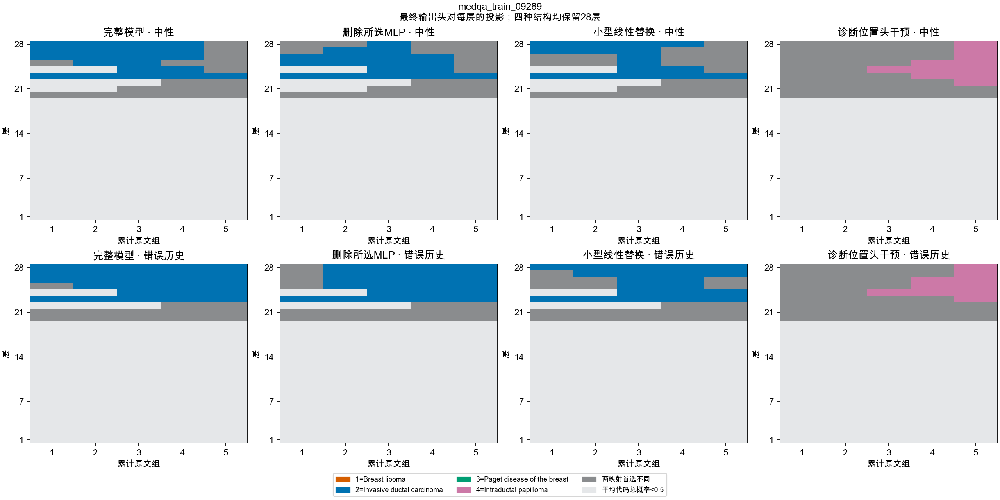

# 一个病例：内部到底从哪个病转向哪个病

这页用一个例子说明怎样读内部变化；总体结论来自345例主验证和另外130例复核。[本例全部原文、候选及图](../results/45_structural_synthesis/cases/medqa_train_09289.md)。

## 病例给了什么

38岁女性，右侧乳头血性分泌物持续3个月；母亲69岁时死于乳腺癌；6个月前乳腺X线检查未见异常；查体没有可触及肿块或腋窝淋巴结肿大；最后补充超声结果：一条导管扩张。原题给出的答案是**导管内乳头状瘤**。

四个候选是乳腺脂肪瘤、浸润性导管癌、乳房Paget病、导管内乳头状瘤。我们把旧诊断固定写为“浸润性导管癌”，逐组加入相同原文。答案编码换两套，检查结论是否依赖某个字母。

## 每条证据进来，选择怎样变化

| 轮次 | 新增内容 | 原模型，两套编码 | 关闭所选8头，两套编码 |
|---|---|---|---|
| 1 | 乳头血性分泌物3个月 | 均选浸润性导管癌 | 一套选导管内乳头状瘤，另一套选Paget病 |
| 2 | 母亲乳腺癌病史 | 均选浸润性导管癌 | 两套仍有上述分歧 |
| 3 | 既往乳腺X线未见异常 | 均选浸润性导管癌 | 两套仍有上述分歧 |
| 4 | 分泌物、无肿块、无腋窝淋巴结肿大 | 均选浸润性导管癌 | 两套仍有上述分歧 |
| 5 | 超声显示单条导管扩张 | 均选浸润性导管癌 | **均选导管内乳头状瘤** |

在干预后原本选Paget病的那套编码中，最后一组加入前，对导管内乳头状瘤的候选内支持为48.44%；加入后变为99.995%。另一套编码更早已偏向乳头状瘤。因此不能把两套编码的平均曲线理解成一个统一、确定的中间诊断。图中的灰色格保留这类分歧。

这些是四候选之间的模型支持，不是患者患病概率。中间轮没有另外指定唯一真值；完整病例才按来源答案判断对错。

## 内部什么时候开始一致

给完五组事实后，把每一层当前状态接到同一个输出头，比较它指向哪个候选。下面仍分别检查两套编码。

| 层 | 原模型的投影方向 | 关闭8头后的投影方向 |
|---|---|---|
| 20—22 | 两套编码不同 | 两套编码仍不同 |
| 23 | 均偏向浸润性导管癌 | **均偏向导管内乳头状瘤** |
| 24—27 | 均偏向浸润性导管癌 | **均偏向导管内乳头状瘤** |
| 28，实际最终代码支持 | 均选浸润性导管癌 | **均选导管内乳头状瘤** |

第23层，干预后两套编码对来源答案的支持分别约99.9%和94.1%；原模型分别约3.6%和0.1%。改动发生在第12、14、15、17、22层的固定头上，后续层重新计算；第23层以后的稳定改变由此产生。我们观察到的不是只改最后显示出来的数字。

读图时先看最下面一排：左边是原模型，右边是头干预。蓝色表示浸润性导管癌，粉色表示导管内乳头状瘤；横轴向右是更多事实，纵轴向上是更深的层。灰色代表编码分歧或代码概率太低，不能读成确定的疾病。最后一列、第23层以上，原模型保持蓝色，干预后变为粉色。

## 小模块替换是不是同一种作用

不是同一种结果。在这个病例上，删除第25、26层MLP，或把它们换成小模块，都没有让错误历史下的最终选择转回来源答案。两种结构的两套编码仍选浸润性导管癌。

这正好说明总体实验为什么要分开两件事：**能否用更少计算保留诊断功能；能否改变错误历史对诊断的牵引。** 本例展示头干预成功，但它不适用于每例；[红斑狼疮旧例](../results/45_structural_synthesis/cases/medqa_train_09811.md)中同一干预没有修好最终选择。所有47例均收录在[完整图谱](../results/45_structural_synthesis/CASE_ATLAS.md)。
