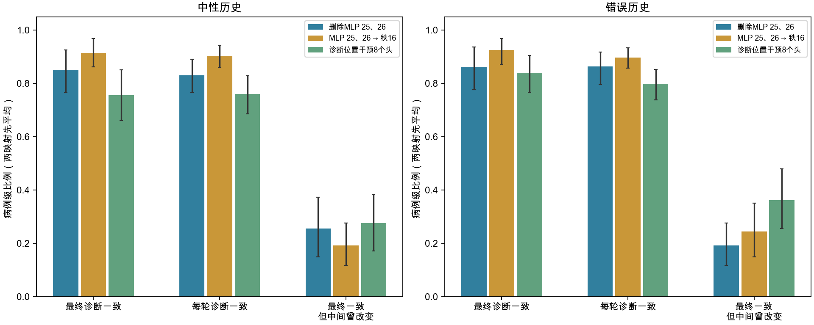
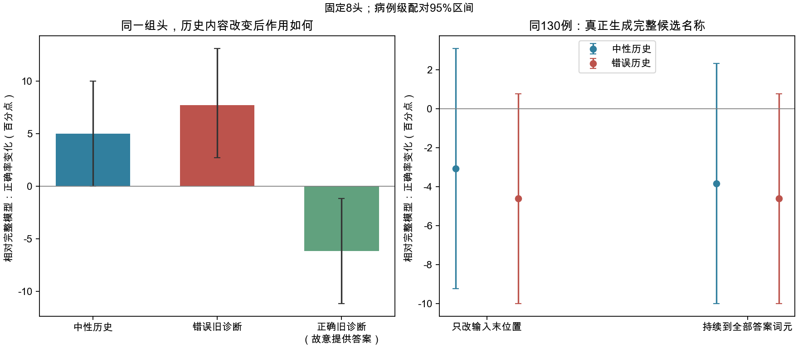

# 医学判断中的关键计算，能否用更小结构保留

本轮已完成从全部层定位、实际结构替换，到留出病例与完整更新轨迹的检验。研究对象是Qwen3-1.7B在三来源诊断类题目上的计算。

**小模块能够补回部分诊断功能；所选注意力头对旧诊断的作用具有方向性和接口依赖；最终判断保持也可能掩盖中间过程改变。** 共520个独立题目，其中45例用于定位/开发、475例分两批验证。[先读中文解释](START_HERE.md)。

## 1. 什么最接近最终诊断，什么真正影响诊断

在严格92例、521个累计前缀的投影中，第25层与同轮最终诊断已达到93.5%／94.3%的一致率（中性／错误历史）。但18例穷尽定位显示，第3层MLP和第20层注意力仍对最终诊断有强作用：分别删除它们，改变69.4%／72.2%及61.1%／44.4%的首选。**答案在后面变得容易读出来，前面的计算仍可能是形成答案所必需的。**

注意力大也不自动意味着作用大：448个头的历史注意力与删除后分布变化的描述性Spearman相关为0.285／0.272。我们依据实际重算后的答案变化定位部件。[每层、每头定位与数值对照](../results/42_structural_localization/RESULTS.md)。

## 2. 真正改结构以后发生了什么

定位18例、组合开发27例、结构留出345例互不重叠。留出来源为MedQA194、MedMCQA125、MMLU26。首批结构实验的独立病例总数为390，60例生成与47例轨迹均为345例的子集；另130例用于随后冻结的注意力头复核，见第7节。

| 结构 | 参数减少 | 中性：正确率 / 原诊断一致率 | 错误历史：正确率 / 原诊断一致率 |
|---|---:|---:|---:|
| 完整模型 | 0.00% | 58.26% / 100.00% | 40.00% / 100.00% |
| 运行前27层 | 2.93% | 58.84% / 97.25% | 40.43% / 95.94% |
| 删MLP 25、26 | 4.39% | 57.25% / 89.71% | 38.99% / 87.97% |
| MLP 25、26 → 秩16 | 4.38% | 59.42% / 94.35% | 41.74% / 92.17% |
| 删第27整层 | 2.93% | 58.55% / 96.23% | 40.14% / 96.23% |
| 诊断位置干预8个头 | 0.00% | 59.42% / 84.06% | 48.26% / 79.42% |
| 对照：删MLP 24、28 | 4.39% | 59.13% / 94.78% | 40.00% / 92.17% |
| 对照：删第14、26整层 | 5.85% | 49.57% / 64.06% | 38.41% / 65.07% |
| MLP 25、26 → 秩64 | 4.36% | 58.99% / 95.80% | 41.45% / 93.19% |

两套代码映射先在同病例内平均。正确率检查来源答案；一致率检查是否保留原模型答案，二者不能互换。完整病例级95%区间和分来源表见[留出结果](../results/44_structural_holdout/RESULTS.md)。

**只运行前27层**，中性与错误历史分别保留97.25%、95.94%的原诊断。准确率相对完整模型变化为0.58% [-0.43, 1.59]、0.43% [-1.01, 1.88]（差值按百分点解释）。整模型参数减少2.93%。

**删除第25、26层MLP**，准确率变化为-1.01% [-2.90, 0.87]／-1.01% [-3.04, 1.01]；但10.29%／12.03%的原诊断发生变化。总体分数接近，不能据此说这两处没有作用。

**用小模块替代这两处MLP**，每处由37,748,736参数变为69,632参数。相对直接删除，原诊断一致率分别提高4.64% [2.46, 6.96]和4.20% [1.74, 6.67]。这直接量化小模块补回了多少功能。与完整模型相比，来源答案命中变化为1.16% [-0.43, 2.75]／1.74% [-0.14, 3.48]。模块用18例内部向量拟合，没有以疾病标签作为拟合目标；开发阶段的结构选择使用了答案评分。

替换后完整模型为1,645,216,768参数，整体减少4.38%。7万参数仅是一个替换部件的大小，并不是完整诊断模型大小。[开发选择与拟合](../results/43_structural_development/RESULTS.md)。

## 3. 错误历史是否随简化而消失

完整模型中，中性与错误历史正确率相差18.26个百分点；秩16替换后仍相差17.68个百分点。局部计算可以简化，旧病名的牵引仍然存在。可压缩性与去偏能力需要分别解释。

诊断位置8个头的固定干预，相对完整模型的准确率变化为1.16% [-1.45, 3.91]／8.26% [5.36, 11.16]。它只在输入最后位置移除这些头的贡献，参数数没有减少。其两历史间的配对作用差以及修复/损坏均保留在[配对对照](../results/44_structural_holdout/paired_contrasts.json)。

## 4. 最后答得一样，中间会不会走不同的路

全部47例、289个累计证据前缀，比较完整模型、删MLP、小模块替换与8头干预。每个条件保留28层投影，完整模型保留28×16头的注意力。图谱涵盖全部病例。

| 结构 | 历史 | 最终与原模型一致 | 各轮与原模型一致 | 最终一致、但中间曾改变 |
|---|---|---|---|---|
| 删MLP 25、26 | 中性 | 85.11% [76.60, 92.55] | 83.02% [76.53, 89.03] | 25.53% [14.89, 37.23] |
| 删MLP 25、26 | 错误历史 | 86.17% [77.66, 93.62] | 86.35% [79.59, 91.82] | 19.15% [11.70, 27.66] |
| MLP 25、26 → 秩16 | 中性 | 91.49% [86.17, 96.81] | 90.37% [85.93, 94.38] | 19.15% [11.70, 27.66] |
| MLP 25、26 → 秩16 | 错误历史 | 92.55% [87.23, 96.81] | 89.69% [85.68, 93.42] | 24.47% [14.89, 35.11] |
| 诊断位置干预8个头 | 中性 | 75.53% [65.96, 85.11] | 75.97% [68.53, 82.95] | 27.66% [17.02, 38.30] |
| 诊断位置干预8个头 | 错误历史 | 84.04% [76.60, 90.43] | 79.89% [73.79, 85.28] | 36.17% [25.53, 47.87] |

读图：前两组柱子越高，保留原判断越多；第三组专门数“最后相同、但前面至少一次选了不同疾病”的轨迹。中间轮没有独立的唯一诊断标签，这里衡量路径改变，不自动将所有中途变化叫作错误。

[47例完整原文、逐轮候选与逐层图](../results/45_structural_synthesis/CASE_ATLAS.md) · [总体动态结果](../results/45_structural_synthesis/RESULTS.md)。

## 5. 实际病名与实际速度

代码选择之外，另在固定60例上实际生成完整候选文本；未解析或不在候选中的输出计错。

| 结构 | 中性答对/60 | 错误历史答对/60 | 相对预填充耗时，95%CI |
|---|---:|---:|---|
| 完整模型 | 37 | 29 | 1.000 |
| 运行前27层 | 35 | 29 | 0.948 [0.912, 0.978] |
| 删MLP 25、26 | 34 | 26 | 0.952 [0.949, 0.954] |
| MLP 25、26 → 秩16 | 35 | 26 | 0.956 [0.951, 0.963] |
| 删第27整层 | 36 | 27 | 0.969 [0.942, 0.988] |
| 诊断位置干预8个头 | 35 | 28 | 1.003 [1.000, 1.006] |
| 对照：删MLP 24、28 | 33 | 23 | 0.952 [0.935, 0.972] |
| 对照：删第14、26整层 | 32 | 18 | 0.925 [0.917, 0.935] |
| MLP 25、26 → 秩64 | 35 | 27 | 0.950 [0.947, 0.953] |

耗时<1表示更快。计时为Apple M2 Pro上6例、两历史、3次交错配对重复的同步预填充与最终词表输出，不包含分词、模型加载和持续生成。参数减少与速度提升分别核实。

## 6. 对照怎样约束结论

秩16相对秩64的原诊断一致率差：中性-1.45% [-2.46, -0.58]；错误历史-1.01% [-2.32, 0.14]。差值按百分点解释。

所选MLP删除相对深度匹配随机删除的一致率差：中性-5.07% [-7.54, -2.61]；错误历史-4.20% [-7.25, -1.01]。差值按百分点解释。

开发集上“小模块比大模块更忠实”的现象没有在345例复现：秩64的原诊断一致率点估计在两种历史下都更高，中性条件的差异区间不跨0。两种秩的正确率差异则都没有明确方向。因此不能把开发阶段的反常现象写成已确认发现。相关比较为探索性区间，不按留出表现重新选层或挑秩。

线性替换、删层和医学内部定位都有直接先例。本研究应将贡献放在证据更新、历史竞争、内部计算与结构取舍之间的关系；[同类工作比较](RELATED_WORK.md)列出LASER、ReplaceMe、医学transcoder及PH3等具体研究。

## 7. 在另外130例上复核注意力头作用

这批MedQA82、MedMCQA48未参与本轮结构选择及首批345例检验。固定两个同层随机集合与一个同层高历史注意力集合，保持每层头数相同；另测试来源答案被明确写为旧诊断的oracle正对照。

| 结构 | 历史 | 来源答案命中 | 相对完整模型变化，95%CI |
|---|---|---|---|
| 完整模型 | neutral | 51.15% [43.46, 58.85] | 0.00% [0.00, 0.00] |
| 完整模型 | wrong | 35.00% [27.69, 42.32] | 0.00% [0.00, 0.00] |
| 所选8个头 | neutral | 56.15% [48.46, 63.85] | 5.00% [0.00, 10.00] |
| 所选8个头 | wrong | 42.69% [35.00, 50.77] | 7.69% [2.69, 13.08] |
| 同层随机集合1 | neutral | 50.38% [42.69, 58.08] | -0.77% [-3.08, 1.54] |
| 同层随机集合1 | wrong | 35.38% [28.46, 43.08] | 0.38% [-2.31, 3.08] |
| 同层随机集合2 | neutral | 50.00% [42.69, 57.31] | -1.15% [-4.23, 1.54] |
| 同层随机集合2 | wrong | 32.69% [25.77, 40.00] | -2.31% [-5.00, 0.38] |
| 同层高历史注意力集合 | neutral | 46.92% [39.23, 54.62] | -4.23% [-7.69, -0.77] |
| 同层高历史注意力集合 | wrong | 28.46% [21.54, 35.38] | -6.54% [-11.15, -2.31] |

[第二批完整结果、同层对照与实际候选生成](../results/46_structural_head_followup/RESULTS.md)。两批结构验证合计475例，加上45例定位/开发，共覆盖严格520例。第二批由第一批结果触发，报告保留这个先后关系，不称一次性事先设计的全部实验。

## 8. 同一部件的作用，取决于历史内容与作答接口

所选8头干预在另外130例的错误历史代码选择中，从35.00%提高到42.69%，配对差7.69个百分点，95%CI [2.69, 13.08]。同层随机集合1、2及高历史注意力集合分别达到35.38%、32.69%、28.46%；所选头相对三个对照的配对检验经Holm校正均小于0.01。三个对照均排除所选头。**看历史更多并不意味着关闭后更能改善诊断，必须直接检验该计算的作用。**

当历史明确给出来源答案时，同样的8头干预使代码命中从81.92%降至75.77%，差−6.15个百分点，95%CI [−11.15, −1.15]。干预在错误历史下的作用比正确历史下高13.85个百分点，[7.69, 20.38]。这一oracle对照支持这组头参与旧诊断利用的解释；它们既可能传递帮助，也可能传递误导，并非普遍无用的组件。

同130例错误历史下，完整候选生成中原模型答对54例，首步关头和持续关头都答对48例；两者相对原模型差均为−4.62个百分点，[−10.00, 0.77]。中性条件分别为70、66、65例。延长同一干预没有改善完整生成。代码收益减去名称生成收益的同病例配对差为12.31个百分点，[5.38, 20.00]；该比较包含两映射代码接口与原顺序名称接口的设计差异，尚未单独分离编码和顺序。**这组部件改变了特定作答过程，代码选择的改善不能直接解释为医学知识增强。**

首批60例也保留在报告中；在同60例上代码与名称干预收益的差异区间跨0。130例配对结果提供了更清楚的接口差异，但不删除第一批结果。[同病例接口统计](../results/46_structural_head_followup/INTERFACE_AND_HISTORY.md)。

具体到导管内乳头状瘤病例，干预使最后一组事实后两套编码均转回来源答案，第23—28层的投影也一致改变；早期轮次仍有编码分歧。小MLP替换并未修好这个病例，而是在总体上恢复直接删除所丢失的功能。这说明“替代计算”和“减轻旧诊断牵引”是不同目标。[逐轮、逐层中文解释](ONE_CASE_EXPLAINED.md)。

据此，下一阶段应检验条件性地调节历史通路，以及用完整名称与逐证据过程共同约束小模块拟合。本轮没有训练这样的条件门控，也没有把两种改动组合成已验证成品。

## 复核与交付

完整模型28层、448个查询头；定位包含6048次全输入组件删除、38304次最后位置组件删除及2016次自身对照。27例比较16个开发配置；345例比较9个冻结配置，共12,420个代码提示条件。60例完成1080次完整文本生成；47例完成4624个逐证据结构条件。每个病例与其来源答案、四候选均能追溯。

[测量定义](MEASUREMENT.md) · [实验协议](PROTOCOL.md) · [复现命令](REPRODUCE.md) · [最终机器核验](FINAL_VALIDATION.json) · [论文论证结构](../acl_paper/v09_structure/ARGUMENT_STRUCTURE.md)。全部使用本地GPU，API费用0美元。
