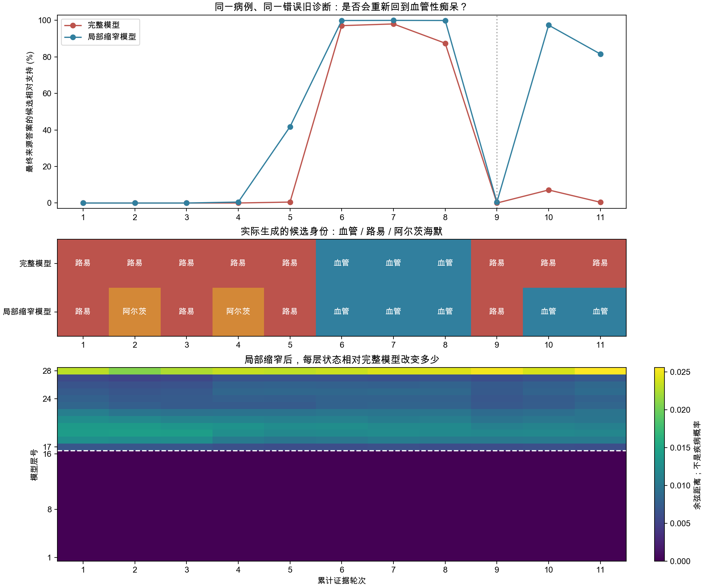

# 用一个病例看清：结构改变了哪一步

原题最终答案是**血管性痴呆**。给两个模型的全部事实完全相同，额外放入同一个错误旧诊断：**路易体痴呆**。比较完整模型与后12层MLP通道减半的模型；后者所选适配器为零增量，因此这个例子测到的是结构变化。两者都使用普通自由生成，避免把输出约束造成的差异混进来。

这个例子在结果后选作解释，属于预先固定24例图谱的一员，不代表总体效果。

## 先看它说出了什么

完整模型在第6轮已经选中最终来源答案，第9轮因加入“腿上淤青、步态不稳”又回到路易体痴呆，最终停在那里。压缩模型第9轮也偏回去，但第10轮重新回到血管性痴呆，并保持到最后。

所以，这个病例并不是原模型从未生成过正确诊断。它曾经到达正确候选，后来又离开；改变部分计算，使它后面的轨迹不同。单个病例不能证明被裁掉的模块普遍有害，400例仍会同时出现修复和损坏。

## 每条事实到来后的实际记录

候选支持是四个完整名称的相对模型分数，不是患者真实患病概率。两个模型此处使用相同评分公式。

| 轮次 | 新增来源事实的中文摘要 | 完整模型实际名称 | 压缩模型实际名称 | 完整模型对血管性痴呆的支持 | 压缩模型的支持 |
|---|---|---|---|---:|---:|
| 1 | 66岁男性，因行为改变由女儿送诊。 | 路易体痴呆 | 路易体痴呆 | 0.00% | 0.01% |
| 2 | 昨天比平时更困惑，反复问同样的问题。 | 路易体痴呆 | 阿尔茨海默病痴呆 | 0.00% | 0.00% |
| 3 | 这些症状持续24小时没有改善。 | 路易体痴呆 | 路易体痴呆 | 0.00% | 0.00% |
| 4 | 去年一系列跌倒后，生活自理能力下降。 | 路易体痴呆 | 阿尔茨海默病痴呆 | 0.03% | 0.54% |
| 5 | 之后不能自己做饭或缴费，其余情况直到这次发作前相对稳定。 | 路易体痴呆 | 路易体痴呆 | 0.53% | 41.79% |
| 6 | 既往有心肌梗死、高血压、糖尿病等疾病。 | 血管性痴呆 | 血管性痴呆 | 97.12% | 99.93% |
| 7 | 提供包括降压药、降糖药在内的当前用药。 | 血管性痴呆 | 血管性痴呆 | 98.05% | 100.00% |
| 8 | 查体时困惑，个人照料较差。 | 血管性痴呆 | 血管性痴呆 | 87.51% | 99.95% |
| 9 | 腿上有淤青，步态不稳。 | 路易体痴呆 | 路易体痴呆 | 0.00% | 0.54% |
| 10 | 对人物、地点有定向力，但部分回答不恰当。 | 路易体痴呆 | 血管性痴呆 | 7.16% | 97.39% |
| 11 | 脉搏90次/分，血压170/100 mmHg。 | 路易体痴呆 | 血管性痴呆 | 0.43% | 81.59% |

## 模型里面测到了什么

每次读完当前累计证据，我们取出每层作答位置的2048维向量。前16层没有改动，两个模型这些位置的状态最大绝对差为0；从第17层开始出现差异，因为裁剪从这里开始。最后一轮，第28层两模型状态的余弦距离为0.02559；最终候选支持则从完整模型的0.43%变为压缩模型的81.59%。

这说明结构改动确实改变了后半段内部状态，也改变了最终候选选择。热图本身只显示变化幅度，不能把黄色直接叫作“更相信血管性痴呆”。还没有从这个例子单独定位出一个专门负责该病的层或神经元。

[完整英文原文、四候选与两种历史](../results/50_structure_trajectories/cases/medqa_train_04812.md) · [全部24例汇总](../results/50_structure_trajectories/RESULTS.md) · [独立400例表现](../results/49_structure_confirmation/RESULTS.md)。
