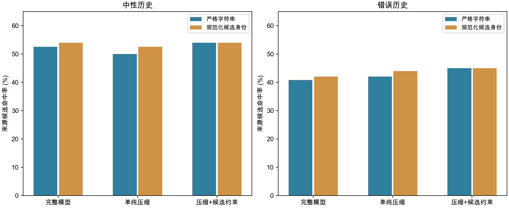
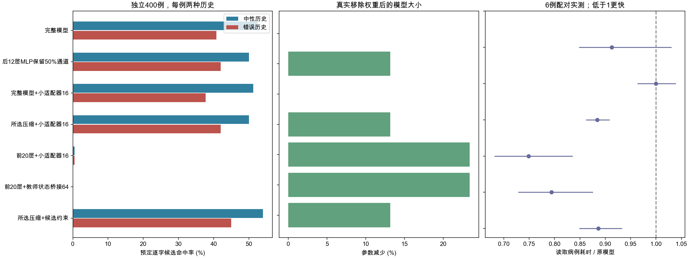
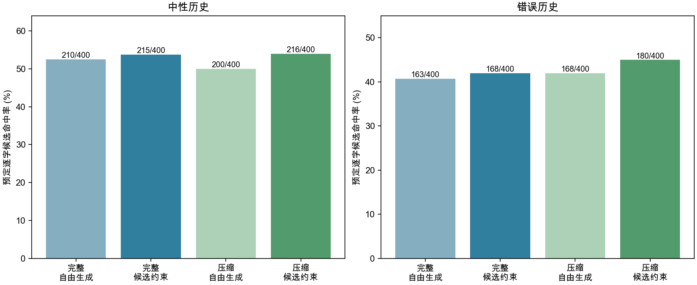
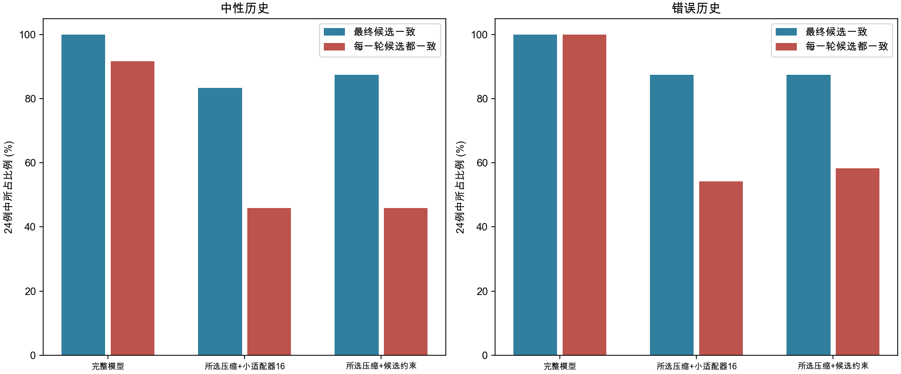

# 医学信念：输入、结构、输出分别影响什么

## 1 本轮判断

这轮选出了可运行的压缩路线：保留层数、缩窄后半段；实际模型更小，回答耗时更短。所选方案实际减少了13.16%参数。严格字符串评分显示的准确率收益，在清理空格、冠词和标点差异后明显缩小。

相对原自由生成模型，原预定逐字评分的平均增益为+2.88个百分点，95%区间[+1.12, +4.75]，Holm p=0.005999；统一表面写法后为+1.50个百分点，95%区间[+0.00, +3.00]，敏感性六项内Holm p=0.2585。同一压缩模型加候选约束的28个严格评分修复中，18个原回答已经写出了正确候选的规范化名称。评分规范化是在主结果后增加的敏感性检查，原方案选择及原评分结果均保留。 单纯通道压缩与输出约束的效果必须分开；本轮没有得到“只要增加适配器就显著提升诊断”的结果。

用户提出的解释是：模型的错误可能来自输入、输出或内部多余计算，而不完全是不会诊断。本轮实际修改这些环节，比较哪些错误被修复、哪些原正确答案被损坏，以及计算量是否下降。

## 2 数据和操作

新增880个原题病例，两个来源各440。400训练、80开发、400确认，病例ID与前540例分离；数据集原始划分与本实验分组不是一回事。这里是诊断相关医学考试题，最终答案来自源题库；不是模型编造病例，也不是临床随访。

每例四个原始候选、同一组患者事实。中性历史写“尚未确定”，错误历史固定放入一个错误候选。每轮重新输入累计证据和固定历史，不将模型上一轮回答自动回填。中间前缀没有独立唯一诊断真值；最终完整材料才按来源答案评分。

模型训练参数不会随每条证据到来自动变化。逐轮记录的是激活、候选支持和实际诊断；本轮结构裁剪或小模块训练是在测试前完成的。

题干含“诊断”不保证选项都是病名，例如ASCA positivity是检查特征，另有题干与分子机制选项不吻合。已将9个明确条目单列，并在366例基础上另做来源答案类型敏感性；不将400例全部称为纯疾病命名。[范围审计](ANSWER_SCOPE.md)。

初始筛选漏检了28例来源问题，后续只根据原文复核，原训练和方案选择保留。原400例确认、386例来源文本子集、366例再去除近重复子集分别报告。[源文本审计与分词修正](SOURCE_AUDIT.md)。

## 3 试过哪些结构与小模块

22种配置覆盖整层截断、局部删层、删MLP、全层/晚层通道裁剪、注意力头组裁剪、旧两MLP线性替换、晚层贡献缩放、层间对比解码、5个输出端适配器、前20层到28层的教师状态桥接，以及3个候选约束对照。只用80例开发结果选择方法，随后冻结7个确认配置。

开发比较中，全层MLP保留75%通道削减15.36%参数，中性/错误历史仅答对33/18例；后12层MLP通道减半削减13.16%，答对54/43例。相近的参数节省，不同位置的代价明显不同。直接前20层的合法输出为0/160；强制它在候选中输出以后答对22/19例，仍远低于完整模型55/39例。

这支持优先研究**保留深度、局部缩窄**，而不能把大量尾层直接视为无用。以上是开发结果，最终确认如下。

## 4 独立400例的真实名称生成

每个格子均以400例为分母。规范化仅清理表面写法，要求唯一匹配四个原候选之一，不采用同义词模型或真值驱动解析。[评分核查](SCORING_AUDIT.md)。

| 方法 | 规范化中性/错误历史 | 逐字中性/错误历史 | 逐字合法中性/错误历史 | 参数减少 |
|---|---:|---:|---:|---:|
| 完整模型 | 216/168 | 210/163 | 394/389 | 0.00% |
| 后12层MLP保留50%通道 | 210/176 | 200/168 | 374/380 | 13.16% |
| 完整模型+小适配器16 | 208/155 | 205/151 | 391/386 | -0.00% |
| 所选压缩+小适配器16 | 210/176 | 200/168 | 374/380 | 13.16% |
| 前20层+小适配器16 | 2/2 | 2/2 | 4/3 | 23.40% |
| 前20层+教师状态桥接64 | 0/0 | 0/0 | 2/2 | 23.39% |
| 所选压缩+候选约束 | 216/180 | 216/180 | 400/400 | 13.16% |
| 完整模型+候选约束 | 215/168 | 215/168 | 400/400 | 0.00% |

最后一行完整模型候选约束是主结果之后追加的解释性对照，前七项为冻结的确认配置。补充同样输出规则的完整模型后，压缩模型相对它的平均差为+1.62个百分点，95%区间[+0.12, +3.13]。这项追加解释性对照出现小幅优势，主要在错误历史条件；需要新增病例确认，尚不足以宣布医学能力普遍提高。

严格文本与近重复子集保留366例。规范化评分下，主方案中性/错误历史答对200/167例，原模型为199/155例；两种历史平均差为+1.78个百分点，95%区间[+0.27, +3.42]。

原逐字评分中，原模型与纯压缩的两条件答对数分别为210/163和200/168；规范化数值见上表。这表明削减计算会同时修复和损坏病例，不能只统计改善例子。每种方法的修复、损坏、来源分层、配对区间与多重校正见[确认报告](../results/49_structure_confirmation/RESULTS.md)。

## 5 小模块为什么没有直接变成更强的诊断器

4096参数的逐维适配器将开发损失从2.178降到1.649，但中性答对从55/80降到50/80，错误历史仍39/80。67600参数适配器选择第100步；更大264256参数版本与压缩骨干上的67600参数版本均退回第0步。退回零初始化意味着没有生效的训练改动，不能称为适配器修复成功。

前20层的适配器使开发损失从11.161降到4.699；266240参数桥接使内部状态均方误差从8.588降到2.281。两者都没有恢复到原模型的完整诊断表现。**拟合答案文字更容易、内部向量更像原模型，与真实诊断更准，是不同的成功标准。**

所有骨干权重冻结；完整与压缩骨干使用相同400例、相同67600参数模块、相同更新设置。最终直接比较见[训练与结构配对图](../results/49_structure_confirmation/figures/training_vs_structure.png)。本轮训练仍含9例后续标记的来源问题，数据规模和当前训练目标限制了对适配器的广泛判断。[训练细节与曲线](../results/48_adapter_training/RESULTS.md)。

## 6 哪些错误来自输入或输出

补充同样输出规则的完整模型后，压缩模型相对它的平均差为+1.62个百分点，95%区间[+0.12, +3.13]。这项追加解释性对照出现小幅优势，主要在错误历史条件；需要新增病例确认，尚不足以宣布医学能力普遍提高。 同400例的四格为完整/压缩骨干×自由/约束生成，进一步区分裁剪效应与输出约束效应。追加对照单独登记，未混入原六项确认检验。

去掉所有旧诊断历史，原模型答对213/400；同患者事实下，规范化评分的错误历史条件为168/400。这里改变了历史内容及对应消息，不能单独称为一种纯内部知识测量。

相同压缩骨干增加输出约束，以下按原逐字评分统计：

- neutral：相对同样的压缩骨干，约束将15个非法名称修复为正确答案，将1个合法错误候选改成正确答案，损坏0个原本正确的答案。原本合法时，有1例换了病名。
- wrong：相对同样的压缩骨干，约束将11个非法名称修复为正确答案，将1个合法错误候选改成正确答案，损坏0个原本正确的答案。原本合法时，有2例换了病名。

约束只使用已给出的四个候选，不使用哪个正确；它可能修复拼写、JSON及表外病名。其中18/28个严格修复原本已有正确的规范化名称。其余10个仍包含错拼、简称和疾病用词变化，不能全称为医学推理被纠正。未做监督权重更新的变换能改变对错，说明最终错误对输入和计算路径敏感；所有方法仍答错也不能证明模型内部绝对没有相关信息。

将“任一方法答对”的病例合并，需要知道真值后选择方法，仅用于错误可恢复性分析，不能宣称实际系统准确率。结构选型本身用了80例来源答案，因此也不将整个流程称为无监督。

## 7 参数与真实速度

读取完整病例的耗时比为0.89 [0.85, 0.93]；固定生成12个词元为0.87 [0.86, 0.89]；实际生成完整答案为0.86 [0.85, 0.86]。比值低于1表示更快。这是Apple M2 Pro上6例的交错配对实测，区间按病例估计。

在两者使用相同候选约束的直接配对中，读取病例耗时比为0.95 [0.72, 1.23]，实际回答耗时比为0.85 [0.81, 0.89]（压缩/完整）。

参数减少13.16%，主要来自真实切除MLP矩阵通道。保留28层意味着注意力层数和KV缓存层数不变。读取病例、固定长度缓存生成、实际回答分别测量；无效答案过长也会增加实际回答时间。全部测速明细见[确认报告](../results/49_structure_confirmation/RESULTS.md)。

## 8 最终相同，判断过程是否也相同

[血管性痴呆病例的逐轮解释](ONE_CASE_EXPLAINED.md)用同一评分公式比较两种结构：完整模型曾经选对，后来离开；缩窄模型在后续证据后重新回来。它是结果后挑出的说明例，以下用全部预定病例汇总。

确认前固定24例，两个来源各12；共147个累计证据前缀，3种配置×2种历史，记录882个轮次条件。来源与近重复严格子集保留22例。

以下一致性以规范化候选身份计算。

| 方法 | 历史 | 最终同原模型/24 | 每轮都同原模型/24 | 最终同但中途不同/24 |
|---|---|---:|---:|---:|
| 完整模型 | neutral | 24 | 22 | 0 |
| 完整模型 | wrong | 24 | 24 | 0 |
| 所选压缩+小适配器16 | neutral | 20 | 11 | 8 |
| 所选压缩+小适配器16 | wrong | 21 | 13 | 7 |
| 所选压缩+候选约束 | neutral | 21 | 11 | 9 |
| 所选压缩+候选约束 | wrong | 21 | 14 | 7 |

每轮保存实际名称、完整候选序列支持、长度归一化敏感性分数、每层输出位置的2048维向量，以及输出适配器前后向量。向量距离只告诉我们改变多大；疾病方向要结合候选支持和实际名称。两个无效回答不算诊断一致，也不直接算疾病改变；过程不同要求至少一轮两个合法候选实际不同。[全部病例与原始数据](../results/50_structure_trajectories/RESULTS.md)。

对同一压缩骨干的294个前缀条件，增加输出约束前后，读完证据时全部层状态最大绝对差为0，输出端向量最大差为0，原始病名有18个条件不同，规范化候选身份有18个条件不同，其中17个是无法匹配变为合法候选，仅1个是在两个合法候选间改变。这里检验的是开始续写前的状态，后续生成状态可能分岔。约束还改变了分数归一化；这类分数变化不能单独当作内部医学信念更新。

## 9 放回论文的三层逻辑

第一层观察同一患者事实如何受旧诊断影响，结合证据增加与顺序改变。第二层通过逐层测量、激活与通路干预区分证据处理和作答位置。第三层真正改变模型，检验可压缩性、答案恢复与证据更新路径是否一致。

上一轮所选注意力头在错误历史的编码选择中有益，正确历史利用却受损，完整名称生成没有同样改善。本轮又看到训练损失和状态拟合不能替代实际诊断检验。两轮共同要求把“内部可读”“计算有作用”“最终答对”和“过程保留”分别测量，而非只用一张读出图证明医学信念。

适配器、剪枝和线性替层均有直接先例；本研究的论证应围绕医学证据、旧诊断利用和实际作答之间的关系。[相关方法](RELATED_METHODS.md) · [三层论证架构](../acl_paper/v10_adapters/ARGUMENT_STRUCTURE.md) · [整合中文稿](../acl_paper/v10_adapters/PAPER_ZH.md)。

## 10 复现与核验

[复现命令](REPRODUCE.md) · [冻结配置](../runs/structural_v2/confirmation_selection.json) · [最终运行核验](FINAL_VALIDATION.json)。原模型权重散列保持不变；所有失败配置、原始生成与来源审计保留。本轮模型API费用0美元。
