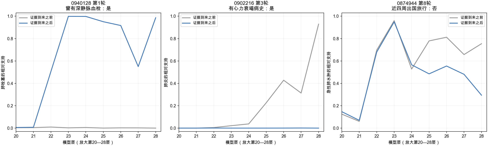

# 阶段01：逐层医学信念更新的探索性观察

## 方法

Qwen3-1.7B，28层。DDxPlus六类疾病各2例，共12例；每例逐组揭示全部明确记录，构成131个证据前缀。独立前向计算，禁用思考生成，不输入前轮回答。使用共享输出头读取各层残差状态，归一化为六种疾病的相对支持。另对9个前缀完成六种循环答案映射，共176个模型观察点。

## 结果

| 指标 | 结果 |
|---|---:|
| 初始首选与数据标签一致 | 2/12例 |
| 终点首选与数据标签一致 | 7/12例 |
| 曾先正确后错误 | 4/12例 |
| 相邻轮首选疾病切换 | 23次 |
| 换位后首选疾病改变 | 4/9个前缀 |

病例0940128加入既往深静脉血栓后，第24—28层首选从哮喘转为肺栓塞，终端肺栓塞支持升至98.64%。病例0902216加入心力衰竭病史后，第26—28层由肺炎转向肺水肿，肺炎支持由92.89%降至不足0.001%。病例0874944加入“近四周未出国旅行”后，第24—27层仍首选肺水肿，终端层改为肺栓塞。

## 结论

新证据可同时改变后几层的疾病支持，也可使终端选择偏离前面几层的读出。选项映射敏感性提示，单一病例、单一编码下的逐层分歧尚不足以确定稳定机制。扩展实验需要独立病例复现、编码对照、顺序配对、独立读出评价及局部干预。

图中内部支持为未经独立校准的原始输出头读出。本阶段为探索性样本，不用于估计总体临床能力。

[逐病例表](case_metrics.csv) · [统计摘要](summary.json)
