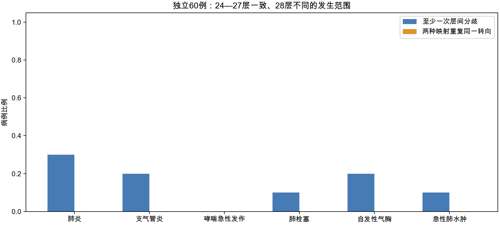
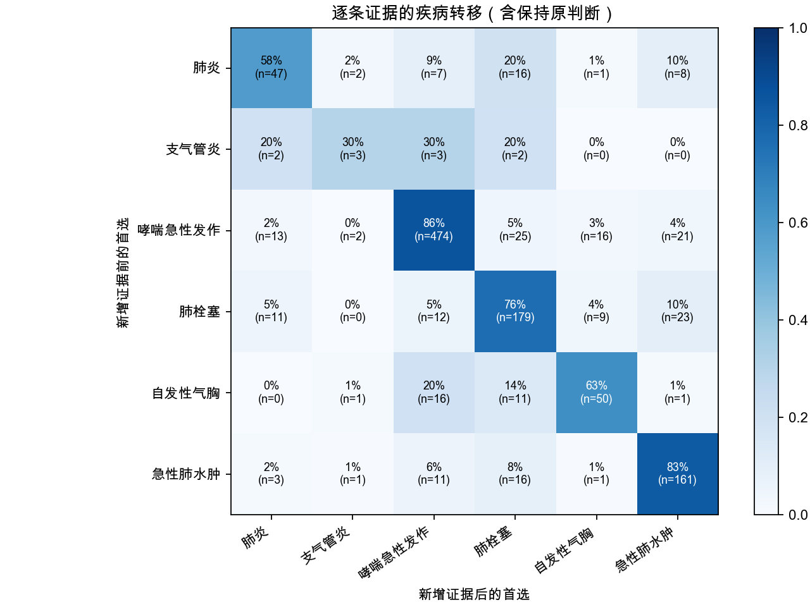
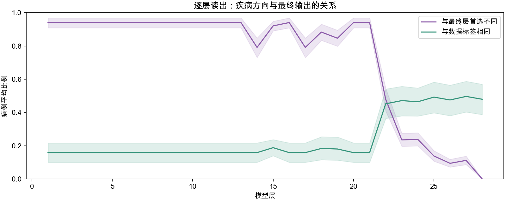
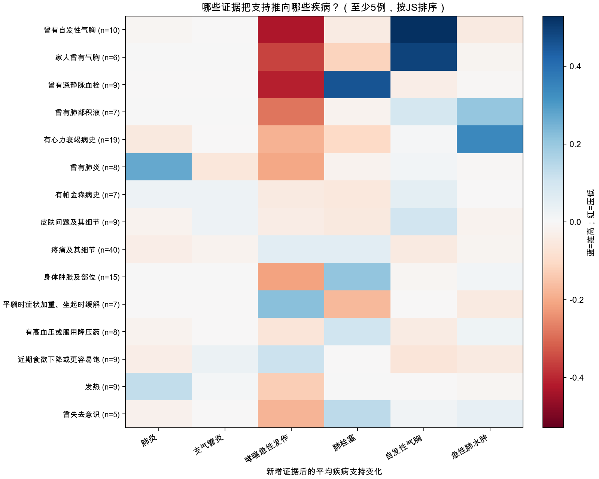

# 阶段02：独立病例中的层间分歧与诊断转移

## 方法

新增60个DDxPlus病例，六类疾病各10例；另保留12例探索病例。年龄18—90岁，至少4组新增明确证据，按固定哈希选择，逐组揭示全部记录。所有前缀运行两种循环映射；初始、中间和终点补齐六映射。主要分析以新增病例为单位；区间为2000次病例bootstrap的95%区间，病例事件比例为0或1时使用精确二项边界区间。

评分取诊断位置未采样logits的六类归一化分布，不要求生成完整回答。“正确/错误”指与数据最终标签的关系，不将早期资料不全时的标签偏离单独判为临床推理错误。两个时间点均有唯一首选且疾病不同才计为疾病切换；并列单独记录。

层间分歧定义为：第24—27层原始输出头读出一致首选同一疾病，而第28层首选其他疾病。跨映射重复要求同一前缀在两种映射下都出现分歧，且转向的疾病对相同。

## 结果

| 指标 | 新增60例中的结果 |
|---|---|
| 至少一次层间分歧的病例 | 15.00% [6.67, 25.00] |
| 病例平均前缀分歧率 | 1.05% [0.43, 1.78] |
| 两映射重复同一分歧的病例 | 0.00% [0.00, 5.96] |
| 两映射重复的前缀比例 | 0.00%（样本内全零） |
| 前面层标签正确、末层标签错误的前缀比例 | 0.38% [0.08, 0.77] |
| 前面层标签错误、末层标签正确的前缀比例 | 0.35% [0.00, 0.81] |
| 曾先对后错的病例 | 43.33% [30.00, 56.67] |
| 前面四层维持原首选、末层随新证据翻转的病例 | 8.33% [1.67, 16.67] |
| 终点首选随映射改变的病例 | 58.33% [45.00, 70.00] |
| 六映射平均支持的终点标签一致率 | 61.67% [48.33, 73.33] |

共有9/60例出现层间分歧，其中0/60例在两种映射下重复同一疾病转向。探索12例单独报告于统计文件，未进入上表。

## 支持强度与错误方向

首选错误且候选支持至少90%的病例平均前缀比例为35.60% [27.74, 44.11]。至少一次出现“保持同一错误首选、支持增加超过5个百分点”的病例比例为58.33% [45.00, 70.00]。六类Brier分数的病例平均值为0.9381 [0.7678, 1.1167]。这些是概率偏好的描述性指标，不表示临床患病概率已经校准。

## 证据类型与疾病方向

对每个证据问题，先在病例内平均两种映射，再对出现该问题的病例平均。下图显示至少5个病例中出现的证据组，按JS变化选前15组；完整问题表均保留。这是条件于当前上下文的描述性关联，不是对某条证据固有临床权重的估计。

[全部证据组统计](evidence_group_effects.csv)

## 输出形式对照

终点改为直接输出疾病名称后，与代码六映射平均首选的一致率为80.00% [72.22, 87.22]；名称完整序列评分的标签一致率为62.22% [50.56, 73.33]。按名称每词元平均分评分时，首选改变比例为3.33% [0.56, 7.22]。名称序列总概率均值为0.276513。

名称总log概率为主分析，每词元平均log概率为长度敏感性分析。名称与代码任务并不等价；差异说明测量依赖，不能只选更准确的评分形式作为结论。

## 结论

层间分歧在新增病例中出现，但跨映射重复病例数由9降至0。本轮没有支持“前面四层保持医学信念、末层稳定推翻它”的跨编码机制解释。原始层读出表示该固定读出下可见的疾病支持，是否参与最终决策由阶段04的局部替换进一步检验。

[逐病例指标](case_metrics.csv) · [完整证据转移](evidence_transitions.csv) · [层间分歧表](layer_divergence.csv) · [72例图谱索引](CASE_ATLAS.md) · [名称对照](name_endpoint_controls.csv)
