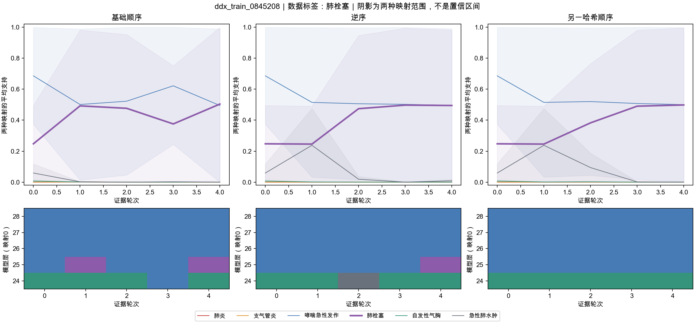

# ddx_train_0845208

队列：replication；数据标签：肺栓塞；新增证据组数：4。

| 基础轮次 | 新证据 | 原始明确记录 |
|---|---|---|
| 0 | 身体局部肿胀（同时揭示部位）：是（E_151） | Do you have swelling in one or more areas of your body? Yes；Where is the swelling located? posterior aspect of the ankle(R); posterior aspect of the ankle(L); calf(R); calf(L) |
| 1 | 近四周出国旅行：否（E_204） | Have you traveled out of the country in the last 4 weeks? No |
| 2 | 近一个月接受过手术：是（E_196） | Have you had surgery within the last month? Yes |
| 3 | 本次就诊相关疼痛（同时揭示性质、位置、程度、放射等记录）：是（E_53） | Do you have pain somewhere, related to your reason for consulting? Yes；Characterize your pain: sensitive; a knife stroke; sharp；Do you feel pain somewhere? side of the chest(R); side of the chest(L); scapula(R); scapula(L); posterior chest wall(L)；How intense is the pain? dataset scale value 6；Does the pain radiate to another location? side of the chest(R); scapula(R); breast(R); posterior chest wall(R); posterior chest wall(L)；How precisely is the pain located? dataset scale value 5；How fast did the pain appear? dataset scale value 8 |
| 4 | 曾失去意识：是（E_159） | Did you lose consciousness? Yes |
