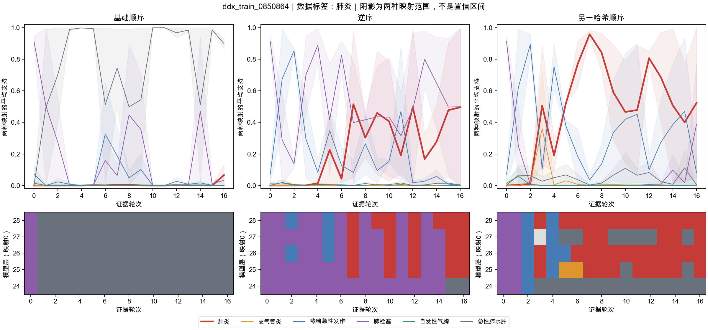

# ddx_train_0850864

队列：replication；数据标签：肺炎；新增证据组数：16。

| 基础轮次 | 新证据 | 原始明确记录 |
|---|---|---|
| 0 | 咯血：是（E_45） | Have you been coughing up blood? Yes |
| 1 | 有心力衰竭病史：是（E_106） | Do you have heart failure? Yes |
| 2 | BMI低于18.5或体重过低：是（E_208） | Is your BMI less than 18.5, or are you underweight? Yes |
| 3 | 咳嗽：是（E_201） | Do you have a cough? Yes |
| 4 | 有慢性阻塞性肺疾病病史：是（E_122） | Do you have a chronic obstructive pulmonary disease (COPD)? Yes |
| 5 | 有自认为与本次就诊相关的皮肤问题（同时揭示颜色、位置、程度等记录）：是（E_129） | Do you have any lesions, redness or problems on your skin that you believe are related to the condition you are consulting for? Yes；What color is the rash? pink；Do your lesions peel off? Yes；Is the rash swollen? dataset scale value 2；Where is the affected region located? cervical spine; thoracic spine; flank(R); shoulder(L)；How intense is the pain caused by the rash? dataset scale value 0；Is the lesion (or are the lesions) larger than 1cm? No；How severe is the itching? dataset scale value 3 |
| 6 | 近期食欲下降或更容易饱：是（E_161） | Have you recently had a loss of appetite or do you get full more quickly then usually? Yes |
| 7 | 近四周出国旅行：否（E_204） | Have you traveled out of the country in the last 4 weeks? No |
| 8 | 广泛肌肉疼痛：是（E_144） | Do you have diffuse (widespread) muscle pain? Yes |
| 9 | 鼻塞或流清鼻涕：是（E_181） | Do you have nasal congestion or a clear runny nose? Yes |
| 10 | 咳嗽，痰变色或增多：是（E_77） | Do you have a cough that produces colored or more abundant sputum than usual? Yes |
| 11 | 寒战：是（E_94） | Have you had chills or shivers? Yes |
| 12 | 曾有肺炎：是（E_117） | Have you ever had pneumonia? Yes |
| 13 | 过量饮酒或酒精依赖：是（E_78） | Do you drink alcohol excessively or do you have an addiction to alcohol? Yes |
| 14 | 本次就诊相关疼痛（同时揭示性质、位置、程度、放射等记录）：是（E_53） | Do you have pain somewhere, related to your reason for consulting? Yes；Characterize your pain: a knife stroke；Do you feel pain somewhere? lower chest; side of the chest(R); upper chest；How intense is the pain? dataset scale value 3；Does the pain radiate to another location? nowhere；How precisely is the pain located? dataset scale value 1；How fast did the pain appear? dataset scale value 4 |
| 15 | 有帕金森病史：是（E_95） | Do you have Parkinson’s disease? Yes |
| 16 | 明显气短或呼吸困难：是（E_66） | Are you experiencing shortness of breath or difficulty breathing in a significant way? Yes |
