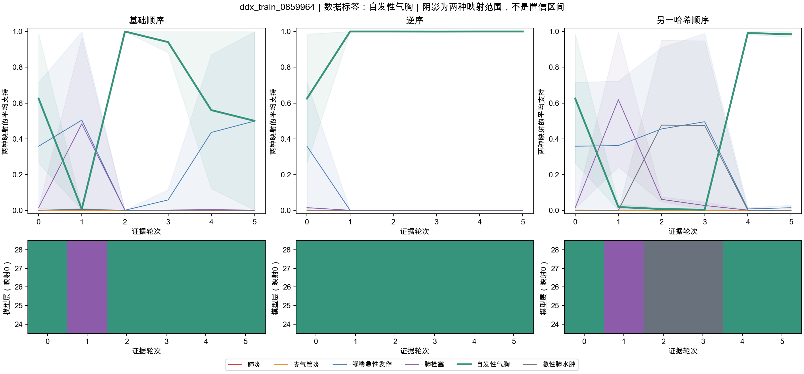

# ddx_train_0859964

队列：replication；数据标签：自发性气胸；新增证据组数：5。

| 基础轮次 | 新证据 | 原始明确记录 |
|---|---|---|
| 0 | 本次就诊相关疼痛（同时揭示性质、位置、程度、放射等记录）：是（E_53） | Do you have pain somewhere, related to your reason for consulting? Yes；Characterize your pain: a knife stroke; violent；Do you feel pain somewhere? lower chest; side of the chest(L); breast(R); breast(L)；How intense is the pain? dataset scale value 6；Does the pain radiate to another location? nowhere；How precisely is the pain located? dataset scale value 1；How fast did the pain appear? dataset scale value 7 |
| 1 | 深吸气使疼痛加重：是（E_220） | Do you have pain that is increased when you breathe in deeply? Yes |
| 2 | 家人曾有气胸：是（E_165） | Have any of your family members ever had a pneumothorax? Yes |
| 3 | 近四周出国旅行：否（E_204） | Have you traveled out of the country in the last 4 weeks? No |
| 4 | 明显气短或呼吸困难：是（E_66） | Are you experiencing shortness of breath or difficulty breathing in a significant way? Yes |
| 5 | 曾有自发性气胸：是（E_21） | Have you ever had a spontaneous pneumothorax? Yes |
