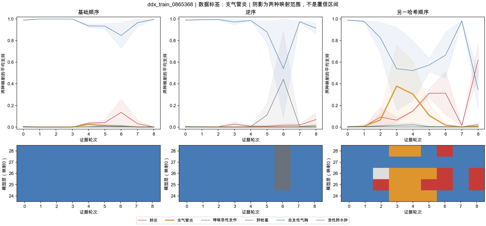

# ddx_train_0865368

队列：replication；数据标签：支气管炎；新增证据组数：8。

| 基础轮次 | 新证据 | 原始明确记录 |
|---|---|---|
| 0 | 咳嗽：是（E_201） | Do you have a cough? Yes |
| 1 | 呼气时有喘鸣：是（E_214） | Have you noticed a wheezing sound when you exhale? Yes |
| 2 | 吸烟：是（E_79） | Do you smoke cigarettes? Yes |
| 3 | 近四周出国旅行：否（E_204） | Have you traveled out of the country in the last 4 weeks? No |
| 4 | 有慢性阻塞性肺疾病病史：是（E_122） | Do you have a chronic obstructive pulmonary disease (COPD)? Yes |
| 5 | 鼻塞或流清鼻涕：是（E_181） | Do you have nasal congestion or a clear runny nose? Yes |
| 6 | 夜间症状更明显：是（E_219） | Are your symptoms more prominent at night? Yes |
| 7 | 本次就诊相关疼痛（同时揭示性质、位置、程度、放射等记录）：是（E_53） | Do you have pain somewhere, related to your reason for consulting? Yes；Characterize your pain: burning；Do you feel pain somewhere? lower chest; side of the chest(R); pharynx; breast(L); posterior chest wall(L)；How intense is the pain? dataset scale value 1；Does the pain radiate to another location? nowhere；How precisely is the pain located? dataset scale value 5；How fast did the pain appear? dataset scale value 2 |
| 8 | 明显气短或呼吸困难：是（E_66） | Are you experiencing shortness of breath or difficulty breathing in a significant way? Yes |
