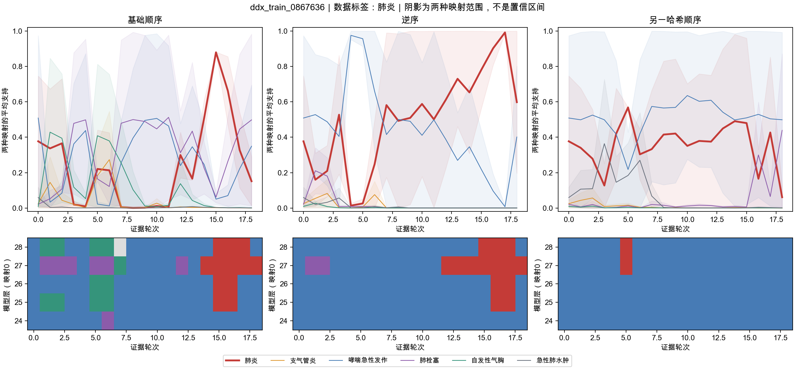

# ddx_train_0867636

队列：replication；数据标签：肺炎；新增证据组数：18。

| 基础轮次 | 新证据 | 原始明确记录 |
|---|---|---|
| 0 | 本次出现疲倦、全身不适、肌痛或整体状态变化：是（E_175） | Have you noticed any new fatigue, generalized and vague discomfort, diffuse (widespread) muscle aches or a change in your general well-being related to your consultation today? Yes |
| 1 | 有自认为与本次就诊相关的皮肤问题（同时揭示颜色、位置、程度等记录）：是（E_129） | Do you have any lesions, redness or problems on your skin that you believe are related to the condition you are consulting for? Yes；What color is the rash? pink；Do your lesions peel off? Yes；Is the rash swollen? dataset scale value 5；Where is the affected region located? thoracic spine; lumbar spine; commissure(L); buttock(R); shoulder(L)；How intense is the pain caused by the rash? dataset scale value 0；Is the lesion (or are the lesions) larger than 1cm? No；How severe is the itching? dataset scale value 0 |
| 2 | 吸烟：是（E_79） | Do you smoke cigarettes? Yes |
| 3 | 有慢性阻塞性肺疾病病史：是（E_122） | Do you have a chronic obstructive pulmonary disease (COPD)? Yes |
| 4 | 夜间症状更明显：是（E_219） | Are your symptoms more prominent at night? Yes |
| 5 | 有帕金森病史：是（E_95） | Do you have Parkinson’s disease? Yes |
| 6 | 发热：是（E_91） | Do you have a fever (either felt or measured with a thermometer)? Yes |
| 7 | 本次就诊相关疼痛（同时揭示性质、位置、程度、放射等记录）：是（E_53） | Do you have pain somewhere, related to your reason for consulting? Yes；Characterize your pain: sharp；Do you feel pain somewhere? posterior chest wall(R); posterior chest wall(L)；How intense is the pain? dataset scale value 5；Does the pain radiate to another location? nowhere；How precisely is the pain located? dataset scale value 7；How fast did the pain appear? dataset scale value 0 |
| 8 | 鼻塞或流清鼻涕：是（E_181） | Do you have nasal congestion or a clear runny nose? Yes |
| 9 | 近期食欲下降或更容易饱：是（E_161） | Have you recently had a loss of appetite or do you get full more quickly then usually? Yes |
| 10 | 广泛肌肉疼痛：是（E_144） | Do you have diffuse (widespread) muscle pain? Yes |
| 11 | 明显气短或呼吸困难：是（E_66） | Are you experiencing shortness of breath or difficulty breathing in a significant way? Yes |
| 12 | 曾有肺炎：是（E_117） | Have you ever had pneumonia? Yes |
| 13 | BMI低于18.5或体重过低：是（E_208） | Is your BMI less than 18.5, or are you underweight? Yes |
| 14 | 咳嗽，痰变色或增多：是（E_77） | Do you have a cough that produces colored or more abundant sputum than usual? Yes |
| 15 | 有哮喘或曾用支气管扩张药：是（E_124） | Do you have asthma or have you ever had to use a bronchodilator in the past? Yes |
| 16 | 咳嗽：是（E_201） | Do you have a cough? Yes |
| 17 | 近四周出国旅行：否（E_204） | Have you traveled out of the country in the last 4 weeks? No |
| 18 | 寒战：是（E_94） | Have you had chills or shivers? Yes |
