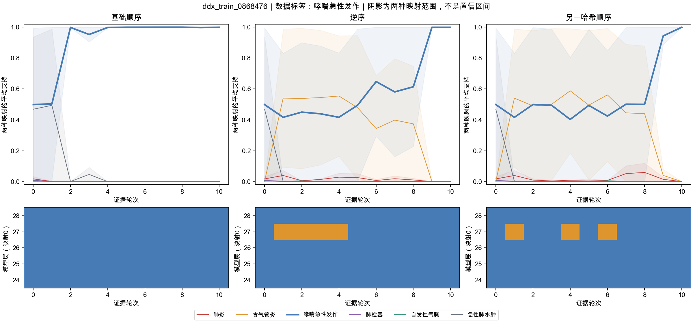

# ddx_train_0868476

队列：replication；数据标签：哮喘急性发作；新增证据组数：10。

| 基础轮次 | 新证据 | 原始明确记录 |
|---|---|---|
| 0 | 咳嗽：是（E_201） | Do you have a cough? Yes |
| 1 | 明显气短或呼吸困难：是（E_66） | Are you experiencing shortness of breath or difficulty breathing in a significant way? Yes |
| 2 | 过去一年因哮喘住院：是（E_101） | Have you been hospitalized for an asthma attack in the past year? Yes |
| 3 | 更容易发生常见过敏：是（E_226） | Are you more likely to develop common allergies than the general population? Yes |
| 4 | 近四周出国旅行：否（E_204） | Have you traveled out of the country in the last 4 weeks? No |
| 5 | 有哮喘或曾用支气管扩张药：是（E_124） | Do you have asthma or have you ever had to use a bronchodilator in the past? Yes |
| 6 | 家人有哮喘：是（E_85） | Do you have any family members who have asthma? Yes |
| 7 | 每天接触二手烟：是（E_222） | Are you exposed to secondhand cigarette smoke on a daily basis? Yes |
| 8 | 住在大城市：是（E_207） | Do you live in in a big city? Yes |
| 9 | 曾被诊断慢性鼻窦炎：是（E_119） | Have you been diagnosed with chronic sinusitis? Yes |
| 10 | 近两周有感冒：是（E_116） | Have you had a cold in the last 2 weeks? Yes |
