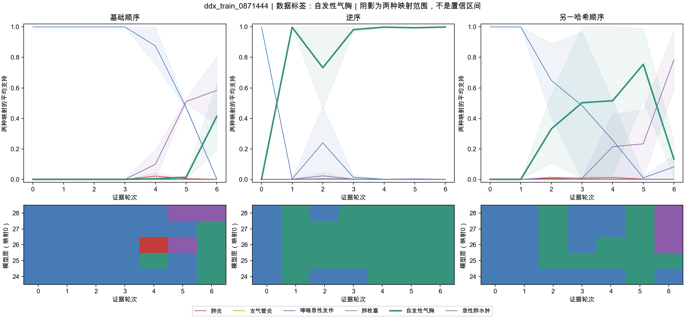

# ddx_train_0871444

队列：replication；数据标签：自发性气胸；新增证据组数：6。

| 基础轮次 | 新证据 | 原始明确记录 |
|---|---|---|
| 0 | 活动时症状加重、休息时缓解：是（E_218） | Do you have symptoms that are increased with physical exertion but alleviated with rest? Yes |
| 1 | 吸烟：是（E_79） | Do you smoke cigarettes? Yes |
| 2 | 休息时也有胸痛：是（E_14） | Do you have chest pain even at rest? Yes |
| 3 | 近四周出国旅行：否（E_204） | Have you traveled out of the country in the last 4 weeks? No |
| 4 | 家人曾有气胸：是（E_165） | Have any of your family members ever had a pneumothorax? Yes |
| 5 | 本次就诊相关疼痛（同时揭示性质、位置、程度、放射等记录）：是（E_53） | Do you have pain somewhere, related to your reason for consulting? Yes；Characterize your pain: heartbreaking; violent；Do you feel pain somewhere? lower chest; side of the chest(R); breast(R); breast(L)；How intense is the pain? dataset scale value 10；Does the pain radiate to another location? nowhere；How precisely is the pain located? dataset scale value 1；How fast did the pain appear? dataset scale value 10 |
| 6 | 曾有自发性气胸：是（E_21） | Have you ever had a spontaneous pneumothorax? Yes |
