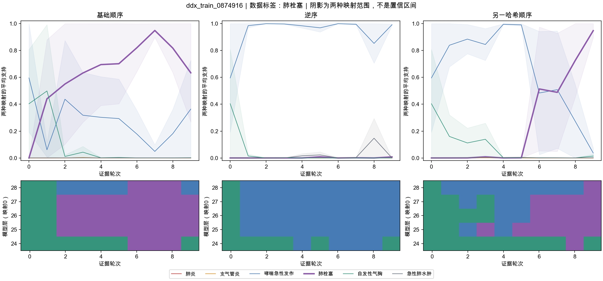

# ddx_train_0874916

队列：replication；数据标签：肺栓塞；新增证据组数：9。

| 基础轮次 | 新证据 | 原始明确记录 |
|---|---|---|
| 0 | 明显气短或呼吸困难：是（E_66） | Are you experiencing shortness of breath or difficulty breathing in a significant way? Yes |
| 1 | 曾有深静脉血栓：是（E_109） | Have you ever had deep vein thrombosis (DVT)? Yes |
| 2 | 近四周出国旅行：North America（E_204） | Have you traveled out of the country in the last 4 weeks? North America |
| 3 | 咯血：是（E_45） | Have you been coughing up blood? Yes |
| 4 | 近一个月接受过手术：是（E_196） | Have you had surgery within the last month? Yes |
| 5 | 曾失去意识：是（E_159） | Did you lose consciousness? Yes |
| 6 | 身体局部肿胀（同时揭示部位）：nowhere（E_151） | Where is the swelling located? nowhere |
| 7 | 深吸气使疼痛加重：是（E_220） | Do you have pain that is increased when you breathe in deeply? Yes |
| 8 | 本次就诊相关疼痛（同时揭示性质、位置、程度、放射等记录）：是（E_53） | Do you have pain somewhere, related to your reason for consulting? Yes；Characterize your pain: sensitive; a knife stroke; sharp；Do you feel pain somewhere? side of the chest(R); side of the chest(L); scapula(R); scapula(L); posterior chest wall(R)；How intense is the pain? dataset scale value 2；Does the pain radiate to another location? side of the chest(R); scapula(L); breast(L); posterior chest wall(R); posterior chest wall(L)；How precisely is the pain located? dataset scale value 7；How fast did the pain appear? dataset scale value 9 |
| 9 | 过去四周有连续超过三天不能活动或起床：是（E_110） | Have you been unable to move or get up for more than 3 consecutive days within the last 4 weeks? Yes |
