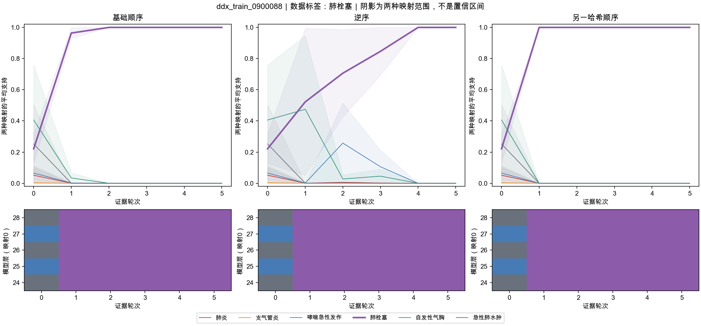

# ddx_train_0900088

队列：replication；数据标签：肺栓塞；新增证据组数：5。

| 基础轮次 | 新证据 | 原始明确记录 |
|---|---|---|
| 0 | 身体局部肿胀（同时揭示部位）：是（E_151） | Do you have swelling in one or more areas of your body? Yes；Where is the swelling located? posterior aspect of the ankle(R); calf(L) |
| 1 | 近四周出国旅行：North America（E_204） | Have you traveled out of the country in the last 4 weeks? North America |
| 2 | 曾有深静脉血栓：是（E_109） | Have you ever had deep vein thrombosis (DVT)? Yes |
| 3 | 目前患有活动性癌症：是（E_34） | Do you have an active cancer? Yes |
| 4 | 本次就诊相关疼痛（同时揭示性质、位置、程度、放射等记录）：是（E_53） | Do you have pain somewhere, related to your reason for consulting? Yes；Characterize your pain: sensitive; sharp；Do you feel pain somewhere? side of the chest(R); side of the chest(L); scapula(L); breast(L); epigastric；How intense is the pain? dataset scale value 6；Does the pain radiate to another location? upper chest; scapula(L); posterior chest wall(R)；How precisely is the pain located? dataset scale value 7；How fast did the pain appear? dataset scale value 4 |
| 5 | 咯血：是（E_45） | Have you been coughing up blood? Yes |
