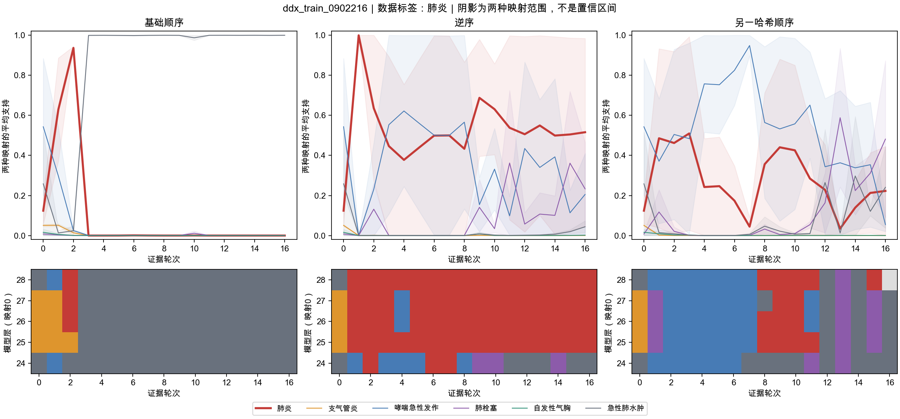

# ddx_train_0902216

队列：pilot；数据标签：肺炎；新增证据组数：16。

| 基础轮次 | 新证据 | 原始明确记录 |
|---|---|---|
| 0 | 咳嗽，痰变色或增多：是（E_77） | Do you have a cough that produces colored or more abundant sputum than usual? Yes |
| 1 | 咳嗽：是（E_201） | Do you have a cough? Yes |
| 2 | 近期食欲下降或更容易饱：是（E_161） | Have you recently had a loss of appetite or do you get full more quickly then usually? Yes |
| 3 | 有心力衰竭病史：是（E_106） | Do you have heart failure? Yes |
| 4 | 近四周出国旅行：否（E_204） | Have you traveled out of the country in the last 4 weeks? No |
| 5 | 吸烟：是（E_79） | Do you smoke cigarettes? Yes |
| 6 | 寒战：是（E_94） | Have you had chills or shivers? Yes |
| 7 | 广泛肌肉疼痛：是（E_144） | Do you have diffuse (widespread) muscle pain? Yes |
| 8 | 有慢性阻塞性肺疾病病史：是（E_122） | Do you have a chronic obstructive pulmonary disease (COPD)? Yes |
| 9 | 本次就诊相关疼痛（同时揭示性质、位置、程度、放射等记录）：是（E_53） | Do you have pain somewhere, related to your reason for consulting? Yes；Characterize your pain: a knife stroke；Do you feel pain somewhere? side of the chest(L); posterior chest wall(L)；How intense is the pain? dataset scale value 4；Does the pain radiate to another location? nowhere；How precisely is the pain located? dataset scale value 3；How fast did the pain appear? dataset scale value 6 |
| 10 | 明显气短或呼吸困难：是（E_66） | Are you experiencing shortness of breath or difficulty breathing in a significant way? Yes |
| 11 | 有帕金森病史：是（E_95） | Do you have Parkinson’s disease? Yes |
| 12 | 近一个月接受过手术：是（E_196） | Have you had surgery within the last month? Yes |
| 13 | 疫苗按时接种：是（E_209） | Are your vaccinations up to date? Yes |
| 14 | 有哮喘或曾用支气管扩张药：是（E_124） | Do you have asthma or have you ever had to use a bronchodilator in the past? Yes |
| 15 | 有自认为与本次就诊相关的皮肤问题（同时揭示颜色、位置、程度等记录）：是（E_129） | Do you have any lesions, redness or problems on your skin that you believe are related to the condition you are consulting for? Yes；What color is the rash? pink；Do your lesions peel off? Yes；Is the rash swollen? dataset scale value 5；Where is the affected region located? side of the neck(R); buttock(L); posterior chest wall(R); shoulder(L)；How intense is the pain caused by the rash? dataset scale value 3；Is the lesion (or are the lesions) larger than 1cm? No；How severe is the itching? dataset scale value 3 |
| 16 | 曾有肺炎：是（E_117） | Have you ever had pneumonia? Yes |
