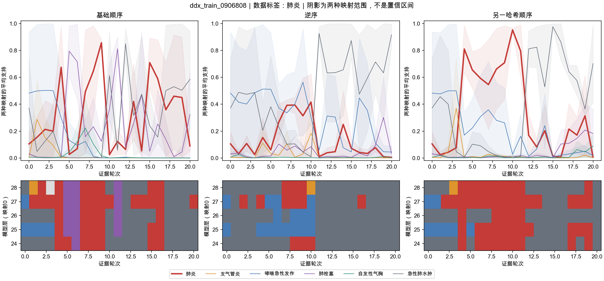

# ddx_train_0906808

队列：replication；数据标签：肺炎；新增证据组数：20。

| 基础轮次 | 新证据 | 原始明确记录 |
|---|---|---|
| 0 | 本次出现疲倦、全身不适、肌痛或整体状态变化：是（E_175） | Have you noticed any new fatigue, generalized and vague discomfort, diffuse (widespread) muscle aches or a change in your general well-being related to your consultation today? Yes |
| 1 | 广泛肌肉疼痛：是（E_144） | Do you have diffuse (widespread) muscle pain? Yes |
| 2 | 疫苗按时接种：是（E_209） | Are your vaccinations up to date? Yes |
| 3 | 夜间症状更明显：是（E_219） | Are your symptoms more prominent at night? Yes |
| 4 | 曾有肺炎：是（E_117） | Have you ever had pneumonia? Yes |
| 5 | 本次就诊相关疼痛（同时揭示性质、位置、程度、放射等记录）：是（E_53） | Do you have pain somewhere, related to your reason for consulting? Yes；Characterize your pain: a knife stroke；Do you feel pain somewhere? side of the chest(R); side of the chest(L); upper chest; posterior chest wall(L)；How intense is the pain? dataset scale value 7；Does the pain radiate to another location? nowhere；How precisely is the pain located? dataset scale value 4；How fast did the pain appear? dataset scale value 0 |
| 6 | 近期食欲下降或更容易饱：是（E_161） | Have you recently had a loss of appetite or do you get full more quickly then usually? Yes |
| 7 | 有自认为与本次就诊相关的皮肤问题（同时揭示颜色、位置、程度等记录）：是（E_129） | Do you have any lesions, redness or problems on your skin that you believe are related to the condition you are consulting for? Yes；What color is the rash? pink；Do your lesions peel off? Yes；Is the rash swollen? dataset scale value 6；Where is the affected region located? back of the neck; thoracic spine; lumbar spine; commissure(R); side of the neck(R)；How intense is the pain caused by the rash? dataset scale value 1；Is the lesion (or are the lesions) larger than 1cm? No；How severe is the itching? dataset scale value 1 |
| 8 | 咳嗽，痰变色或增多：是（E_77） | Do you have a cough that produces colored or more abundant sputum than usual? Yes |
| 9 | 咯血：是（E_45） | Have you been coughing up blood? Yes |
| 10 | 有心力衰竭病史：是（E_106） | Do you have heart failure? Yes |
| 11 | 近四周出国旅行：否（E_204） | Have you traveled out of the country in the last 4 weeks? No |
| 12 | 鼻塞或流清鼻涕：是（E_181） | Do you have nasal congestion or a clear runny nose? Yes |
| 13 | 有慢性阻塞性肺疾病病史：是（E_122） | Do you have a chronic obstructive pulmonary disease (COPD)? Yes |
| 14 | 过量饮酒或酒精依赖：是（E_78） | Do you drink alcohol excessively or do you have an addiction to alcohol? Yes |
| 15 | 寒战：是（E_94） | Have you had chills or shivers? Yes |
| 16 | 近一个月接受过手术：是（E_196） | Have you had surgery within the last month? Yes |
| 17 | 吸烟：是（E_79） | Do you smoke cigarettes? Yes |
| 18 | 深吸气使疼痛加重：是（E_220） | Do you have pain that is increased when you breathe in deeply? Yes |
| 19 | 咳嗽：是（E_201） | Do you have a cough? Yes |
| 20 | BMI低于18.5或体重过低：是（E_208） | Is your BMI less than 18.5, or are you underweight? Yes |
