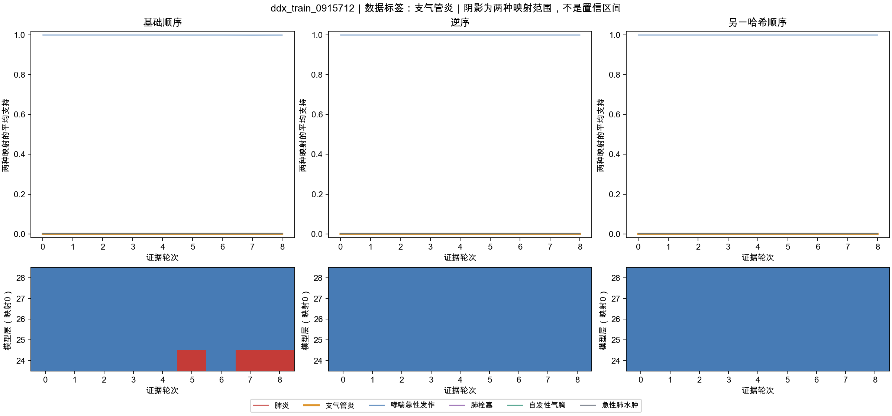

# ddx_train_0915712

队列：pilot；数据标签：支气管炎；新增证据组数：8。

| 基础轮次 | 新证据 | 原始明确记录 |
|---|---|---|
| 0 | 呼气时有喘鸣：是（E_214） | Have you noticed a wheezing sound when you exhale? Yes |
| 1 | 发热：是（E_91） | Do you have a fever (either felt or measured with a thermometer)? Yes |
| 2 | 咳嗽：是（E_201） | Do you have a cough? Yes |
| 3 | 疫苗按时接种：是（E_209） | Are your vaccinations up to date? Yes |
| 4 | 近四周出国旅行：否（E_204） | Have you traveled out of the country in the last 4 weeks? No |
| 5 | 夜间症状更明显：是（E_219） | Are your symptoms more prominent at night? Yes |
| 6 | 有慢性阻塞性肺疾病病史：是（E_122） | Do you have a chronic obstructive pulmonary disease (COPD)? Yes |
| 7 | 咽痛：是（E_97） | Do you have a sore throat? Yes |
| 8 | 本次就诊相关疼痛（同时揭示性质、位置、程度、放射等记录）：是（E_53） | Do you have pain somewhere, related to your reason for consulting? Yes；Characterize your pain: sensitive；Do you feel pain somewhere? side of the chest(R); upper chest; breast(R); posterior chest wall(R); posterior chest wall(L)；How intense is the pain? dataset scale value 5；Does the pain radiate to another location? nowhere；How precisely is the pain located? dataset scale value 1；How fast did the pain appear? dataset scale value 1 |
