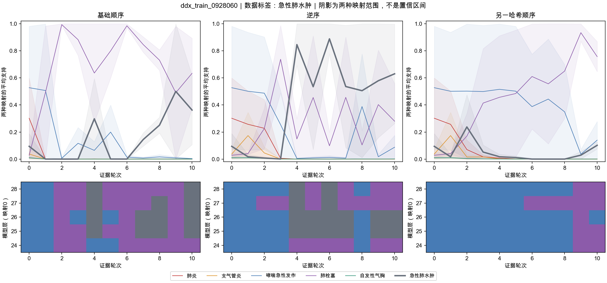

# ddx_train_0928060

队列：replication；数据标签：急性肺水肿；新增证据组数：10。

| 基础轮次 | 新证据 | 原始明确记录 |
|---|---|---|
| 0 | 本次出现疲倦、全身不适、肌痛或整体状态变化：是（E_175） | Have you noticed any new fatigue, generalized and vague discomfort, diffuse (widespread) muscle aches or a change in your general well-being related to your consultation today? Yes |
| 1 | 曾有心肌梗死或有心绞痛：是（E_105） | Have you ever had a heart attack or do you have angina (chest pain)? Yes |
| 2 | 身体局部肿胀（同时揭示部位）：是（E_151） | Do you have swelling in one or more areas of your body? Yes；Where is the swelling located? ankle(R); ankle(L); calf(R); tibia(L) |
| 3 | 平躺时症状加重、坐起时缓解：是（E_217） | Are your symptoms worse when lying down and alleviated while sitting up? Yes |
| 4 | 曾有肺部积液：是（E_5） | Have you ever had fluid in your lungs? Yes |
| 5 | 有高血压或服用降压药：是（E_104） | Do you have high blood pressure or do you take medications to treat high blood pressure? Yes |
| 6 | 明显气短或呼吸困难：是（E_66） | Are you experiencing shortness of breath or difficulty breathing in a significant way? Yes |
| 7 | 有心力衰竭病史：是（E_106） | Do you have heart failure? Yes |
| 8 | 出汗明显增多：是（E_50） | Have you had significantly increased sweating? Yes |
| 9 | 本次就诊相关疼痛（同时揭示性质、位置、程度、放射等记录）：是（E_53） | Do you have pain somewhere, related to your reason for consulting? Yes；Characterize your pain: tedious; sensitive; tugging；Do you feel pain somewhere? ankle(L); side of the chest(L); calf(R); breast(R); posterior chest wall(R)；How intense is the pain? dataset scale value 4；Does the pain radiate to another location? biceps(L); chin; jaw; scapula(L); shoulder(L)；How precisely is the pain located? dataset scale value 7；How fast did the pain appear? dataset scale value 0 |
| 10 | 近四周出国旅行：否（E_204） | Have you traveled out of the country in the last 4 weeks? No |
