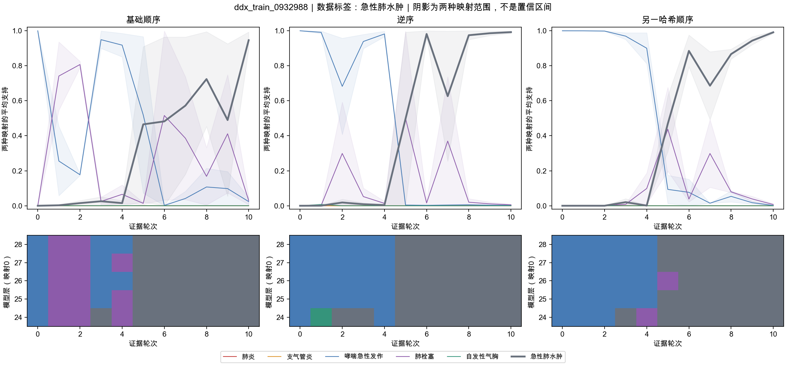

# ddx_train_0932988

队列：replication；数据标签：急性肺水肿；新增证据组数：10。

| 基础轮次 | 新证据 | 原始明确记录 |
|---|---|---|
| 0 | 活动时症状加重、休息时缓解：是（E_218） | Do you have symptoms that are increased with physical exertion but alleviated with rest? Yes |
| 1 | 身体局部肿胀（同时揭示部位）：是（E_151） | Do you have swelling in one or more areas of your body? Yes；Where is the swelling located? ankle(R); ankle(L); calf(L); tibia(R); tibia(L) |
| 2 | 明显气短或呼吸困难：是（E_66） | Are you experiencing shortness of breath or difficulty breathing in a significant way? Yes |
| 3 | 平躺时症状加重、坐起时缓解：是（E_217） | Are your symptoms worse when lying down and alleviated while sitting up? Yes |
| 4 | 近四周出国旅行：否（E_204） | Have you traveled out of the country in the last 4 weeks? No |
| 5 | 本次就诊相关疼痛（同时揭示性质、位置、程度、放射等记录）：是（E_53） | Do you have pain somewhere, related to your reason for consulting? Yes；Characterize your pain: tedious; tugging; heavy；Do you feel pain somewhere? lower chest; side of the chest(R); side of the chest(L); breast(R); posterior chest wall(R)；How intense is the pain? dataset scale value 5；Does the pain radiate to another location? chin; jaw; scapula(R); shoulder(R); shoulder(L)；How precisely is the pain located? dataset scale value 6；How fast did the pain appear? dataset scale value 8 |
| 6 | 有心力衰竭病史：是（E_106） | Do you have heart failure? Yes |
| 7 | 夜间因憋气或气短醒来：是（E_67） | Do you have bouts of choking or shortness of breath that wake you up at night? Yes |
| 8 | 有高血压或服用降压药：是（E_104） | Do you have high blood pressure or do you take medications to treat high blood pressure? Yes |
| 9 | 曾有心肌梗死或有心绞痛：是（E_105） | Have you ever had a heart attack or do you have angina (chest pain)? Yes |
| 10 | 曾有肺部积液：是（E_5） | Have you ever had fluid in your lungs? Yes |
