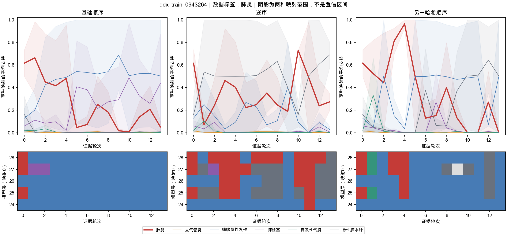

# ddx_train_0943264

队列：replication；数据标签：肺炎；新增证据组数：13。

| 基础轮次 | 新证据 | 原始明确记录 |
|---|---|---|
| 0 | 发热：是（E_91） | Do you have a fever (either felt or measured with a thermometer)? Yes |
| 1 | 有自认为与本次就诊相关的皮肤问题（同时揭示颜色、位置、程度等记录）：是（E_129） | Do you have any lesions, redness or problems on your skin that you believe are related to the condition you are consulting for? Yes；What color is the rash? pink；Do your lesions peel off? Yes；Is the rash swollen? dataset scale value 1；Where is the affected region located? thoracic spine; lumbar spine; buttock(L); belly; shoulder(R)；How intense is the pain caused by the rash? dataset scale value 5；Is the lesion (or are the lesions) larger than 1cm? No；How severe is the itching? dataset scale value 1 |
| 2 | 有慢性阻塞性肺疾病病史：是（E_122） | Do you have a chronic obstructive pulmonary disease (COPD)? Yes |
| 3 | 夜间症状更明显：是（E_219） | Are your symptoms more prominent at night? Yes |
| 4 | 本次就诊相关疼痛（同时揭示性质、位置、程度、放射等记录）：是（E_53） | Do you have pain somewhere, related to your reason for consulting? Yes；Characterize your pain: a knife stroke；Do you feel pain somewhere? side of the chest(R); side of the chest(L); breast(L); posterior chest wall(R); posterior chest wall(L)；How intense is the pain? dataset scale value 5；Does the pain radiate to another location? nowhere；How precisely is the pain located? dataset scale value 6；How fast did the pain appear? dataset scale value 3 |
| 5 | 有哮喘或曾用支气管扩张药：是（E_124） | Do you have asthma or have you ever had to use a bronchodilator in the past? Yes |
| 6 | 咯血：是（E_45） | Have you been coughing up blood? Yes |
| 7 | 广泛肌肉疼痛：是（E_144） | Do you have diffuse (widespread) muscle pain? Yes |
| 8 | 曾有肺炎：是（E_117） | Have you ever had pneumonia? Yes |
| 9 | 深吸气使疼痛加重：是（E_220） | Do you have pain that is increased when you breathe in deeply? Yes |
| 10 | 有帕金森病史：是（E_95） | Do you have Parkinson’s disease? Yes |
| 11 | 咳嗽：是（E_201） | Do you have a cough? Yes |
| 12 | 近四周出国旅行：否（E_204） | Have you traveled out of the country in the last 4 weeks? No |
| 13 | 有心力衰竭病史：是（E_106） | Do you have heart failure? Yes |
