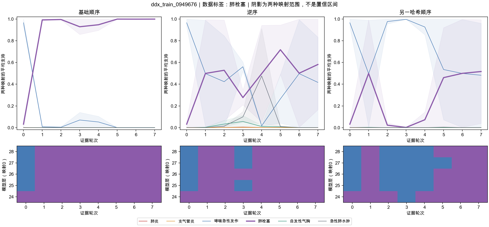

# ddx_train_0949676

队列：replication；数据标签：肺栓塞；新增证据组数：7。

| 基础轮次 | 新证据 | 原始明确记录 |
|---|---|---|
| 0 | 本次就诊相关疼痛（同时揭示性质、位置、程度、放射等记录）：是（E_53） | Do you have pain somewhere, related to your reason for consulting? Yes；Characterize your pain: a knife stroke；Do you feel pain somewhere? side of the chest(R); side of the chest(L); scapula(R); scapula(L); breast(R)；How intense is the pain? dataset scale value 9；Does the pain radiate to another location? side of the chest(R); side of the chest(L); scapula(R); scapula(L); posterior chest wall(R)；How precisely is the pain located? dataset scale value 8；How fast did the pain appear? dataset scale value 4 |
| 1 | 曾有深静脉血栓：是（E_109） | Have you ever had deep vein thrombosis (DVT)? Yes |
| 2 | 目前患有活动性癌症：是（E_34） | Do you have an active cancer? Yes |
| 3 | 近一个月接受过手术：是（E_196） | Have you had surgery within the last month? Yes |
| 4 | 身体局部肿胀（同时揭示部位）：是（E_151） | Do you have swelling in one or more areas of your body? Yes；Where is the swelling located? calf(R); calf(L) |
| 5 | 深吸气使疼痛加重：是（E_220） | Do you have pain that is increased when you breathe in deeply? Yes |
| 6 | 明显气短或呼吸困难：是（E_66） | Are you experiencing shortness of breath or difficulty breathing in a significant way? Yes |
| 7 | 近四周出国旅行：否（E_204） | Have you traveled out of the country in the last 4 weeks? No |
