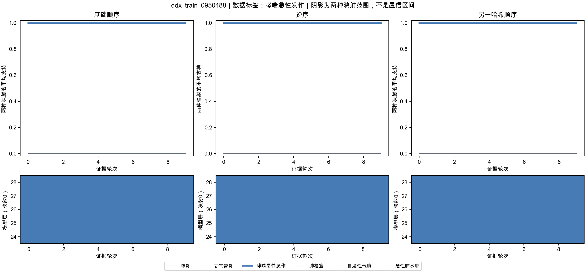

# ddx_train_0950488

队列：replication；数据标签：哮喘急性发作；新增证据组数：9。

| 基础轮次 | 新证据 | 原始明确记录 |
|---|---|---|
| 0 | 呼气时有喘鸣：是（E_214） | Have you noticed a wheezing sound when you exhale? Yes |
| 1 | 近四周出国旅行：否（E_204） | Have you traveled out of the country in the last 4 weeks? No |
| 2 | 家人有哮喘：是（E_85） | Do you have any family members who have asthma? Yes |
| 3 | 近两周有感冒：是（E_116） | Have you had a cold in the last 2 weeks? Yes |
| 4 | 有哮喘或曾用支气管扩张药：是（E_124） | Do you have asthma or have you ever had to use a bronchodilator in the past? Yes |
| 5 | 明显气短或呼吸困难：是（E_66） | Are you experiencing shortness of breath or difficulty breathing in a significant way? Yes |
| 6 | 更容易发生常见过敏：是（E_226） | Are you more likely to develop common allergies than the general population? Yes |
| 7 | 过去一年哮喘发作至少两次：是（E_46） | Have you had 2 or more asthma attacks in the past year? Yes |
| 8 | 咳嗽：是（E_201） | Do you have a cough? Yes |
| 9 | 每天接触二手烟：是（E_222） | Are you exposed to secondhand cigarette smoke on a daily basis? Yes |
