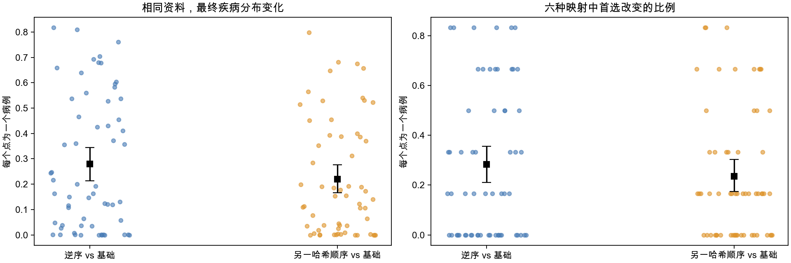
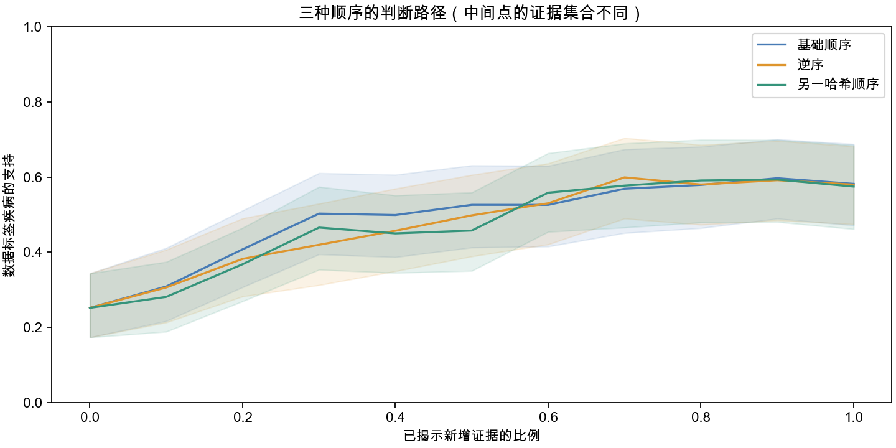

# 阶段03：相同证据集合的顺序效应

## 方法

每个病例使用基础哈希、逆序和另一哈希三种揭示顺序。初始组与最终证据集合保持相同。每轮独立输入累计记录，模型不接收前轮答案。终点逐病例、逐映射配对；六映射平均分布作为辅助汇总。中间轮信息集合不同，因此仅展示路径，不把中间差异当作纯顺序效应。

## 结果

| 指标 | 逆序 vs 基础 | 另一哈希 vs 基础 |
|---|---|---|
| 病例平均同映射首选改变比例 | 28.33% [21.11, 35.56] | 23.61% [17.50, 30.28] |
| 至少一种映射首选改变的病例 | 60.00% [48.33, 71.67] | 63.33% [50.00, 75.00] |
| 六映射平均首选改变的病例 | 25.00% [15.00, 35.00] | 20.00% [10.00, 30.00] |
| 终点分布总变差 | 0.2797 [0.2139, 0.3449] | 0.2195 [0.1663, 0.2756] |
| 终点JS散度 | 0.1482 [0.1102, 0.1877] | 0.1091 [0.0791, 0.1425] |
| 替代顺序六映射平均标签一致率 | 63.33% [51.67, 75.00] | 66.67% [53.33, 78.33] |

## 结论

最终资料内容相同，但其排列可以改变模型终端分布和首选疾病。当前实验支持提示内的排列敏感性；由于每轮重新计算且不保留前轮回答，不把该结果解释为持久记忆或自我承诺。按问题ID规范排序后，三种顺序的终点输入完全一致。

疾病名称评分下，三种顺序至少一次改变首选的病例比例为23.33% [13.33, 33.37]；代码六映射平均首选对应比例为28.33% [16.67, 40.00]。

[终点配对数据](matched_endpoint_effects.csv) · [完整轨迹指标](trajectory_metrics.csv) · [证据进度分数](evidence_progress.csv)
