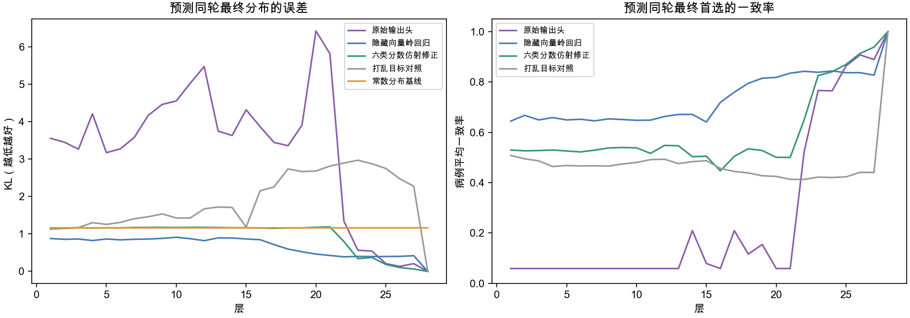
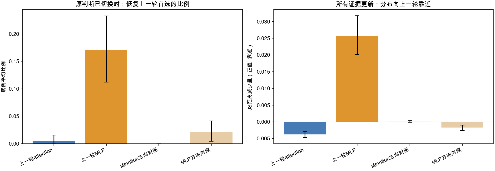
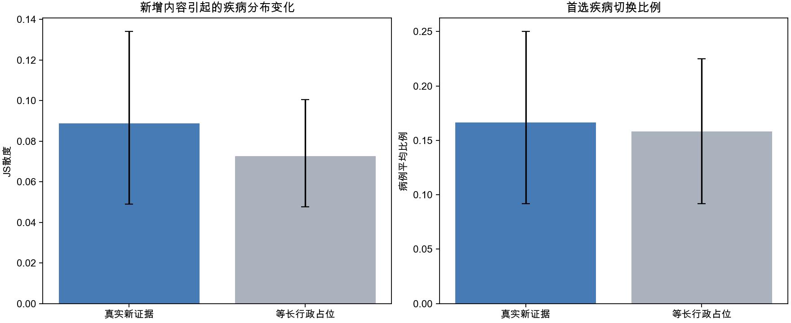
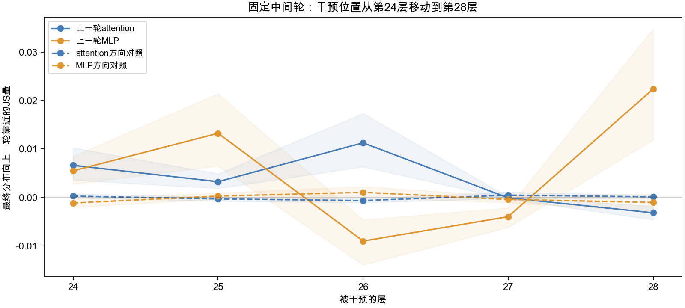

# 阶段04：独立读出与最后层计算的局部干预

## 方法

使用独立fit病例120例训练、60例选择正则，每例初始、中间和终点三个前缀。每层用L2归一化隐藏状态拟合六类岭回归，目标为同轮模型的最终疾病分布。真值标签不参与训练。测试在新增60例上进行；加入病例块打乱目标及常数分布对照。该读出是六类任务读出，不是全词表Tuned Lens。

对基础顺序、两种映射下的全部相邻轮，在最后层诊断锚点分别替换attention或MLP增量为上一轮状态。attention替换后重新计算最后层MLP。方向对照将相同增量差沿隐藏维度循环移位；sham用当前状态。恢复率只在原本发生首选切换的点上定义，再按病例平均。

## 读出结果

第27层原始读出预测最终分布的KL为0.2062；独立任务读出为0.4183；打乱目标对照为2.2721。对应首选一致率分别为88.93%、82.68%、44.05%。

原始读出的病例平均层间分歧率为1.05% [0.43, 1.78]，独立任务读出为11.82% [9.32, 14.43]。读出训练目标本身是最终分布，分歧减少不能单独作为内部已经一致的证据。

开发集上隐藏向量岭回归未改善后几层，因此增加六类logits的仿射修正，仍只用原有训练与开发病例选参数。独立测试第27层KL为0.0615，首选一致率为93.82%；修正后的病例平均层间分歧率为0.56% [0.19, 1.01]。这是开发集驱动的方法迭代，未改动测试病例。

## 干预结果

| 替换方式 | 切换点恢复上一轮首选 | 全部更新向上一轮靠近的JS量 | 干预后候选质量 |
|---|---|---|---|
| 上一轮attention | 0.52% [0.00, 1.56] | -0.0037 [-0.0047, -0.0028] | 100.00% [100.00, 100.00] |
| 上一轮MLP | 17.13% [11.23, 23.27] | 0.0257 [0.0201, 0.0317] | 100.00% [100.00, 100.00] |
| attention方向对照 | 0.00%（样本内全零） | 0.0001 [-0.0002, 0.0003] | 100.00% [100.00, 100.00] |
| MLP方向对照 | 2.08% [0.42, 4.17] | -0.0017 [-0.0026, -0.0010] | 100.00% [100.00, 100.00] |

新增病例共有1158对相邻轮，其中234对发生首选切换。

相对等范数方向对照，attention替换的恢复率差为0.52% [0.00, 1.56]；MLP替换的恢复率差为15.05% [9.53, 20.86]。区间按病例配对重采样。

## 新证据内容与长度对照

每例固定中间轮、两种映射，新增病例共120个对照点。真实证据相对上一轮引起的JS变化为0.0889 [0.0489, 0.1340]；等词元长度占位为0.0726 [0.0476, 0.1005]；病例配对差为0.0162 [-0.0223, 0.0594]。真实与占位的首选切换率分别为16.67% [9.17, 25.00]和15.83% [9.17, 22.50]。

占位保留输入长度、诊断位置及其他所有词元，仅替换新证据正文。占位语言不是自然医学问答，该对照隔离长度与位置，不能完全隔离语言自然度。

## 干预深度对照

在相同中间轮对第24—28层分别干预，再重新计算后续层的诊断锚点。600个独立病例“前缀×深度”检查中，2个未通过预设sham一致性检查，已保留并排除于深度主统计。

| 干预层 | attention相对方向对照的JS增益 | MLP相对方向对照的JS增益 |
|---|---|---|
| 24 | 0.0064 [0.0034, 0.0100] | 0.0066 [0.0036, 0.0100] |
| 25 | 0.0036 [0.0020, 0.0054] | 0.0130 [0.0061, 0.0215] |
| 26 | 0.0119 [0.0068, 0.0180] | -0.0101 [-0.0155, -0.0052] |
| 27 | -0.0006 [-0.0013, 0.0002] | -0.0036 [-0.0055, -0.0019] |
| 28 | -0.0033 [-0.0048, -0.0019] | 0.0234 [0.0129, 0.0360] |

旧MLP增量的作用随层位置反转：在第26层和第27层，最终分布平均更远离上一轮（JS靠近量分别为-0.0090 [-0.0139, -0.0046]、-0.0040 [-0.0062, -0.0021]）；在第28层则更接近上一轮（0.0224 [0.0119, 0.0348]）。三个区间均不跨0。该符号模式属于探索性归纳，区间未经多重比较校正。

[内容对照数据](content_control_events.csv) · [逐深度干预数据](depth_intervention_events.csv) · [数值检查排除表](depth_summary.json)

## 结论

最后层MLP的上一轮增量可以定向恢复部分旧诊断：病例平均恢复率为17.13% [11.23, 23.27]，方向对照为2.08% [0.42, 4.17]。注意力替换未显示同等恢复作用。因此，最后层MLP的计算内容参与了本任务的诊断更新，而不是任意同等扰动都能得到同样结果。

内部“分歧”的频率也取决于读法：原始输出头为1.05% [0.43, 1.78]，隐藏向量岭回归为11.82% [9.32, 14.43]，预测最终分布更准确的六维仿射修正为0.56% [0.19, 1.01]。应把读出差异与实际干预效果分别解释。

[逐层读出质量](readout_quality.csv) · [所有干预事件](intervention_events.csv) · [病例级干预统计](intervention_case_metrics.csv) · [读出分歧](readout_case_divergence.csv)
