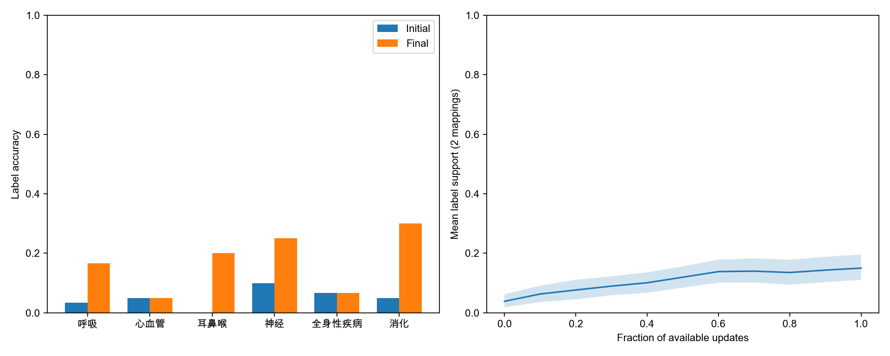
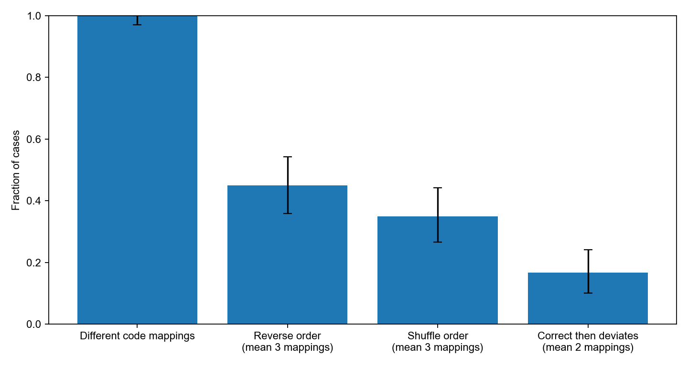

# 阶段06：完整疾病空间中的诊断更新

## 方法

Qwen3-1.7B FP16，冻结参数，本机GPU。DDxPlus validate 中固定哈希抽取120个新病例，24病种各5例；六个疾病组、全部49疾病候选。病例与此前252例去重。无旧回答历史：每轮重新输入累计证据。基础和逆序各追踪全轮，独立乱序测终点；两编码贯穿全轨迹，三个编码测初始、中间与终点。完成5040次观测，基础顺序960次新增证据。区间为2000次病例bootstrap，全0/全1二元指标使用精确二项区间；同一病例内先汇总，未将多个轮次当独立病例。

## 结果

**扩大候选后，字母接口成为主要测量问题。** 120例中，相同终点资料仅改变疾病—字母对应关系，首选发生变化的比例为100.00% [96.97, 100.00]。首个输出token全部落在编码候选中，仍不足以说明对应疾病判断稳定。因此阶段09使用完整疾病名重新测量；本阶段编码结果保留作对照，不单独承担医学机制的核心论证。

| 指标 | 病例均值 [95%区间] |
|---|---|
| 初始标签命中（三编码均值） | 5.00% [1.67, 9.17] |
| 终点标签命中（三编码均值） | 17.50% [10.83, 24.17] |
| 终点标签命中（固定单编码） | 16.67% [10.83, 24.17] |
| 标签曾命中后偏离（两编码均值轨迹） | 16.67% [10.00, 24.17] |
| 相同终点资料仅换编码，首选不同 | 100.00% [96.97, 100.00] |
| 相同终点事实逆序，首选不同（三编码均值） | 45.00% [35.83, 54.17] |
| 相同终点事实乱序，首选不同（三编码均值） | 35.00% [26.67, 44.17] |
| 与源参考分布的JS距离 | 0.5295 [0.5073, 0.5498] |
| 首选与源参考分布首位一致 | 15.83% [10.00, 22.50] |

| 疾病组 | 病例数 | 初始命中 | 终点命中 | 逆序首选改变 |
|---|---|---|---|---|
| 呼吸 | 30 | 3.3% | 16.7% | 63.3% |
| 心血管 | 20 | 5.0% | 5.0% | 50.0% |
| 耳鼻喉 | 15 | 0.0% | 20.0% | 66.7% |
| 神经 | 20 | 10.0% | 25.0% | 20.0% |
| 全身性疾病 | 15 | 6.7% | 6.7% | 40.0% |
| 消化 | 20 | 5.0% | 30.0% | 25.0% |

## 真值与解释

所有49疾病均进入候选，完整覆盖每例参考鉴别分布。源疾病标签与参考分布首位一致的比例为75.83% [68.33, 83.33]：标签评价和参考分布评价是两个问题。最终标签可用于计算命中、排名、Brier和NLL；中间每轮没有医学标准后验，“命中后偏离”仅指离开源标签，不能把所有中途改诊都叫错误。候选分数是固定接口下的模型支持，不是患者患病率。

**本阶段给出了跨疾病、跨顺序的完整诊断轨迹。是否形成稳定的医学更新机制，需要结合阶段07的内部读出和阶段08的干预。** 单个病种仅5例，病种差异只作描述；总体结果不以病例数量替代机制证明。

## 数据

- [全部120例逐轮图谱](CASE_ATLAS.md)
- [逐病例指标](case_metrics.csv)、[全部证据转移](evidence_transitions.csv)、[疾病组汇总](family_metrics.csv)
- [精确结果和数值检查](summary.json)

API成本：0美元。
