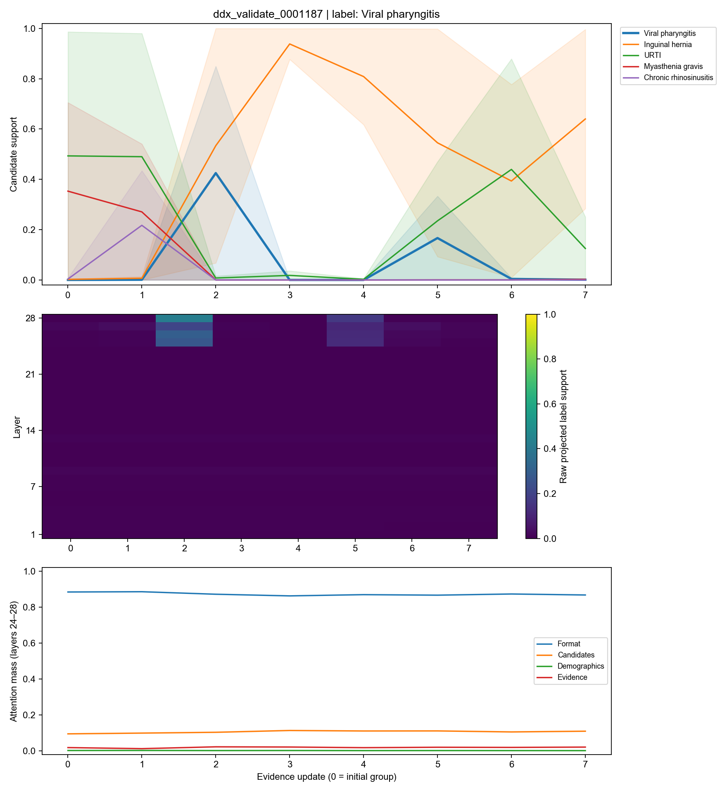

# ddx_validate_0001187

源标签：**Viral pharyngitis**；参考首位：**Viral pharyngitis**。

实线为两个编码的平均分，阴影为两编码范围；逐层热图为原始投影，注意力曲线为晚5层均值。终点评价使用三个编码，可能与此处两编码轨迹不同。

| 轮 | 新证据（原始英文） | 当前首选 | 标签支持 |
|---|---|---|---|
| 0 | Do you have nasal congestion or a clear runny nose? **Yes** | URTI | 0.0002 |
| 1 | Do you attend or work in a daycare? **Yes** | URTI | 0.0008 |
| 2 | Do you have pain somewhere, related to your reason for consulting? **Yes** Characterize your pain: **sensitive** Do you feel pain somewhere? **tonsil(R); tonsil(L); palace; under the jaw** How intense is the pain? **Recorded scale value 8 on the dataset's 0-10 scale; endpoint meanings are unspecified** Does the pain radiate to another location? **nowhere** How precisely is the pain located? **Recorded scale value 5 on the dataset's 0-10 scale; endpoint meanings are unspecified** How fast did the pain appear? **Recorded scale value 2 on the dataset's 0-10 scale; endpoint meanings are unspecified** | Inguinal hernia | 0.4249 |
| 3 | Have you been in contact with a person with similar symptoms in the past 2 weeks? **Yes** | Inguinal hernia | 0.0001 |
| 4 | Are you immunosuppressed? **Yes** | Inguinal hernia | 0.0000 |
| 5 | Do you have a cough? **Yes** | Inguinal hernia | 0.1667 |
| 6 | Have you traveled out of the country in the last 4 weeks? **No** | URTI | 0.0040 |
| 7 | Have you been coughing up blood? **Yes** | Inguinal hernia | 0.0009 |
