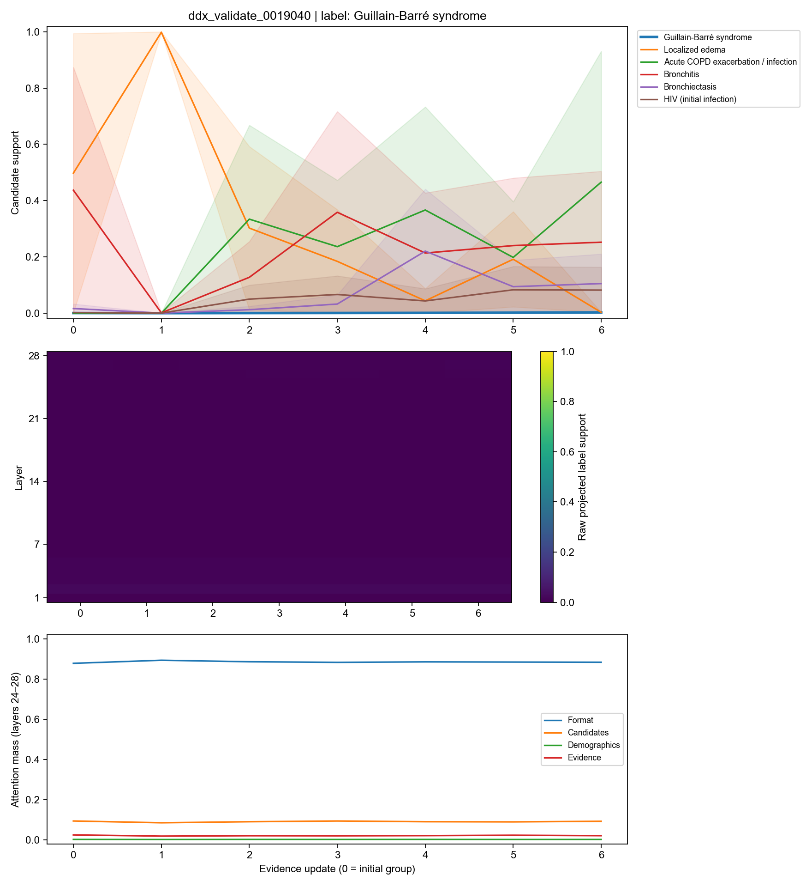

# ddx_validate_0019040

源标签：**Guillain-Barré syndrome**；参考首位：**Guillain-Barré syndrome**。

实线为两个编码的平均分，阴影为两编码范围；逐层热图为原始投影，注意力曲线为晚5层均值。终点评价使用三个编码，可能与此处两编码轨迹不同。

| 轮 | 新证据（原始英文） | 当前首选 | 标签支持 |
|---|---|---|---|
| 0 | Do you have numbness, loss of sensation or tingling in the feet? **Yes** | Localized edema | 0.0004 |
| 1 | Are you experiencing shortness of breath or difficulty breathing in a significant way? **Yes** | Localized edema | 0.0000 |
| 2 | Have you recently had a viral infection? **Yes** | Acute COPD exacerbation / infection | 0.0003 |
| 3 | Have you traveled out of the country in the last 4 weeks? **No** | Bronchitis | 0.0006 |
| 4 | Do you currently, or did you ever, have numbness, loss of sensitivity or tingling anywhere on your body? **Yes** | Acute COPD exacerbation / infection | 0.0010 |
| 5 | Have you recently had numbness, loss of sensation or tingling, in both arms and legs and around your mouth? **Yes** | Bronchitis | 0.0016 |
| 6 | Do you feel weakness in both arms and/or both legs? **Yes** | Acute COPD exacerbation / infection | 0.0028 |
