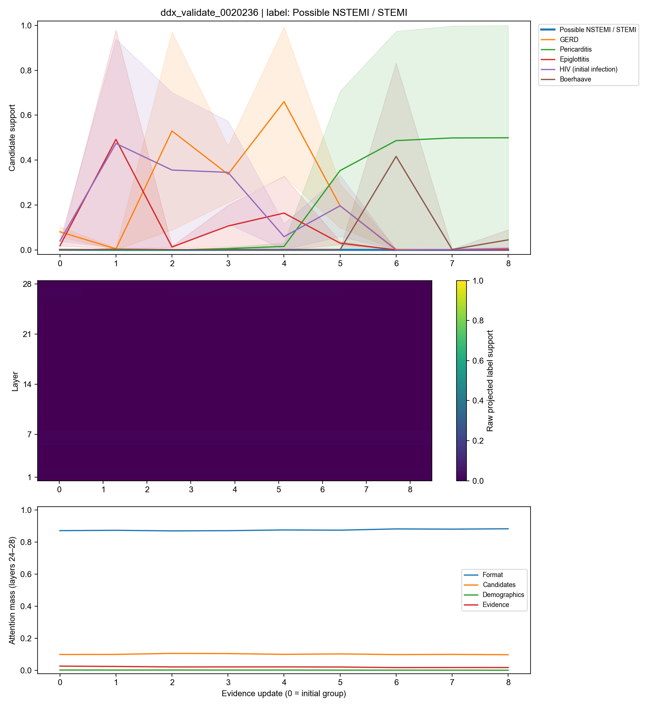

# ddx_validate_0020236

源标签：**Possible NSTEMI / STEMI**；参考首位：**Possible NSTEMI / STEMI**。

实线为两个编码的平均分，阴影为两编码范围；逐层热图为原始投影，注意力曲线为晚5层均值。终点评价使用三个编码，可能与此处两编码轨迹不同。

| 轮 | 新证据（原始英文） | 当前首选 | 标签支持 |
|---|---|---|---|
| 0 | Do you have pain somewhere, related to your reason for consulting? **Yes** Characterize your pain: **tedious; heavy; sharp; sickening** Do you feel pain somewhere? **lower chest; side of the chest(R); upper chest; breast(R); epigastric** How intense is the pain? **Recorded scale value 5 on the dataset's 0-10 scale; endpoint meanings are unspecified** Does the pain radiate to another location? **biceps(R); biceps(L); thoracic spine; under the jaw; shoulder(L)** How precisely is the pain located? **Recorded scale value 3 on the dataset's 0-10 scale; endpoint meanings are unspecified** How fast did the pain appear? **Recorded scale value 5 on the dataset's 0-10 scale; endpoint meanings are unspecified** | Larygospasm | 0.0007 |
| 1 | Are you feeling nauseous or do you feel like vomiting? **Yes** | Epiglottitis | 0.0000 |
| 2 | Do you have high cholesterol or do you take medications to treat high cholesterol? **Yes** | GERD | 0.0000 |
| 3 | Have you had significantly increased sweating? **Yes** | HIV (initial infection) | 0.0003 |
| 4 | Have you traveled out of the country in the last 4 weeks? **No** | GERD | 0.0002 |
| 5 | Do you have a problem with poor circulation? **Yes** | Pericarditis | 0.0004 |
| 6 | Have you ever had a heart attack or do you have angina (chest pain)? **Yes** | Pericarditis | 0.0000 |
| 7 | Are you a former smoker? **Yes** | Pericarditis | 0.0000 |
| 8 | Do you smoke cigarettes? **Yes** | Pericarditis | 0.0000 |
