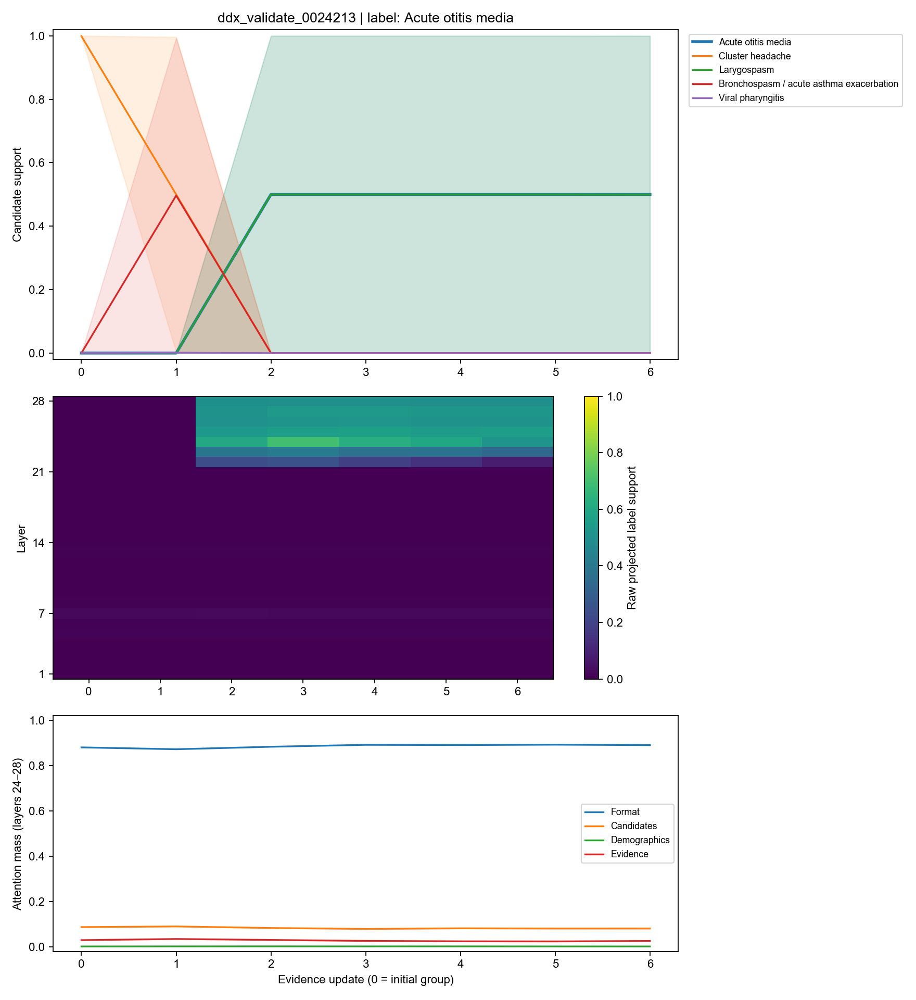

# ddx_validate_0024213

源标签：**Acute otitis media**；参考首位：**URTI**。

实线为两个编码的平均分，阴影为两编码范围；逐层热图为原始投影，注意力曲线为晚5层均值。终点评价使用三个编码，可能与此处两编码轨迹不同。

| 轮 | 新证据（原始英文） | 当前首选 | 标签支持 |
|---|---|---|---|
| 0 | Do you have pain somewhere, related to your reason for consulting? **Yes** Characterize your pain: **sensitive; sharp** Do you feel pain somewhere? **ear(R)** How intense is the pain? **Recorded scale value 8 on the dataset's 0-10 scale; endpoint meanings are unspecified** Does the pain radiate to another location? **nowhere** How precisely is the pain located? **Recorded scale value 9 on the dataset's 0-10 scale; endpoint meanings are unspecified** How fast did the pain appear? **Recorded scale value 3 on the dataset's 0-10 scale; endpoint meanings are unspecified** | Cluster headache | 0.0000 |
| 1 | Do you have a cough? **Yes** | Cluster headache | 0.0000 |
| 2 | Are you currently being treated or have you recently been treated with an oral antibiotic for an ear infection? **Yes** | Acute otitis media | 0.5000 |
| 3 | Do you have nasal congestion or a clear runny nose? **Yes** | Acute otitis media | 0.5000 |
| 4 | Are you more irritable or has your mood been very unstable recently? **Yes** | Acute otitis media | 0.5000 |
| 5 | Have you traveled out of the country in the last 4 weeks? **No** | Acute otitis media | 0.5000 |
| 6 | Do you have a fever (either felt or measured with a thermometer)? **Yes** | Acute otitis media | 0.5000 |
