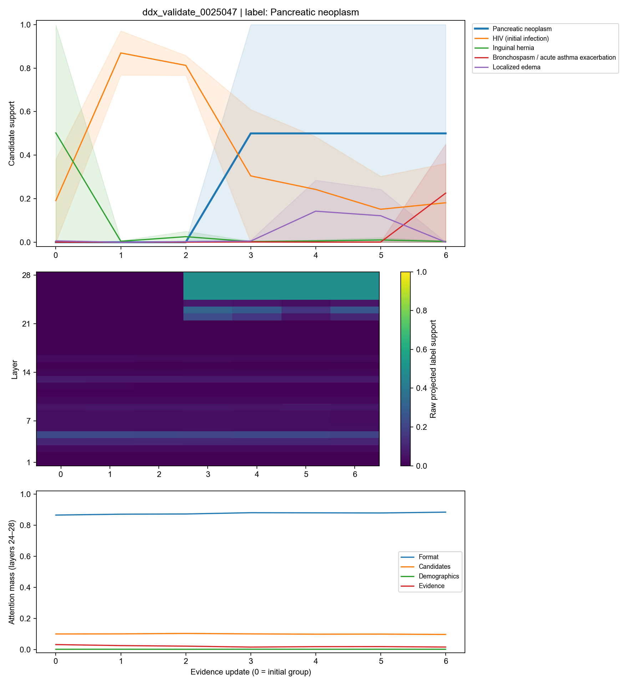

# ddx_validate_0025047

源标签：**Pancreatic neoplasm**；参考首位：**Bronchitis**。

实线为两个编码的平均分，阴影为两编码范围；逐层热图为原始投影，注意力曲线为晚5层均值。终点评价使用三个编码，可能与此处两编码轨迹不同。

| 轮 | 新证据（原始英文） | 当前首选 | 标签支持 |
|---|---|---|---|
| 0 | Do you have any lesions, redness or problems on your skin that you believe are related to the condition you are consulting for? **Yes** What color is the rash? **yellow** Do your lesions peel off? **No** Is the rash swollen? **Recorded scale value 0 on the dataset's 0-10 scale; endpoint meanings are unspecified** Where is the affected region located? **epigastric** How intense is the pain caused by the rash? **Recorded scale value 3 on the dataset's 0-10 scale; endpoint meanings are unspecified** Is the lesion (or are the lesions) larger than 1cm? **Yes** How severe is the itching? **Recorded scale value 3 on the dataset's 0-10 scale; endpoint meanings are unspecified** | Inguinal hernia | 0.0002 |
| 1 | Do you have a cough? **Yes** | HIV (initial infection) | 0.0000 |
| 2 | Have you had an involuntary weight loss over the last 3 months? **Yes** | HIV (initial infection) | 0.0001 |
| 3 | Are there members of your family who have been diagnosed with pancreatic cancer? **Yes** | Pancreatic neoplasm | 0.5000 |
| 4 | Do you smoke cigarettes? **Yes** | Pancreatic neoplasm | 0.5000 |
| 5 | Have you traveled out of the country in the last 4 weeks? **No** | Pancreatic neoplasm | 0.5000 |
| 6 | Do you have pain somewhere, related to your reason for consulting? **Yes** Characterize your pain: **a cramp** Do you feel pain somewhere? **hypochondrium(L); epigastric** How intense is the pain? **Recorded scale value 6 on the dataset's 0-10 scale; endpoint meanings are unspecified** Does the pain radiate to another location? **thoracic spine** How precisely is the pain located? **Recorded scale value 1 on the dataset's 0-10 scale; endpoint meanings are unspecified** How fast did the pain appear? **Recorded scale value 1 on the dataset's 0-10 scale; endpoint meanings are unspecified** | Pancreatic neoplasm | 0.5000 |
