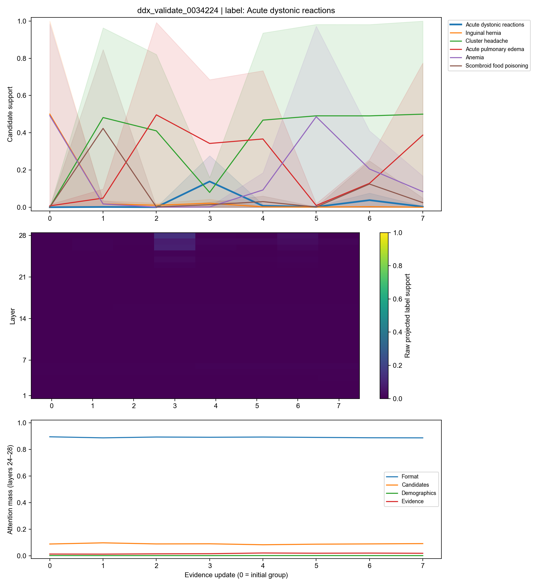

# ddx_validate_0034224

源标签：**Acute dystonic reactions**；参考首位：**Acute dystonic reactions**。

实线为两个编码的平均分，阴影为两编码范围；逐层热图为原始投影，注意力曲线为晚5层均值。终点评价使用三个编码，可能与此处两编码轨迹不同。

| 轮 | 新证据（原始英文） | 当前首选 | 标签支持 |
|---|---|---|---|
| 0 | Do you have trouble keeping your tongue in your mouth? **Yes** | Inguinal hernia | 0.0000 |
| 1 | Do you have annoying muscle spasms in your face, neck or any other part of your body? **Yes** | Cluster headache | 0.0015 |
| 2 | Are you experiencing shortness of breath or difficulty breathing in a significant way? **Yes** | Acute pulmonary edema | 0.0002 |
| 3 | Have you started or taken any antipsychotic medication within the last 7 days? **Yes** | HIV (initial infection) | 0.1384 |
| 4 | Do you suddenly have difficulty or an inability to open your mouth or have jaw pain when opening it? **Yes** | Cluster headache | 0.0074 |
| 5 | Do you feel that muscle spasms or soreness in your neck are keeping you from turning your head to one side? **Yes** | Cluster headache | 0.0021 |
| 6 | Have you traveled out of the country in the last 4 weeks? **No** | Cluster headache | 0.0380 |
| 7 | Have you ever felt like you were suffocating for a very short time associated with inability to breathe or speak? **Yes** | Cluster headache | 0.0029 |
