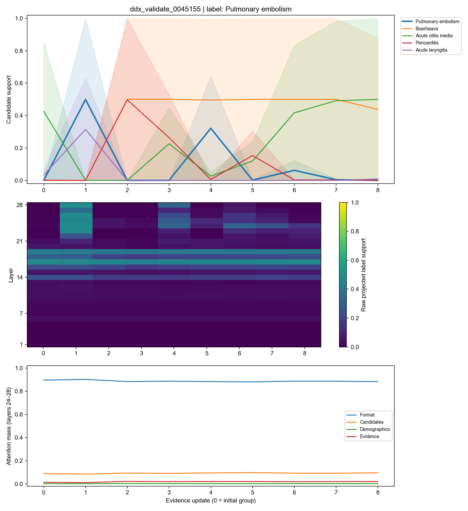

# ddx_validate_0045155

源标签：**Pulmonary embolism**；参考首位：**Pulmonary embolism**。

实线为两个编码的平均分，阴影为两编码范围；逐层热图为原始投影，注意力曲线为晚5层均值。终点评价使用三个编码，可能与此处两编码轨迹不同。

| 轮 | 新证据（原始英文） | 当前首选 | 标签支持 |
|---|---|---|---|
| 0 | Do you have pain that is increased when you breathe in deeply? **Yes** | Acute otitis media | 0.0007 |
| 1 | Have you ever had deep vein thrombosis (DVT)? **Yes** | Pulmonary embolism | 0.4992 |
| 2 | Do you have pain somewhere, related to your reason for consulting? **Yes** Characterize your pain: **a knife stroke** Do you feel pain somewhere? **side of the chest(R); side of the chest(L); scapula(R); scapula(L); posterior chest wall(R)** How intense is the pain? **Recorded scale value 5 on the dataset's 0-10 scale; endpoint meanings are unspecified** Does the pain radiate to another location? **side of the chest(L); scapula(R); posterior chest wall(L)** How precisely is the pain located? **Recorded scale value 5 on the dataset's 0-10 scale; endpoint meanings are unspecified** How fast did the pain appear? **Recorded scale value 0 on the dataset's 0-10 scale; endpoint meanings are unspecified** | Boerhaave | 0.0000 |
| 3 | Do you have swelling in one or more areas of your body? **Yes** Where is the swelling located? **posterior aspect of the ankle(R); calf(R); calf(L)** | Boerhaave | 0.0001 |
| 4 | Have you been coughing up blood? **Yes** | Boerhaave | 0.3217 |
| 5 | Are you experiencing shortness of breath or difficulty breathing in a significant way? **Yes** | Boerhaave | 0.0018 |
| 6 | Do you have an active cancer? **Yes** | Boerhaave | 0.0620 |
| 7 | Have you had surgery within the last month? **Yes** | Boerhaave | 0.0044 |
| 8 | Have you traveled out of the country in the last 4 weeks? **North America** | Acute otitis media | 0.0002 |
