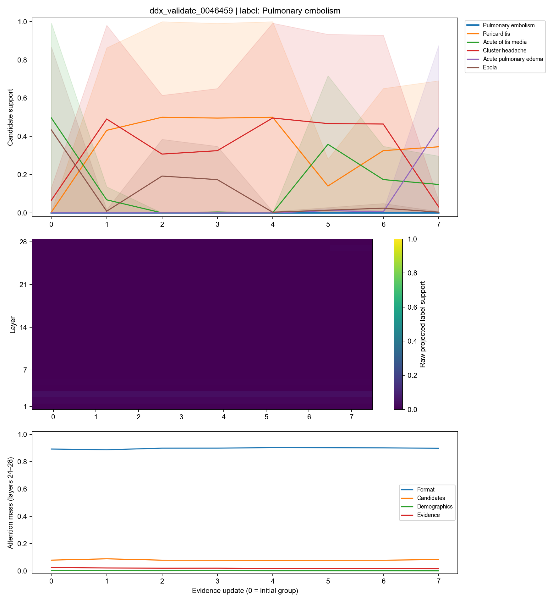

# ddx_validate_0046459

源标签：**Pulmonary embolism**；参考首位：**Pulmonary embolism**。

实线为两个编码的平均分，阴影为两编码范围；逐层热图为原始投影，注意力曲线为晚5层均值。终点评价使用三个编码，可能与此处两编码轨迹不同。

| 轮 | 新证据（原始英文） | 当前首选 | 标签支持 |
|---|---|---|---|
| 0 | Do you have pain somewhere, related to your reason for consulting? **Yes** Characterize your pain: **sensitive; sharp** Do you feel pain somewhere? **side of the chest(R); side of the chest(L); upper chest; scapula(R); epigastric** How intense is the pain? **Recorded scale value 1 on the dataset's 0-10 scale; endpoint meanings are unspecified** Does the pain radiate to another location? **side of the chest(R); side of the chest(L); scapula(R); scapula(L); posterior chest wall(R)** How precisely is the pain located? **Recorded scale value 8 on the dataset's 0-10 scale; endpoint meanings are unspecified** How fast did the pain appear? **Recorded scale value 2 on the dataset's 0-10 scale; endpoint meanings are unspecified** | Acute otitis media | 0.0000 |
| 1 | Have you been unable to move or get up for more than 3 consecutive days within the last 4 weeks? **Yes** | Cluster headache | 0.0000 |
| 2 | Have you traveled out of the country in the last 4 weeks? **North America** | Pericarditis | 0.0000 |
| 3 | Are you experiencing shortness of breath or difficulty breathing in a significant way? **Yes** | Pericarditis | 0.0000 |
| 4 | Did you lose consciousness? **Yes** | Pericarditis | 0.0000 |
| 5 | Do you currently take hormones? **Yes** | Cluster headache | 0.0000 |
| 6 | Have you had surgery within the last month? **Yes** | Cluster headache | 0.0000 |
| 7 | Do you have swelling in one or more areas of your body? **Yes** Where is the swelling located? **posterior aspect of the ankle(R); posterior aspect of the ankle(L)** | Acute pulmonary edema | 0.0002 |
